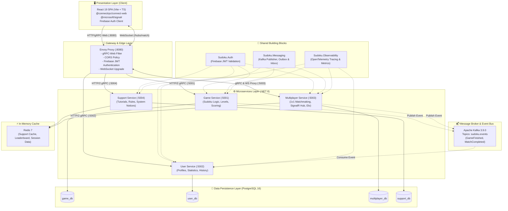
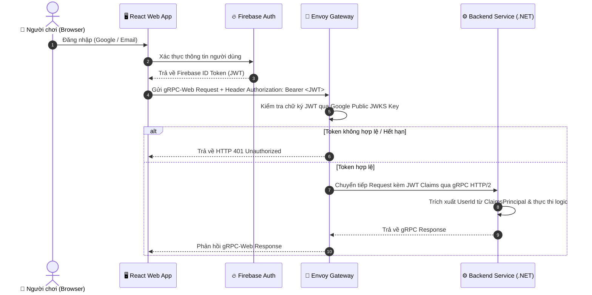
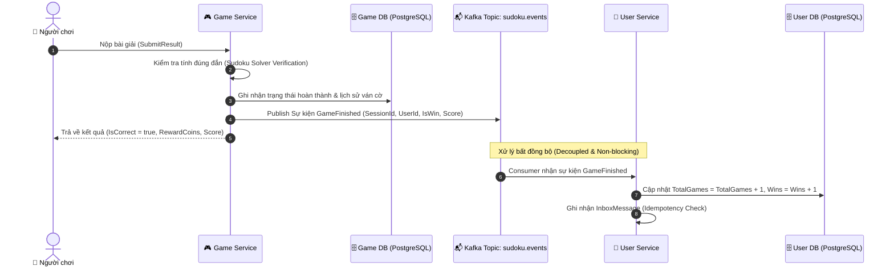

# 🏛️ TÀI LIỆU KIẾN TRÚC VÀ CÔNG NGHỆ HỆ THỐNG (SYSTEM ARCHITECTURE & TECH STACK)
## Dự án: PRN_ASM — Sudoku Online & Realtime Multiplayer Platform

---

## 1. 📌 Tổng quan Hệ thống (System Overview)

**PRN_ASM (Sudoku Online Platform)** là hệ thống giải đố Sudoku trực tuyến kết hợp thi đấu đối kháng thời gian thực (Real-time Multiplayer 1v1). Hệ thống được thiết kế theo kiến trúc **Event-Driven Microservices** hiện đại, áp dụng phương pháp tiếp cận **Contract-First** (gRPC & Protocol Buffers) nhằm đảm bảo hiệu năng cao, độ trễ thấp và khả năng mở rộng linh hoạt.

### Các đặc điểm kiến trúc nổi bật:
* **Contract-First & gRPC-First**: Định nghĩa toàn bộ schema API và sự kiện (events) thông qua `.proto` làm chuẩn duy nhất (Single Source of Truth).
* **Database-per-Service**: Mỗi microservice sở hữu cơ sở dữ liệu độc lập, phân tách ranh giới nghiệp vụ (bounded context) hoàn toàn, giảm thiểu khớp nối (loose coupling).
* **Event-Driven Communication**: Giao tiếp bất đồng bộ giữa các microservices thông qua Apache Kafka, áp dụng Transactional Outbox & Inbox Pattern đảm bảo tính toàn vẹn và độ tin cậy của dữ liệu.
* **Unified API Gateway**: Sử dụng Envoy Proxy đóng vai trò làm Reverse Proxy, chuyển dịch giao thức (gRPC-Web ➔ gRPC HTTP/2), xử lý CORS, xác thực Firebase JWT tập trung và hỗ trợ WebSocket Upgrade cho SignalR.
* **Distributed Observability**: Tích hợp OpenTelemetry chuẩn OTLP cho toàn bộ các microservices để theo dõi distributed tracing và metrics tập trung.

---

## 2. 🗺️ Sơ đồ Kiến trúc Tổng thể (High-Level Architecture)



---

## 3. 🛠️ Danh mục Công nghệ (Technology Stack)

| Phân tầng / Khía cạnh | Công nghệ & Thư viện | Phiên bản | Mục đích & Lý do lựa chọn |
| :--- | :--- | :--- | :--- |
| **Frontend Framework** | **React** | `19.2.x` | Giao diện Single Page Application (SPA), rendering hiệu năng cao với React Server/Client Components. |
| **Frontend Language** | **TypeScript** | `~6.0.x` | Type safety toàn diện, tương thích 100% với kiểu dữ liệu sinh tự động từ Protocol Buffers. |
| **Build & Tooling** | **Vite** & **Oxlint** | Vite 8, Oxlint | Tốc độ dev server cực nhanh (HMR), bundle siêu nhẹ, linter tốc độ cao thay thế ESLint. |
| **Frontend RPC & Realtime** | **@connectrpc/connect-web**, **@microsoft/signalr** | Connect 2.2, SignalR 10 | Gọi trực tiếp gRPC từ trình duyệt không cần REST wrapper; kết nối WebSocket 2 chiều cho trận đấu realtime. |
| **API Gateway** | **Envoy Proxy** | `1.31+` | Xử lý transcode gRPC-Web sang HTTP/2 gRPC, CORS, rate limiting, kiểm tra JWT xác thực trước khi chạm tới services. |
| **Backend Framework** | **.NET 8 (C# 12)** / ASP.NET Core | `net8.0` | Nền tảng backend hiệu năng hàng đầu thế giới, native hỗ trợ gRPC, HTTP/2, SignalR và async IO. |
| **RPC & Serialization** | **gRPC** & **Protocol Buffers** | `v3` / Grpc 2.57 | Chuẩn hóa hợp đồng dữ liệu, serialization dạng nhị phân kích thước siêu nhỏ, tốc độ vượt trội so với JSON/REST. |
| **Schema Tooling** | **Buf CLI** | `1.74.x` | Quản lý linting, formatting và tự động code generation cho cả C# và TypeScript từ file `.proto`. |
| **Message Broker** | **Apache Kafka** | `3.9.0` (KRaft mode) | Xử lý streaming sự kiện phân tán, throughput cao, độ tin cậy và khả năng scale ngang cho Event-Driven Architecture. |
| **Data Persistence** | **PostgreSQL** | `16.x` | Cơ sở dữ liệu quan hệ mạnh mẽ, ACID, hỗ trợ JSONB linh hoạt cho trạng thái bàn cờ Sudoku. |
| **In-Memory Cache** | **Redis** | `7.x` | Caching dữ liệu tần suất cao (Tutorials, Notices, Leaderboards, Room sessions). |
| **Authentication & IAM** | **Firebase Auth** | `13.x` / JwtBearer | Định danh người dùng bảo mật cao, xác thực JWT token qua Google Remote JWKS. |
| **Distributed Tracing** | **OpenTelemetry (OTel)** | `1.20.0` | Tiêu chuẩn mở thu thập Trace, Metrics, Logs qua OTLP Exporter, dễ dàng nối tới Grafana Tempo/Jaeger. |
| **Container & Orchestration** | **Docker & Docker Compose** | Compose v2 | Chuẩn hóa môi trường local dev và đóng gói container đồng nhất cho deployment. |

---

## 4. 🧩 Chi tiết Kiến trúc từng Thành phần

### 4.1. Edge & Gateway Layer: Envoy Proxy
* **Cổng lắng nghe**: `8080` (HTTP/1.1 và HTTP/2).
* **Nhiệm vụ chính**:
  1. **gRPC-Web Filter**: Chuyển đổi các HTTP request định dạng gRPC-Web từ trình duyệt thành cuộc gọi HTTP/2 gRPC thuần gửi tới các backend services.
  2. **JWT Authentication Provider**: Xác thực trực tiếp Firebase ID Token thông qua Remote JWKS endpoint của Google (`https://www.googleapis.com/service_accounts/v1/jwk/securetoken@system.gserviceaccount.com`).
  3. **CORS Enforcement**: Quản lý whitelist domain trình duyệt (`http://localhost:5173`), method (`GET, POST, OPTIONS`), và các headers đặc thù của gRPC (`x-grpc-web`, `grpc-status`, `grpc-message`).
  4. **WebSocket Upgrade**: Điều hướng route `/hubs/match` tới cluster `Multiplayer Service` mà không ngắt quãng stream.

---

### 4.2. Microservices Backend (.NET 8)

Hệ thống bao gồm 4 Microservices độc lập nằm trong thư mục `services/`:

#### 1. Game Service (`Game.Api`) — Port nội bộ: `5001`
* **Trách nhiệm**:
  * Sinh đề bài Sudoku ngẫu nhiên theo các cấp độ (Easy, Medium, Hard, Expert).
  * Khởi tạo phiên chơi (`StartGameRequest` ➔ `StartGameResponse`).
  * Kiểm tra tính hợp lệ của lời giải do người chơi nộp (`SubmitResultRequest`).
  * Tính điểm thưởng, thời gian chơi, xếp hạng điểm cao (`GetHighScores`).
  * **Sự kiện xuất bản (Publisher)**: Gửi sự kiện `GameFinished` vào topic Kafka `sudoku.events` khi người chơi giải thành công.

#### 2. User Service (`User.Api`) — Port nội bộ: `5002`
* **Trách nhiệm**:
  * Quản lý thông tin hồ sơ người chơi (`UserProfile`): tên hiển thị, email, avatar URL.
  * Tự động khởi tạo profile người dùng mới khi đăng nhập lần đầu (`GetOrCreateProfile`).
  * Cập nhật thông tin tài khoản cá nhân (`UpdateProfile`).
  * **Bộ lắng nghe sự kiện (Consumer)**: Lắng nghe sự kiện `GameFinished` và `MatchCompleted` từ Kafka để cập nhật tích lũy chỉ số: `total_games`, `wins`.

#### 3. Multiplayer Service (`Multiplayer.Api`) — Port nội bộ: `5003`
* **Trách nhiệm**:
  * Quản lý phòng chơi đối kháng 1v1 theo thời gian thực qua **SignalR Hub** (`/hubs/match`).
  * Cơ chế ghép trận tự động (Matchmaking queue) dựa trên điểm Elo / Rating.
  * Đồng bộ tiến độ giải cờ từng ô giữa 2 người chơi cùng phòng.
  * Lưu trữ và tra cứu lịch sử trận đấu (`GetMatchHistory`) và bảng xếp hạng Elo (`GetRankings`).
  * **Sự kiện xuất bản (Publisher)**: Bắn sự kiện `MatchCompleted` (người thắng, người thua, cộng/trừ Elo) vào Kafka.

#### 4. Support Service (`Support.Api`) — Port nội bộ: `5004`
* **Trách nhiệm**:
  * Cung cấp luật chơi Sudoku chuẩn và các biến thể (`GetRules`).
  * Hướng dẫn các kỹ thuật giải Sudoku từ cơ bản đến nâng cao (`ListTutorials`).
  * Danh sách thông báo cập nhật hệ thống, sự kiện trong game (`ListNotices`).
  * Tích hợp **Redis Caching** để phản hồi tức thì với tốc độ sub-millisecond, giảm tải tối đa cho cơ sở dữ liệu.

---

### 4.3. Building Blocks (`building-block/`)
Các thư viện dùng chung độc lập (Shared Libraries) giải quyết các mối quan tâm liên quan (Cross-Cutting Concerns):

1. **`Sudoku.Auth`**:
   * Cấu hình middleware `AddFirebaseJwt()` dựa trên `Microsoft.AspNetCore.Authentication.JwtBearer`.
   * Tự động giải mã Firebase Token, xác thực Audience/Issuer và inject `ClaimsPrincipal` vào context của gRPC/SignalR.
2. **`Sudoku.Messaging`**:
   * Triển khai Kafka Producer thông qua thư viện `Confluent.Kafka`.
   * Chuẩn hóa cấu trúc phong bì sự kiện (`EventEnvelope`).
   * Cung cấp abstraction cho **Transactional Outbox Pattern** (`OutboxMessage`) và **Idempotent Inbox Pattern** (`InboxMessage`) ngăn chặn mất mát hoặc xử lý lặp sự kiện.
3. **`Sudoku.Observability`**:
   * Cung cấp phương thức mở rộng `AddSudokuObservability(serviceName)` tích hợp OpenTelemetry.
   * Thu thập Traces & Metrics tự động từ ASP.NET Core, gRPC Client, gRPC Server và xuất qua chuẩn OTLP.

---

## 5. 🔄 Mô hình Giao tiếp & Luồng Dữ liệu (Data Flow)

### 5.1. Luồng Xác thực (Authentication Flow)



### 5.2. Luồng Bất đồng bộ Event-Driven (Game Completion Flow)



---

## 6. 🗄️ Kiến trúc Dữ liệu & Lưu trữ (Data Architecture)

Hệ thống tuân thủ nguyên tắc **Database-per-Service Pattern**: Không service nào được phép truy cập trực tiếp vào cơ sở dữ liệu của service khác. Mọi chia sẻ dữ liệu bắt buộc đi qua gRPC API hoặc Kafka Event Bus.

```
PostgreSQL 16 Instance
├── 📁 game_db          # Bàn cờ Sudoku, ván game, lịch sử bước đi, điểm thưởng
├── 📁 user_db          # Hồ sơ người dùng, chỉ số thành tích cá nhân, settings
├── 📁 multiplayer_db   # Lịch sử trận đấu 1v1, điểm xếp hạng Elo, bảng vàng
└── 📁 support_db       # Danh mục câu hỏi, luật chơi, bài hướng dẫn, thông báo

Redis 7 Instance
├── 🔑 cached:support:rules:*      # Cache luật chơi
├── 🔑 cached:support:tutorials    # Cache danh sách bài hướng dẫn
└── 🔑 match:room:session:*        # Trạng thái phòng đấu realtime tạm thời
```

---

## 7. 📁 Cấu trúc Thư mục Dự án (Source Code Organization)

```text
PRN_ASM/
├── proto/                               # [Single Source of Truth] Định nghĩa Protobuf
│   ├── buf.yaml                         # Cấu hình Buf Workspace & Lint
│   ├── buf.gen.yaml                     # Cấu hình code generation cho TypeScript
│   └── sudoku/
│       ├── events/v1/events.proto       # Các sự kiện EventEnvelope, GameFinished, MatchCompleted
│       ├── game/v1/game.proto           # API GameService (StartGame, SubmitResult,...)
│       ├── multi/v1/multi.proto         # API MultiplayerService (GetRankings, MatchHistory,...)
│       ├── support/v1/support.proto     # API SupportService (Rules, Tutorials, Notices)
│       └── user/v1/user.proto           # API UserService (Profile, Stats, Updates)
│
├── gateway/                             # [Edge Layer] Cấu hình Envoy Gateway
│   ├── Dockerfile                       # Image Envoy Proxy 
│   └── envoy.yaml                       # Filter CORS, gRPC-Web, JWT Authn, WebSocket route
│
├── building-block/                      # [Shared Libraries] Thư viện dùng chung
│   ├── Sudoku.Auth/                     # Module xác thực Firebase Bearer JWT
│   ├── Sudoku.Messaging/                # Kafka Publisher, Outbox & Inbox Models
│   └── Sudoku.Observability/            # Tích hợp OpenTelemetry Tracing & Metrics
│
├── services/                            # [Core Domain] Các Microservices độc lập
│   ├── Game/Game.Api/                   # Microservice Xử lý Logic Game & Bàn cờ
│   ├── User/User.Api/                   # Microservice Quản lý Người dùng & Profile
│   ├── Multiplayer/Multiplayer.Api/     # Microservice Đấu mạng 1v1 & SignalR Hub
│   └── Support/Support.Api/             # Microservice Hỗ trợ, Hướng dẫn & Notices
│       └── Mỗi Service gồm:
│           ├── Grpc/                    # Implement các gRPC Server Service Base
│           ├── Hubs/                    # SignalR WebSockets (đối với Multiplayer)
│           ├── Domain/                  # Entities, Business Services, Interfaces
│           ├── Data/                    # DbContext, Migrations, Repositories
│           └── Messaging/               # Kafka Consumers & Handlers
│
├── web/                                 # [Frontend] React 19 Client SPA
│   ├── src/
│   │   ├── api/                         # Khởi tạo gRPC-Web Client qua @connectrpc
│   │   ├── auth/                        # Firebase Authentication integration
│   │   ├── realtime/                    # SignalR Hub Client connection
│   │   ├── gen/                         # TypeScript code tự động sinh từ proto
│   │   ├── App.tsx                      # Component giao diện chính
│   │   └── main.tsx                     # Entry point ứng dụng
│   └── package.json
│
├── deploy/                              # [DevOps & Infrastructure]
│   ├── docker-compose.yml               # Định nghĩa các container: Envoy, DB, Kafka, Redis
│   ├── postgres-init/01-create-dbs.sql  # Script tạo sẵn 4 cơ sở dữ liệu
│   └── .env.example                     # Mẫu biến môi trường
└── PRN_ASM.sln                          # Solution .NET quản lý toàn bộ backend
```

---

## 8. 🛡️ Chiến lược Đảm bảo Chất lượng & Tiêu chuẩn Thiết kế (Design Principles)

1. **Clean Code & DTO Isolation**:
   * Các Entity cơ sở dữ liệu (`Data/`) không bao giờ được trả trực tiếp về phía Client. Mọi phản hồi đều phải được map sang Protobuf Messages được sinh từ `proto/`.
2. **Idempotency & Resiliency (Tính bất biến & Khả năng chịu lỗi)**:
   * **Transactional Outbox Pattern**: Lưu trữ sự kiện vào bảng Outbox cùng transaction với dữ liệu nghiệp vụ trước khi phát tán lên Kafka, tránh tình trạng "Dual-Write Failure".
   * **Inbox Pattern**: Phía Consumer kiểm tra `EventId` đã xử lý chưa trước khi áp dụng thay đổi số dư / thành tích, đảm bảo an toàn dù nhận lặp thông điệp.
3. **Fail-Fast Error Handling**:
   * Các ngoại lệ nghiệp vụ ở tầng Domain được dịch thành `RpcException` với mã lỗi gRPC chuẩn hóa (`StatusCode.NotFound`, `StatusCode.InvalidArgument`, `StatusCode.Unauthenticated`).
4. **Zero-Hardcoding**:
   * Toàn bộ chuỗi kết nối (Connection Strings), Kafka bootstrap servers, khóa bí mật đều được inject qua Environment Variables và `appsettings.json`.

---

## 9. 🚀 Hướng dẫn Cài đặt & Vận hành (Deployment & Operations)

### Bước 1: Khởi động Hạ tầng Docker
```bash
cd deploy
docker compose up -d
```
* **Envoy Gateway**: `http://localhost:8080`
* **PostgreSQL**: `localhost:5432` (User: `postgres` / Pass: `postgres`)
* **Apache Kafka**: `localhost:9092`
* **Redis**: `localhost:6379`

### Bước 2: Khởi chạy Microservices (.NET 8)
```bash
# Terminal 1 - Game Service
dotnet run --project services/Game/Game.Api

# Terminal 2 - User Service
dotnet run --project services/User/User.Api

# Terminal 3 - Multiplayer Service
dotnet run --project services/Multiplayer/Multiplayer.Api

# Terminal 4 - Support Service
dotnet run --project services/Support/Support.Api
```

### Bước 3: Khởi chạy Giao diện Frontend
```bash
cd web
npm install
npm run dev
```
* Ứng dụng chạy tại: `http://localhost:5173`
