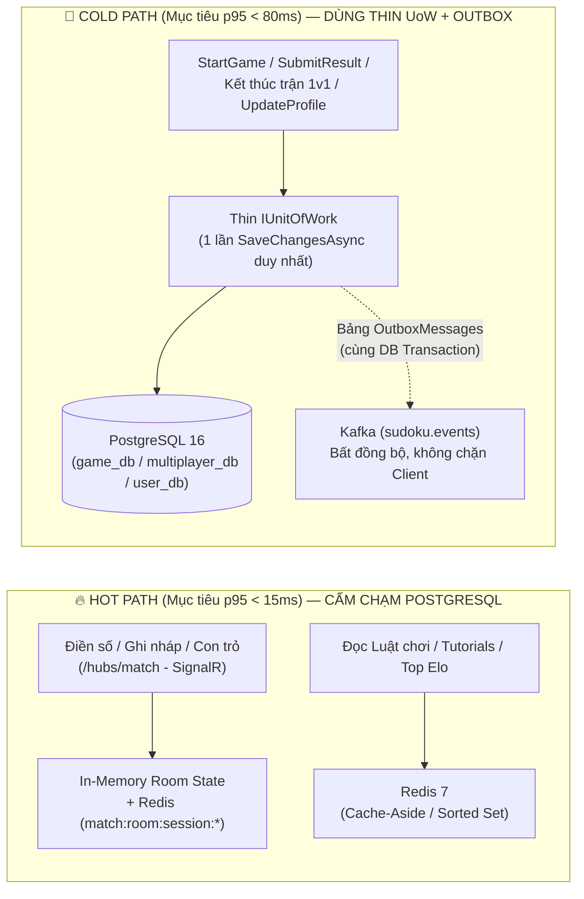

# ⚡ TÀI LIỆU TIÊU CHUẨN TỐI ƯU HÓA HIỆU NĂNG & RESPONSE TIME (OPTIMIZATION GUIDE)
## Dự án áp dụng: `PRN_ASM` — Sudoku Online & Realtime Multiplayer Platform
> **Mục tiêu**: Bộ quy chuẩn kỹ thuật và thực hành tốt nhất (Best Practices) nhằm tối ưu hóa hiệu năng, giảm độ trễ (latency) và đảm bảo độ phản hồi thời gian thực cho kiến trúc **Event-Driven Microservices (.NET 8 + gRPC + SignalR + Kafka + Redis + PostgreSQL 16 + React 19 TS)** của `PRN_ASM`.

---

## 1. 🎯 Ngân sách Độ trễ & Phân tách Luồng (Latency Budget & Path Separation)

Nguyên nhân phổ biến nhất gây suy giảm hiệu năng hệ thống là **đối xử mọi thao tác như nhau** — đẩy cả tác vụ thời gian thực lẫn tác vụ đọc danh mục xuống thẳng PostgreSQL bằng các câu query/transaction nặng.

Trong `PRN_ASM`, mọi tính năng bắt buộc phải phân vào **Hot Path** hoặc **Cold Path** ngay từ lúc thiết kế:



| Nhóm luồng trong `PRN_ASM` | Thành phần chịu trách nhiệm | Ngân sách p95 | Quy tắc lưu trữ bắt buộc |
| :--- | :--- | :--- | :--- |
| **Thao tác trong trận 1v1** (điền ô, xóa ô, pencil notes, báo lỗi, tiến độ `%`) | `Multiplayer.Api` (`Hubs/`) | **< 15 ms** | Giữ trên **RAM / Redis** (`match:room:session:{id}`). **Tuyệt đối không** gọi Repository hay `SaveChangesAsync()` mỗi nước đi. |
| **Tra cứu đọc tần suất cao** (`GetRules`, `ListTutorials`, `ListNotices`, `GetRankings`) | `Support.Api`, `Multiplayer.Api` | **< 30 ms** | Ưu tiên trả từ **Redis 7**; nếu xuống PostgreSQL bắt buộc `.AsNoTracking()` + chiếu thẳng sang Protobuf DTO. |
| **Khởi tạo & Chốt kết quả ván cờ** (`StartGame`, `SubmitResult`, chốt trận 1v1) | `Game.Api`, `Multiplayer.Api` | **< 80 ms** | Gom toàn bộ thay đổi + `OutboxMessage` vào **1 lần `UoW.SaveChangesAsync()` duy nhất**; đẩy việc cộng tích lũy sang Kafka nền. |
| **Đồng bộ thống kê liên Service** (`total_games`, `wins`, lịch sử Elo) | `Sudoku.Messaging` $\rightarrow$ `User.Api` | **Eventual (< 1s)** | Xử lý bất đồng bộ qua Kafka Consumer + `InboxMessage` (không bắt người chơi chờ ở màn hình kết quả). |

---

## 2. ⚙️ Tối ưu hóa Backend (.NET 8, EF Core, PostgreSQL 16, gRPC, Redis, Kafka)

### 2.1. Áp dụng Thin `IUnitOfWork` & Gom Repository theo Aggregate Root
**Vấn đề & Rủi ro hiệu năng (Pitfalls)**:
- Khi mỗi hàm trong Repository (`Add`, `Update`, `Delete`) tự gọi `await _ctx.SaveChangesAsync()`, một nghiệp vụ ghi qua 4–5 bảng phụ sẽ bắn 5–10 lệnh tuần tự xuống PostgreSQL (nhân độ trễ mạng lên $N$ lần) và gây rách dữ liệu (Partial Commit) nếu lỗi ở bước giữa.
- Ngược lại, nếu nhét cả 10–12 Repository làm property của một `God UnitOfWork` sẽ gây phình dependency và cực khó viết test.

**Quy chuẩn cho `services/*/Data/` trong `PRN_ASM`**:
1. **Gom Repository theo Aggregate Root** (không đẻ 1 bảng phụ = 1 Repo):
   - Ví dụ trong `Multiplayer.Api`: Chỉ cần 1 `IMatchRepository` quản lý trọn gói `Match` + `MatchPlayers` + `MatchRounds` thông qua navigation collection, thay vì tách 3 Repo rời. Mỗi microservice chỉ nên giữ **2–5 Repository chính**.
2. **Repository không bao giờ tự gọi `SaveChangesAsync()`** và không gọi `_ctx.Update(entity)` tràn lan trên entity đang được track (tránh làm bẩn toàn bộ navigation graph trong `ChangeTracker`).
3. **Dùng Thin `IUnitOfWork` kết hợp `OutboxMessage` của `Sudoku.Messaging`**:
   - Nhờ `AddDbContext<TDbContext>()` mặc định là `Scoped`, các `IRepository` và `IUnitOfWork` trong cùng một gRPC call tự động chia sẻ chung **1 instance `DbContext`**.

```csharp
// building-block hoặc services/<Service>/Domain/Interfaces/IUnitOfWork.cs
public interface IUnitOfWork
{
    Task<int> SaveChangesAsync(CancellationToken ct = default);
    Task ExecuteInTransactionAsync(Func<CancellationToken, Task> operation, CancellationToken ct = default);
}

// services/<Service>/Data/UnitOfWork.cs
public sealed class UnitOfWork<TDbContext>(TDbContext ctx) : IUnitOfWork
    where TDbContext : DbContext
{
    public Task<int> SaveChangesAsync(CancellationToken ct = default)
        => ctx.SaveChangesAsync(ct);

    public async Task ExecuteInTransactionAsync(Func<CancellationToken, Task> operation, CancellationToken ct = default)
    {
        var strategy = ctx.Database.CreateExecutionStrategy();
        await strategy.ExecuteAsync(async () =>
        {
            await using var tx = await ctx.Database.BeginTransactionAsync(ct);
            await operation(ct);
            await ctx.SaveChangesAsync(ct);
            await tx.CommitAsync(ct);
        });
    }
}
```

**Mẫu chốt ván cờ 1 Round-Trip (kết hợp Outbox, không chờ Kafka mạng chậm)**:
```csharp
// Trong GameService (services/Game/Game.Api/Domain/)
public async Task<SubmitResultResponse> SubmitResultAsync(SubmitResultRequest req, Guid userId, CancellationToken ct)
{
    var session = await gameRepo.GetActiveSessionForUpdateAsync(req.SessionId, userId, ct)
        ?? throw new RpcException(new Status(StatusCode.NotFound, "Session not found"));

    bool isValid = SudokuVerifier.Verify(session.InitialBoard, req.SubmittedBoard);
    session.Complete(isValid, CalculateScore(session));

    // Ghi sự kiện vào bảng Outbox cùng game_db thay vì gọi thẳng Kafka đồng bộ trên request của user
    var eventPayload = new GameFinished
    {
        SessionId = session.Id,
        UserId = userId.ToString(),
        IsWin = isValid,
        Score = session.Score
    };

    outboxRepo.Add(new OutboxMessage
    {
        EventId = Guid.NewGuid().ToString(),
        Type = nameof(GameFinished),
        UserId = userId.ToString(),
        Topic = "sudoku.events",
        Payload = eventPayload.ToByteArray()
    });

    // ĐÚNG 1 LẦN round-trip xuống game_db cho cả GameSession + OutboxMessage!
    await uow.SaveChangesAsync(ct);

    return new SubmitResultResponse { IsCorrect = isValid, Score = session.Score };
}
```

---

### 2.2. Kỷ luật Truy vấn Đọc (EF Core Read Path) — Nơi quyết định 70% Response Time
**Rủi ro hiệu năng & Lỗi chống mẫu (Anti-Patterns)**: Hầu hết các ca suy giảm tốc độ phản hồi không nằm ở câu lệnh `INSERT`, mà nằm ở 3 lỗi:
1. Gọi `GetAll()` kéo toàn bộ bảng của mọi user lên RAM rồi mới `.Where(x => x.UserId == userId)` ở C#.
2. Nối 5–7 bảng `.Include().ThenInclude()` gây **Cartesian Explosion** (nhân bản hàng nghìn dòng dữ liệu lặp).
3. Quên `.AsNoTracking()` trên luồng chỉ đọc, bắt EF Core tốn CPU/RAM tạo snapshot theo dõi từng bản ghi.

**Quy chuẩn bắt buộc cho `PRN_ASM`**:
- **100% truy vấn Read-only phải có `.AsNoTracking()`**.
- **Chiếu thẳng (`.Select()`) sang Protobuf Message / Read DTO ngay trong LINQ** thay vì load cả Entity nặng rồi map bằng tay. Đặc biệt trong `game_db` và `multiplayer_db`, các cột `JSONB` lưu trạng thái bàn cờ / lịch sử từng nước đi (`move_history`) rất nặng — **cấm load cột này** khi chỉ hiển thị danh sách lịch sử (`GetMatchHistory`, `GetHighScores`).
- **Cấm viết hàm `GetAll*()` không có điều kiện lọc & giới hạn `Take(limit)`**.

```csharp
// ❌ SAI: Kéo hết entity kèm JSONB nặng + tracking thừa rồi mới map sang Protobuf
var matches = await _ctx.Matches
    .Include(m => m.Players)
    .Include(m => m.MoveLogs) // Nổ dữ liệu!
    .Where(m => m.Player1Id == userId || m.Player2Id == userId)
    .ToListAsync(ct);

// ✅ ĐÚNG: AsNoTracking + Projection lấy đúng các cột nhẹ cho gRPC GetMatchHistoryResponse
var historyItems = await _ctx.Matches
    .AsNoTracking()
    .Where(m => m.Player1Id == userId || m.Player2Id == userId)
    .OrderByDescending(m => m.EndedAt)
    .Take(pageSize)
    .Select(m => new MatchHistoryItem // Protobuf generated message
    {
        MatchId = m.Id.ToString(),
        OpponentName = m.Player1Id == userId ? m.Player2Name : m.Player1Name,
        EloDelta = m.Player1Id == userId ? m.Player1EloDelta : m.Player2EloDelta,
        IsWinner = m.WinnerId == userId,
        DurationSeconds = m.DurationSeconds
    })
    .ToListAsync(ct);
```

- **Bẫy đa luồng với `DbContext`**: Không bao giờ chạy `await Task.WhenAll(repoA.GetAsync(), repoB.GetAsync())` trên cùng một Scoped `DbContext` (sẽ nổ `InvalidOperationException`). Nếu một API thực sự cần bắn 2 query độc lập song song xuống cùng 1 DB, hãy đăng ký `AddDbContextFactory<TDbContext>()` để mỗi nhánh lấy 1 context ngắn hạn riêng.

---

### 2.3. Thiết kế Index PostgreSQL 16 cho 4 Database & Outbox/Inbox
**Nguyên tắc thiết kế Index**: Chỉ thiếu 1 Composite Index trên cặp cột hay lọc cùng nhau cũng khiến query chậm đi 10–50 lần khi bảng vượt vài chục nghìn dòng.

Checklist đánh Index ngay từ Migration đầu tiên cho 4 DB của `PRN_ASM`:

| Database | Bảng | Index bắt buộc | Lý do tối ưu |
| :--- | :--- | :--- | :--- |
| **`game_db`** | `game_sessions` | `(user_id, status, created_at DESC)` | Lấy nhanh ván đang chơi dở hoặc lịch sử ván của 1 user không cần sort lại. |
| **`game_db`** | `game_sessions` | `(difficulty, score DESC, duration_ms ASC) WHERE status = 'Completed'` | Partial Index phục vụ `GetHighScores` tức thì theo từng mức độ. |
| **`multiplayer_db`** | `match_participants` *(hoặc 2 index riêng trên `matches`)* | `(user_id, ended_at DESC)` | Tránh điều kiện `OR` (`player1_id = @u OR player2_id = @u`) dễ làm giảm hiệu quả B-Tree index khi tra lịch sử đấu. |
| **`multiplayer_db`** | `player_ratings` | `(elo_rating DESC, wins DESC)` | Backup truy vấn bảng xếp hạng khi Redis cold-start. |
| **`game_db` & `multiplayer_db`** | `outbox_messages` | `(created_at ASC) WHERE processed_at IS NULL` | **Bắt buộc dùng Partial Index**: bảng Outbox sẽ phình hàng triệu dòng đã gửi, partial index giữ kích thước index gần như bằng 0, worker quét `< 1ms`. |
| **`user_db`** | `inbox_messages` | `UNIQUE (event_id, consumer_name)` | Chặn xử lý trùng sự kiện Kafka (`GameFinished`, `MatchCompleted`) ở mức khóa cứng của DB với chi phí $O(\log N)$. |

---

### 2.4. Khai thác tối đa Redis 7, Pre-generation & Cache Warm-up
**Vấn đề hiệu năng (Cold-Start & CPU Spikes)**:
- Request của người dùng đầu tiên sau khi deploy thường bị khựng (cold start) do EF Core biên dịch model + cache rỗng.
- Thuật toán nặng chạy đồng bộ trong request tạo cảm giác lag.

**Áp dụng cụ thể vào từng Microservice của `PRN_ASM`**:
1. **`Game.Api` — Sinh trước đề Sudoku (Puzzle Pool Pre-generation)**:
   - Sinh đề Sudoku chuẩn (đảm bảo duy nhất 1 nghiệm - Unique Solution) ở cấp `Hard` / `Expert` bằng thuật toán cắt tỉa có thể tốn vài chục tới hàng trăm ms CPU.
   - **Giải pháp**: Dùng một `BackgroundService` duy trì sẵn hàng đợi đề cho mỗi độ khó trong Redis List (`sudoku:pool:easy`, `sudoku:pool:expert`, mỗi list giữ sẵn ~50–100 đề). Khi gRPC `StartGameRequest` gọi tới, chỉ việc `LPOP` đề ra trong **< 1ms** và kích hoạt worker bù đề ở nền!
2. **`Multiplayer.Api` — Bảng xếp hạng Elo bằng Redis Sorted Set**:
   - Dùng `ZADD leaderboard:elo <score> <userId>` mỗi khi kết thúc trận và `ZREVRANGE` + `ZREVRANK` cho `GetRankings`. Lấy Top 100 kèm thứ hạng cá nhân của người chơi luôn đạt $O(\log N)$ dưới **1ms**, không cần `COUNT(*)` trên PostgreSQL.
3. **`Support.Api` — Cache Warm-up khi khởi động & Tập trung Invalidation**:
   - Chạy `IHostedService` lúc start `Support.Api` để nạp sẵn `cached:support:rules:*` và `cached:support:tutorials` vào Redis + khởi động sẵn EF Core model.
   - Khi Admin cập nhật luật/thông báo, gom lệnh xóa key Redis ngay sau `await uow.SaveChangesAsync(ct)` tại một chỗ duy nhất (tránh rải rác `InvalidateCache()` ở nhiều nơi dễ bỏ sót).

---

### 2.5. Tối ưu gRPC, SignalR & Envoy Gateway
1. **Truyền `CancellationToken` từ gRPC / SignalR xuống tận DB**:
   - Trong mọi gRPC method (`ServerCallContext context`), luôn truyền `context.CancellationToken` xuống Service $\rightarrow$ Repo $\rightarrow$ `ToListAsync(context.CancellationToken)`. Khi người chơi tắt tab hoặc hủy tìm trận, DB giải phóng kết nối ngay lập tức.
2. **Cấu hình Cache Remote JWKS trên Envoy (`gateway/envoy.yaml`)**:
   - Envoy xác thực Firebase JWT qua Google JWKS. Đảm bảo `remote_jwks` trong `envoy.yaml` đặt `cache_duration` (ví dụ `300s`–`3600s`) và `async_fetch` để Envoy xác thực JWT hoàn toàn trên RAM, không tạo phụ thuộc mạng ra Google trên từng request của người chơi.
3. **Tối giản Payload SignalR trên `/hubs/match`**:
   - Khi đồng bộ nước đi giữa 2 người chơi, không gửi lại cả mảng 81 ô mỗi lần bấm phím. Chỉ gửi gói delta siêu nhỏ: `{ i: cellIndex, v: value }` (hoặc chỉ gửi tiến độ `filledCount` / `mistakeCount` nếu luật đấu ẩn con số cụ thể của đối thủ để chống nhìn bài!).

---

## 3. 🖥️ Tối ưu hóa Frontend (`web/` — React 19 + TypeScript + Vite 8 + ConnectRPC + SignalR)

### 3.1. Khởi tạo Tức thì (0ms) với Stale-While-Revalidate & In-Flight Deduplication
**Vấn đề & Rủi ro giao diện (Frontend Anti-Patterns)**:
- Lưu dữ liệu vào state khởi tạo rỗng `useState(null)` kèm `loading = true` khiến mỗi lần chuyển màn hình hay F5 là giao diện nháy trắng chờ mạng, thậm chí chặn cả route bảo vệ.
- Nhiều component cùng mount (Navbar hiển thị Avatar/Elo, trang Lobby cũng gọi Profile) bắn trùng 2–3 gRPC-Web request giống hệt nhau.

**Áp dụng cho `web/src/api/`**:
- Tạo lớp cache 2 tầng (**RAM Map** + **`sessionStorage`**) kèm **In-Flight Promise Map** cho các dữ liệu đọc lặp lại (`GetOrCreateProfile`, `ListTutorials`, `ListNotices`, `GetRankings`).
- Khởi tạo state React đồng bộ ngay từ cache để render ngay ở frame đầu tiên (`0ms`), sau đó âm thầm revalidate ở nền:

```ts
// web/src/api/queryCache.ts
const memoryCache = new Map<string, { data: unknown; ts: number }>();
const inflightMap = new Map<string, Promise<unknown>>();

export function getCachedSync<T>(key: string, ttlMs = 300_000): T | null {
  const mem = memoryCache.get(key);
  if (mem && Date.now() - mem.ts < ttlMs) return mem.data as T;

  try {
    const raw = sessionStorage.getItem(key);
    if (!raw) return null;
    const parsed = JSON.parse(raw) as { data: T; ts: number };
    if (Date.now() - parsed.ts < ttlMs) {
      memoryCache.set(key, parsed);
      return parsed.data;
    }
  } catch { /* ignore storage quota/privacy errors */ }
  return null;
}

export function fetchDeduped<T>(key: string, fetcher: () => Promise<T>, ttlMs = 300_000): Promise<T> {
  const cached = getCachedSync<T>(key, ttlMs);
  if (cached !== null) return Promise.resolve(cached);

  const existing = inflightMap.get(key) as Promise<T> | undefined;
  if (existing) return existing; // Gộp 3 component gọi cùng lúc thành 1 request mạng!

  const promise = fetcher()
    .then((data) => {
      const entry = { data, ts: Date.now() };
      memoryCache.set(key, entry);
      try { sessionStorage.setItem(key, JSON.stringify(entry)); } catch {}
      return data;
    })
    .finally(() => inflightMap.delete(key));

  inflightMap.set(key, promise);
  return promise;
}
```

```tsx
// Trong Component React 19: Không bị nháy Spinner nếu đã có cache!
const [profile, setProfile] = useState<UserProfile | null>(
  () => getCachedSync<UserProfile>(`profile:${uid}`)
);
```

---

### 3.2. Optimistic UI, Tận dụng Response Trực tiếp & Chống Double-Submit
**Vấn đề khi cập nhật trạng thái (State Mutation Pitfalls)**:
- Sau khi bấm Lưu (`UpdateProfile`, `SubmitResult`), gọi tiếp một lệnh `fetchAll()` để tải lại dữ liệu làm tốn gấp đôi thời gian phản hồi.
- Không khóa nút khi đang gửi khiến người dùng sốt ruột bấm liên tiếp, sinh bản ghi trùng hoặc lỗi race condition.

**Quy tắc bắt buộc trong `web/src/`**:
1. **Không bao giờ re-fetch sau khi mutate nếu response đã trả đủ dữ liệu**: Khi gọi `UpdateProfile` hoặc `SubmitResult`, cập nhật thẳng state và cache từ Protobuf response trả về.
2. **Optimistic UI (0ms) cho mọi thao tác trên bàn cờ Sudoku**:
   - Khi người chơi gõ phím `1–9` hoặc bật ghi chú (Notes), cập nhật mảng bàn cờ trên Client **ngay lập tức ở 0ms** (`useState` / `useOptimistic`), đồng thời bắn frame SignalR đi ở nền. Không bao giờ disable bàn cờ ngồi chờ ack từ server trên từng ô!
3. **In-flight Action Guard**: Mọi nút hành động (`Tìm trận`, `Nộp bài`, `Lưu hồ sơ`) bắt buộc có cờ `isSubmitting` (hoặc `useActionState` của React 19) chặn bấm đúp ngay từ dòng đầu tiên của hàm handler.

---

### 3.3. Chống Re-render Bàn cờ 81 Ô & Cô lập Đồng hồ Đếm giờ (Đặc thù Sudoku)
Đây là điểm dễ làm tụt FPS nhất trên giao diện web Sudoku nếu tổ chức state sai:

1. **Tuyệt đối tách riêng `<GameTimer />` khỏi `<SudokuBoard />`**:
   - Nếu đặt `const [seconds, setSeconds] = useState(0)` ở component cha `GameScreen` chứa bàn cờ, cứ mỗi giây `setInterval` chạy sẽ ép **toàn bộ 81 component `<SudokuCell />` và bảng đối thủ re-render lại vô ích**.
   - **Giải pháp**: Đóng gói bộ đếm thời gian vào `<GameTimer startTime={startedAt} />` tự quản lý state nội bộ; khi nộp bài chỉ cần tính `Date.now() - startedAt`.
2. **Biểu diễn State bàn cờ phẳng & Dùng Bitmask cho Pencil Marks**:
   - Lưu giá trị 81 ô bằng mảng phẳng chiều dài 81 (`Uint8Array` hoặc `number[]`), không dùng mảng 2 chiều lồng nhau `number[][]` phải clone nhiều cấp khi cập nhật 1 ô.
   - Với ghi nháp (pencil marks 1–9 trong mỗi ô): Dùng **1 số nguyên bitmask 9-bit (`0..511`)** thay vì `number[]` hoặc `Set<number>`:
     ```ts
     // Toggle số n (1..9) trong ghi nháp của ô chỉ tốn 1 phép XOR, không cấp phát vùng nhớ mới!
     const toggleNote = (mask: number, n: number): number => mask ^ (1 << (n - 1));
     const hasNote = (mask: number, n: number): boolean => (mask & (1 << (n - 1))) !== 0;
     ```
   - Bọc `<SudokuCell />` bằng `React.memo` với toàn bộ props là kiểu nguyên thủy (`value: number`, `notesMask: number`, `isSelected: boolean`, `isHighlighted: boolean`, `isConflict: boolean`) để khi chọn hoặc điền 1 ô, ~60 ô không liên quan đứng im tuyệt đối.

---

### 3.4. Quản lý Kết nối SignalR, Hủy Request Cũ & Xử lý Media/Lazy Tab
**Vấn đề về tài nguyên & mạng (Resource & Network Pitfalls)**:
- Render sẵn tất cả các tab ẩn nặng ngay lúc vào trang làm chậm thời gian tương tác ban đầu (TTI).
- Người dùng upload ảnh Avatar gốc nặng 4–8MB làm treo request; quên `URL.revokeObjectURL` gây rò rỉ bộ nhớ trình duyệt.
- Không hủy request cũ khi đổi filter nhanh gây hiện tượng response cũ về sau ghi đè response mới.

**Áp dụng cho `web/`**:
1. **Lazy-mount các khu vực phụ (`React.lazy` + cờ `visitedTabs`)**:
   - Khi vào trang chủ, chỉ tải bundle cốt lõi của Lobby & Bàn cờ. Các màn `Tutorials` (`SupportService`), `MatchHistory`, `Leaderboard` dùng `React.lazy()` và chỉ mount lần đầu khi người dùng thực sự mở tab, sau đó giữ bằng `display: none` nếu muốn chuyển qua lại tức thì không tải lại.
2. **Truyền `AbortSignal` cho `@connectrpc/connect-web`**:
   ```ts
   useEffect(() => {
     const controller = new AbortController();
     multiClient.getMatchHistory({ page }, { signal: controller.signal })
       .then(res => setHistory(res.items))
       .catch(err => { if (err.name !== 'AbortError') reportError(err); });
     return () => controller.abort(); // Hủy ngay trên đường truyền khi chuyển trang/đổi trang phân trang
   }, [page]);
   ```
3. **Vòng đời SignalR (`web/src/realtime/`)**:
   - Khởi tạo 1 connection duy nhất cho phiên đấu, cấu hình `.withAutomaticReconnect([0, 1000, 2000, 5000])`.
   - Khi reconnect thành công (`onreconnected`), gửi lại `SyncRoomState(roomId)` để lấy snapshot mới nhất từ Redis phòng trường hợp rớt mạng 1–2 giây.
   - Bắt buộc gỡ listener `connection.off("OpponentProgress", handler)` trong hàm cleanup của `useEffect` để không bị nhân đôi callback sau mỗi ván đấu.
4. **Nén ảnh tại Client trước khi đổi Avatar (`UserService.UpdateProfile`)**:
   - Nếu cho phép tải ảnh đại diện lên storage, nén ảnh bằng `<canvas>` trên trình duyệt về tối đa `256x256px` (`WebP`, quality `0.8`, `< 40KB`) trước khi upload; hiển thị preview tức thì bằng `URL.createObjectURL(file)` và gọi `URL.revokeObjectURL()` ngay khi xong hoặc unmount.

---

## 4. 🔍 Tận dụng `Sudoku.Observability` để Bắt Sớm Điểm Nghẽn

Dự án `PRN_ASM` đã có sẵn thư viện `building-block/Sudoku.Observability` (OpenTelemetry). Đừng đợi người dùng than lag mới đi tìm thủ phạm — hãy bật thêm 2 cấu hình theo dõi sau ngay từ đầu:

1. **Gắn Instrumentation cho EF Core & Redis**:
   - Bổ sung `AddEntityFrameworkCoreInstrumentation()` và `AddRedisInstrumentation()` vào `AddSudokuObservability()` để mọi câu SQL chậm hoặc lệnh gọi `SaveChangesAsync()` lặp trong 1 gRPC trace hiện rõ thành từng thanh (span) trên Jaeger / Grafana Tempo.
   - Quy tắc nhìn Trace: Nếu 1 gRPC request xuất hiện **> 3 spans DB tuần tự**, phải gộp query hoặc gom lại bằng `IUnitOfWork` ngay.
2. **Đo thời gian thực thi Solver & Matchmaking bằng Custom `Histogram`**:
   - Ghi metric cho thời gian lấy đề (`sudoku.puzzle.acquire_ms`) và độ trễ broadcast SignalR (`sudoku.match.move_ms`) để phát hiện sớm khi pool đề cạn hoặc Redis chậm.

---

## 5. ✅ Checklist Kiểm Duyệt Nhanh Trước Khi Merge Mọi Pull Request

### Backend (`services/*`)
- [ ] Luồng trong trận đấu (`SignalR Hub`) có vô tình đụng vào `DbContext` / PostgreSQL trên từng nước đi không? *(Phải là KHÔNG)*.
- [ ] Mọi câu query đọc trong `Data/Repositories` đã có `.AsNoTracking()` và `.Select()` ra DTO/Protobuf (bỏ qua cột `JSONB` nặng khi không cần) chưa?
- [ ] Có hàm nào gọi `SaveChangesAsync()` bên trong vòng lặp `foreach` hoặc tự gọi lẻ tẻ trong từng Repository không? *(Phải gom về 1 lần `await uow.SaveChangesAsync(ct)` ở Service)*.
- [ ] Khi phát sự kiện Kafka (`GameFinished`, `MatchCompleted`), đã ghi qua `OutboxMessage` chung transaction DB thay vì gọi mạng chéo hoặc Dual-Write chưa?
- [ ] Mọi gRPC method & Repository method đã nhận và truyền `CancellationToken` xuyên suốt chưa?
- [ ] Mệnh đề `WHERE` + `ORDER BY` mới thêm đã có Composite Index tương ứng trong EF Migration chưa?

### Frontend (`web/`)
- [ ] Màn hình chính có bị trắng xóa chờ API khi đã có dữ liệu cache từ phiên trước không? *(Phải hydrate đồng bộ bằng `getCachedSync`)*.
- [ ] Nhiều component cùng lấy chung 1 dữ liệu đã đi qua hàm deduplicate in-flight promise chưa?
- [ ] Đồng hồ đếm giờ (`Timer`) đã được tách thành component riêng để không kéo theo 81 ô bàn cờ re-render mỗi giây chưa?
- [ ] Thao tác điền số / ghi nháp trên bàn cờ có phản hồi 0ms tại Client (Optimistic) và các nút bấm gửi form đã có khóa chống bấm đúp (`isSubmitting`) chưa?
- [ ] Các `useEffect` gọi gRPC-Web đã gắn `AbortController` và các sự kiện SignalR đã có `connection.off(...)` khi unmount chưa?
