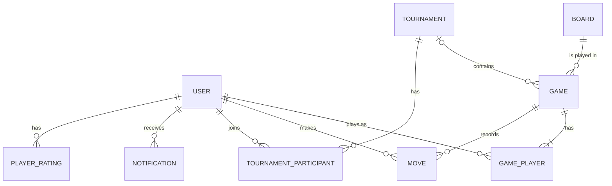
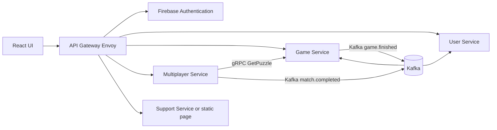

# CORE-LOGIC: Sudoku Online Platform

Tài liệu handoff về logic lõi của game và multiplayer, gồm 3 phần:

1. [Core logic](#1-core-logic) của game (chơi một mình) và multiplayer (race, dual, tournament)
2. [ERD, thuộc tính và logic liên quan ở cấp tổng quan](#2-cấp-tổng-quan-erd-tổng)
3. [Cùng nội dung ở cấp microservice](#3-cấp-microservice)

**Cách đọc nhãn trạng thái**

- **Đã chốt**: đã được người dùng xác nhận trong thảo luận.
- **Đề xuất**: đề xuất hợp lý nhưng chưa được xác nhận. Các hằng số (điểm, thời gian, hệ số) đều là điểm xuất phát, chỉnh lại sau khi chơi thử.
- **Việc còn mở**: cần quyết định (xem [mục 4](#4-việc-còn-mở)).

Stack: .NET 8, gRPC, React (Vite), Envoy API Gateway, PostgreSQL (mỗi service một database), Kafka, Firebase Authentication.

---

## 1. Core logic

### 1.1 Hai trục độc lập: Layout và Format (Đã chốt ở mức tổng quan)

| Trục | Câu hỏi | Giá trị | Bản chất |
|---|---|---|---|
| **Layout** (kiểu bảng) | Bảng trông như thế nào | `standard` (normal), `irregular` (shuffle) | **Dữ liệu** của board |
| **Format** (cách chơi) | Ván diễn ra như thế nào | `solo`, `race`, `duel` | **Hành vi** của ván |

Mọi tổ hợp đều hợp lệ (ví dụ duel + shuffle). Layout là dữ liệu nên **không cần nhánh code riêng**: mọi hàm validate, tính ứng viên, tính độ khó đều đọc `region_map`. Format là hành vi nên dùng **Strategy** (một class cho mỗi format, đọc tham số từ `rules`).

### 1.2 Board

**Lưu và mã hóa (Đã chốt)**

- Mỗi board lưu thành chuỗi **81 ký tự**, đọc từng hàng từ trái sang phải. `0` là ô trống, `1-9` là giá trị.
- Công thức quy đổi (0-based): `index = row * 9 + col`, `row = index / 9`, `col = index % 9`.
- Board được **sinh trước và lưu thành kho puzzle** (không sinh lúc người chơi bấm New Game). Lý do: cần `solution_board` để validate, nhiều người phải chơi **cùng một puzzle** (Multiplayer, Tournament), sinh board có nghiệm duy nhất và đúng độ khó khá chậm.
- `solution_board` chỉ ở phía server, **không gửi xuống client**.

**Phân biệt ô đề và ô người chơi (Đã chốt)**

| Điều kiện tại `idx` | Ý nghĩa |
|---|---|
| `initial_board[idx] != '0'` | Ô đề, không được sửa |
| `initial_board[idx] == '0'` và `current_board[idx] != '0'` | Ô người chơi điền |
| `initial_board[idx] == '0'` và `current_board[idx] == '0'` | Ô trống |

Đúng/sai của ô người chơi **không** nằm trong chuỗi board mà nằm ở `Move.is_correct` (hoặc so với `solution_board`).

**Layout shuffle: vùng bất quy tắc (Đề xuất cách lưu)**

- Hàng và cột giữ nguyên, 9 vùng có hình dạng tùy ý, mỗi vùng đúng 9 ô.
- Lưu bằng `region_map`: chuỗi 81 ký tự, ký tự thứ `i` là số hiệu vùng (0-8) của ô `i`. Sudoku chuẩn là trường hợp đặc biệt (giá trị mặc định là các khối 3x3).
- Ràng buộc khi sinh sơ đồ vùng: mỗi vùng đúng 9 ô; **các ô trong một vùng liên thông** theo chiều ngang/dọc (kiểm tra bằng BFS).
- `puzzle_hash` phải băm cả `initial_board` lẫn `region_map`.

**Pipeline sinh puzzle (chạy offline, Đề xuất)**

1. Sinh sơ đồ vùng (chỉ cho layout irregular).
2. Điền lời giải bằng backtracking với 3 ràng buộc: hàng, cột, vùng (theo `region_map`).
3. Xóa dần ô, dùng solver (cũng hiểu `region_map`) để đảm bảo còn **đúng một nghiệm**.
4. Chấm độ khó, gán level; tính `required_techniques`, `is_logic_solvable` nếu cần.
5. Lưu `initial_board`, `solution_board`, `region_map`, `puzzle_hash`, `generator_version`.

Giữ pool vài trăm đến vài nghìn board cho mỗi cặp (level, layout). Cần job hoặc script bổ sung khi pool cạn.

### 1.3 Validate nước đi (Đã chốt: server là nơi quyết định)

```csharp
int idx = row * 9 + col;
if (initialBoard[idx] != '0') return Error("Ô cho sẵn, không được sửa");
bool isCorrect = (solutionBoard[idx] - '0') == value;   // value = 0 là xóa ô
```

Điền **sai = khác `solution_board`** (không chỉ vi phạm luật hàng/cột/vùng). Client chỉ để hiển thị và chặn thao tác cho tiện. Pencil marks là dữ liệu riêng tư, lưu ở `notes` (JSON, key là chỉ số ô), không trộn vào chuỗi board.

### 1.4 Game solo (Đề xuất, trừ phần lưu board)

- New Game: người chơi chọn level + layout (và tùy chọn "chỉ puzzle giải được bằng logic"). Server chọn ngẫu nhiên một puzzle `is_active` đúng (level, layout) mà người chơi chưa chơi.
- Một ván lưu: `current_board`, `notes`, `mistakes_count`, `hints_used`, `elapsed_time`, `accuracy`, `score`, thời điểm bắt đầu/kết thúc.
- Có gợi ý (hint) ở solo, tính vào `hints_used` (server tính từ `solution_board`, tôn trọng `region_map`).
- Kết thúc ván phát event `GameFinished` (xem mục 3.5): phục vụ nhiệm vụ, XP, thống kê.
- **Thống kê và điểm cao nhất là dữ liệu dẫn xuất** (`MAX`, `COUNT`, `AVG` trên lịch sử ván), không phải thực thể gốc ở cấp tổng quan. Cân nhắc bảng tổng hợp sẵn ở cấp service nếu truy vấn chậm hoặc cần chụp theo mùa.
- Bảng xếp hạng solo tách theo layout (shuffle khó hơn, không so chung).

### 1.5 Quy tắc chung của multiplayer (Đã chốt: 3 mạng; còn lại Đề xuất)

| Quy tắc | Nội dung |
|---|---|
| Mạng | **3 mạng mỗi người chơi** (đã chốt). Điền sai mất 1 mạng, một ô chỉ phạt một lần cho cùng một chữ số sai. |
| Hint | Tắt hoàn toàn. Không tự động điền ghi chú. |
| Thời gian | Server tính giờ, hai người bắt đầu cùng lúc sau đếm ngược do server phát. |
| Mất kết nối | Cho 30 giây vào lại, đồng hồ vẫn chạy; quá hạn thì xử thua. |
| Ghép trận | Theo rating. Level puzzle lấy theo người có rating thấp hơn. |
| Rating | Elo, **tách theo `play_format`** (race và duel riêng). Chưa tách theo layout. |

### 1.6 Race: cùng puzzle, mỗi người một bảng (Đã chốt định nghĩa; rule Đề xuất)

- Cả hai nhận cùng `initial_board` (và `region_map`), mỗi người có bảng riêng.
- **Người hoàn thành đúng trước thắng.**
- Điền sai: mất 1 mạng **và cộng 10 giây** vào thời gian (để đoán mò không rẻ).
- Hết mạng = thua, đối thủ thắng ngay.
- Chỉ hiển thị **thanh tiến độ (% ô đúng)** của đối thủ, không lộ ô nào.
- Hòa (hoàn thành sát nhau): ít lỗi hơn thắng, vẫn hòa thì chia điểm rating.
- Hết giờ trận: so số ô đúng, rồi so số mạng còn lại.
- Chống gian lận: server kiểm tra từng nước đi, đặt thời gian giải tối thiểu theo level (nhanh bất thường thì gắn cờ), giới hạn tần suất gửi nước đi.

### 1.7 Duel: bảng chung, đánh luân phiên (Đã chốt: luân phiên, đối kháng tính điểm theo ô)

**Luồng lượt**: server báo lượt của ai kèm hạn chót, người đó chọn **một ô** và số trong 15 giây (mặc định, tăng theo level), server kiểm tra, rồi chuyển lượt. Không có tranh chấp ô nên không cần khóa mềm hay xử lý theo độ trễ.

| Tình huống | Rule (Đề xuất) |
|---|---|
| Ai đi trước | Chọn ngẫu nhiên |
| Cân bằng người đi trước | Chỉ chọn puzzle có **số ô trống chẵn** cho duel (hai người đi bằng số nước nếu không ai mất lượt) |
| Điền đúng | Cộng điểm theo độ khó ô (xem 1.8), chuyển lượt |
| Điền sai | Mất 1 mạng, trừ 5 điểm, ô vẫn trống, **mất lượt**. Chữ số sai được hiện cho **cả hai người** (loại trừ cho ô đó) |
| Hết 15 giây | Mất lượt và mất 1 mạng (có thêm khoảng 1 giây bù độ trễ) |
| Hết mạng | Thua ngay (thống nhất với race) |
| Board hoàn thành | Điểm cao hơn thắng; hòa điểm thì ai còn nhiều mạng hơn; vẫn hòa thì hòa |
| Ghi chú | Riêng tư; người chơi tranh thủ lúc đối thủ đi để suy nghĩ |
| Hint | Tắt |

Mỗi nước đi gửi kèm `turn_number`; server từ chối nước đi sai lượt hoặc quá hạn để tránh gửi trùng khi mạng chập chờn.

### 1.8 Độ khó của ô, tính động (Đề xuất)

Độ khó của một ô = kỹ thuật dễ nhất đủ để xác định ô đó **từ trạng thái board ngay lúc điền**. Tính trên board trước khi áp dụng nước đi, chỉ tính khi nước đi **đúng**.

| Bậc | Điều kiện | Điểm |
|---|---|---|
| 1. Naked Single | Ô chỉ còn 1 ứng viên | 5 |
| 2. Hidden Single | Một số chỉ đặt được ở ô này trong hàng/cột/vùng của nó | 10 |
| 3. Còn lại | Cần suy luận sâu hoặc đoán | 8 × số ứng viên |

Nhờ tính động, ô khó lúc đầu nhưng đã được "mở khóa" thì điểm tự giảm, và nước đi của một người có thể làm dễ ô cho đối thủ. Bậc 3 gộp chung các kỹ thuật nâng cao (xấp xỉ chấp nhận được). Bản tối giản: `điểm = base × số ứng viên`.

Mọi hàm tính đều đọc `region_map` nên chạy cho cả hai layout.

### 1.9 Tournament: loại trực tiếp (Đã chốt: tứ kết, bán kết)

- Giải loại trực tiếp **4, 8 hoặc 16 người** (cố định để tránh phải xử lý bye). Số vòng = `log2(max_players)`.
- **Không cần bảng `Round`.** Mỗi ván có `round_number` (1 là vòng đầu) và `bracket_slot` (vị trí trong vòng, đếm từ 1), ràng buộc duy nhất `(tournament_id, round_number, bracket_slot)`. Giải 8 người có 7 ván: 4 tứ kết, 2 bán kết, 1 chung kết.
- Tên vòng **tính từ số vòng**, không lưu:

```csharp
static string RoundName(int roundNumber, int totalRounds) =>
    (totalRounds - roundNumber) switch {
        0 => "Chung kết", 1 => "Bán kết", 2 => "Tứ kết",
        var n => $"Vòng {1 << (n + 1)}" };
```

- Người thắng đi tiếp bằng công thức: ván `(r, slot)` kết thúc thì người thắng vào ván `(r + 1, (slot + 1) / 2)`, slot lẻ vào ghế A, slot chẵn vào ghế B.
- Khởi tạo nhánh đấu (chọn một, Đề xuất): tạo sẵn 7 ván trạng thái `pending` lúc bắt đầu giải (vẽ được sơ đồ nhánh ngay), hoặc tạo từng vòng khi vòng trước kết thúc.
- Nhánh đấu cần người thắng rõ ràng: ít lỗi hơn thắng, vẫn hòa thì ai nhanh hơn, vẫn hòa thì đấu lại.

**Setting khi tạo giải**

| Nhóm | Setting |
|---|---|
| Cột thật | `play_format` (race/duel), `board_layout` (standard/irregular), `level_id`, `max_players` (4/8/16), `status`, `registration_ends_at`, `starts_at` |
| `rule_config` (JSON) | `lives` (3), `turn_seconds` (chỉ duel), `wrong_time_penalty_seconds` (chỉ race), `match_time_limit_seconds`, `round_levels` (tùy chọn, độ khó tăng dần theo vòng) |

Trạng thái giải: `draft` → `registration` → `in_progress` → `finished` (hoặc `cancelled`).

**Xác thực khi tạo giải (Đề xuất)**: `max_players` hợp lệ; duel bắt buộc có `turn_seconds`, race có phạt thời gian; **kho puzzle đủ dùng** cho tổ hợp (layout, level, và với duel là số ô trống chẵn) nhiều hơn số ván cần dùng; `starts_at` sau `registration_ends_at`.

**Snapshot luật**: lúc tạo mỗi ván, sao chép `play_format` và `rule_config` đã ghép mặc định vào `rules` của ván. Sửa mặc định sau này không ảnh hưởng ván đã tạo.

---

## 2. Cấp tổng quan (ERD tổng)

Ở cấp này chưa chia service, và `Game` không phân biệt chơi một mình hay nhiều người.

### 2.1 Quan hệ



### 2.2 Entity và thuộc tính (Đề xuất, dựa trên bản nháp của người dùng)

| Entity | Thuộc tính chính |
|---|---|
| **Board** | `board_id`, `level`, `layout_type`, `initial_board`, `solution_board`, `region_map`, `difficulty_score`, `puzzle_hash` |
| **Game** | `game_id`, `board_id`, `tournament_id` (nullable), `play_format` (solo/race/duel), `status`, `rules` (JSON snapshot), `round_number`, `bracket_slot`, `shared_board` (chỉ duel), `current_turn_user_id`, `turn_number`, `turn_deadline`, `started_at`, `finished_at` |
| **GamePlayer** (đổi tên từ `History`) | `game_id`, `user_id`, `turn_order`, `current_board` (solo/race), `notes`, `lives_remaining`, `mistakes_count`, `hints_used`, `timeout_count`, `score`, `elapsed_time`, `result` |
| **Move** | `move_id`, `game_id`, `user_id`, `turn_number` hoặc `move_order`, `move_type` (place/timeout), `row`, `col`, `value`, `is_correct`, `difficulty_tier`, `points_awarded`, `time_taken_ms`, `created_at` |
| **Tournament** | `tournament_id`, `name`, `created_by`, `status`, `play_format`, `board_layout`, `level`, `max_players`, `rule_config`, `registration_ends_at`, `starts_at` |
| **TournamentParticipant** | `tournament_id`, `user_id`, `points`, `final_rank`, `joined_at` |
| **User** | `user_id`, `firebase_uid`, `email`, `role`, `status`, `display_name`, `avatar_url`, `country`, `total_exp`, `player_level`, `trophies` (gộp Profile và PlayerProgress ở mức khái niệm, hoặc tách nếu đề bài yêu cầu) |
| **PlayerRating** | `user_id`, `play_format`, `rating`, `matches_played`, `matches_won` |
| **Notification** | `notification_id`, `user_id`, `type`, `content`, `is_read`, `created_at` |
| **Tutorial** (tùy chọn) | Nội dung tĩnh; có thể bỏ khỏi ERD nếu Support là trang HTML tĩnh |

Ghi chú:

- `Game – Move` là 1–N và `Move` có `user_id` (cần cho duel). `User – Tournament` là N–M nên cần `TournamentParticipant`. `Game.tournament_id` nullable vì ván thường không thuộc giải.
- `History` trong bản nháp đóng vai bảng nối giữa ván và người chơi, nên đổi tên thành `GamePlayer`. Ván solo có đúng một `GamePlayer`.
- `Level` chỉ là thuộc tính của `Board`; tách thành entity chỉ khi đề bài yêu cầu thể hiện cấu hình độ khó (thưởng, số ô cho sẵn tối thiểu/tối đa).
- **Không có thực thể `GameMode`** ở cấp này (layout nằm ở `Board`, `play_format` nằm ở `Game`/`Tournament`).
- **Không có `HighScore`, `PlayerGameStats`, `Ranking`**: là dữ liệu dẫn xuất. Ngoại lệ là `PlayerRating` vì Elo không suy ra gọn từ lịch sử.
- **Không có `Round`**: dùng `round_number` và `bracket_slot` trong `Game`.

### 2.3 Logic cấp tổng quan

- Luồng bắt đầu ván: người chơi chọn format + layout + level → chọn `Board` thỏa điều kiện (kèm số ô trống chẵn nếu duel) → tạo `Game` và các `GamePlayer` → chạy theo chiến lược của `play_format` → ghi `Move` → kết thúc thì cập nhật `result`, rating, XP, thông báo.
- Mọi quy tắc ở mục 1 áp dụng nguyên văn; chỉ khác nơi chúng được thực thi (xem mục 3).

---

## 3. Cấp microservice

### 3.1 Phân chia trách nhiệm



| Service | Sở hữu | Không sở hữu |
|---|---|---|
| **User** | Tài khoản, hồ sơ, tiến trình (XP, level, trophy) | Token (Firebase lo), puzzle, ván |
| **Game** | Kho puzzle, ván solo, nước đi solo, nhiệm vụ | Rating, giải đấu, trận nhiều người |
| **Multiplayer** | Trận race/duel, nước đi trận, rating, giải đấu | Kho puzzle (xin từ Game) |
| **Support** | Nội dung hướng dẫn | Mọi dữ liệu game |

Auth: **Firebase thuần** (Đã chốt), không có bảng `RefreshToken`; Gateway xác minh token. Cân nhắc phân quyền bằng cột `role` ở User Service hoặc custom claims.

Quy ước dữ liệu: mỗi service có database riêng, mọi `user_id`, `puzzle_id` xuyên service là **tham chiếu logic** (không có FK thật).

### 3.2 Ánh xạ từ ERD tổng sang service

| Entity tổng quan | Game Service | Multiplayer Service | User Service |
|---|---|---|---|
| Board | `Puzzle` | bản chụp trong `Match` | |
| Game | `GameSession` (solo) | `Match` (race/duel) | |
| GamePlayer | chính `GameSession` | `MatchPlayer` | |
| Move | `GameMove` | `MatchMove` | |
| Tournament, TournamentParticipant | | `Tournament`, `TournamentParticipant` | |
| PlayerRating | | `PlayerRating` | |
| User (tài khoản, hồ sơ, tiến trình) | | | `User`, `Profile`, `PlayerProgress` |
| Notification | chưa có service phụ trách | | |

### 3.3 Game Service

**Entity**: `Level` (hoặc thuộc tính, xem mục 4), `Puzzle`, `GameSession`, `GameMove`, `QuestTemplate`, `UserQuestProgress`, `ArenaChallenge` (tùy chọn); `HighScore` và `PlayerGameStats` là bảng tổng hợp tùy chọn.

- `Puzzle`: `puzzle_id`, `level_id`, `initial_board CHAR(81)`, `solution_board CHAR(81)`, `layout_type`, `region_map CHAR(81)` (mặc định là các khối 3x3), `puzzle_hash` (unique), `clue_count`, `difficulty_score`, `required_techniques`, `is_logic_solvable`, `is_active`, `generator_version`, `created_at`.
- `GameSession`: `session_id`, `user_id` (ref), `puzzle_id`, `status`, `current_board`, `notes`, `mistakes_count`, `hints_used`, `elapsed_time`, `accuracy`, `score`, `started_at`, `finished_at`. Có `layout_type` nếu bỏ `GameMode`.
- `GameMove`: `move_id`, `session_id`, `row`, `col`, `value`, `is_correct`, `move_order`. Ràng buộc `row/col` trong 0-8, `value` trong 0-9 (0 là xóa).
- Nếu có bảng tổng hợp: khóa `(user_id, level_id, layout_type)` (hoặc kèm `mode_id` nếu giữ `GameMode`). Cập nhật qua event `GameFinished`.

**Hành vi**: chọn puzzle, tạo và chạy ván solo, validate nước đi, hint, chấm điểm, phát `game.finished`, theo dõi nhiệm vụ; **phục vụ gRPC cho Multiplayer**.

### 3.4 Multiplayer Service

**Entity**: `Match`, `MatchPlayer`, `MatchMove`, `PlayerRating`, `Tournament`, `TournamentParticipant`.

- `Match`: `match_id`, `tournament_id` (nullable), `round_number`, `bracket_slot`, `play_format`, `board_layout`, `puzzle_id` (ref), **bản chụp puzzle** (`initial_board`, `solution_board`, `region_map`), `rules` (JSON snapshot), `status`, `shared_board` (duel), `current_turn_user_id`, `turn_number`, `turn_deadline`, `started_at`, `finished_at`.
- `MatchPlayer`: `match_id`, `user_id` (ref), `turn_order`, `current_board` (race), `lives_remaining`, `mistakes_count`, `correct_cells`, `score`, `timeout_count`, `result`, `completion_time`, `rating_change`, `finished_at`.
- `MatchMove`: `match_id`, `user_id`, `turn_number` (race dùng thứ tự nước đi), `move_type`, `cell_index` hoặc `row/col`, `value`, `is_correct`, `difficulty_tier`, `points_awarded`, `time_taken_ms`, `created_at`.
- `PlayerRating`: khóa `(user_id, play_format)`.
- `Tournament`: như mục 2.2, kèm `rule_config`. `TournamentParticipant`: khóa `(tournament_id, user_id)`.
- `Match` **không có `mode_id`**, thay bằng `play_format` và `board_layout`.

**Vì sao chụp puzzle vào `Match` (Đề xuất)**: Multiplayer cần `solution_board` để validate từng nước đi. Sao chép bản chụp (khoảng 240 byte) lúc tạo trận giúp Multiplayer tự đủ dữ liệu, không phải gọi sang Game Service trong lúc chơi, và không phụ thuộc việc puzzle gốc bị ẩn hoặc sửa sau này. `solution_board` vẫn không được gửi xuống client.

**Hành vi**: ghép trận theo rating, dựng nhánh đấu giải, tạo trận (xin puzzle từ Game Service), chạy máy trạng thái trận (race hoặc duel) với server tính giờ, validate nước đi, tính điểm động (duel), cập nhật Elo, phát `match.completed`.

**Realtime**: WebSocket hoặc SignalR (.NET), đi qua Envoy (cần bật WebSocket trên route). Server giữ máy trạng thái và bộ đếm giờ lượt/trận; client chỉ hiển thị đếm ngược. Khi chạy nhiều bản sao service, cần định tuyến cố định (sticky) hoặc lưu trạng thái trận ra ngoài bộ nhớ (xem mục 4).

### 3.5 User Service

**Entity**: `User` (`user_id`, `firebase_uid` unique, `email`, `role`, `status`, `created_at`), `Profile` (`display_name`, `avatar_url`, `country`), `PlayerProgress` (`total_exp`, `player_level`, `trophies`), `Subscription` (tùy chọn). Không có `RefreshToken`.

**Hành vi**: tạo và ánh xạ tài khoản từ Firebase, hồ sơ, **nhận event thưởng để cập nhật XP và trophy**. Cung cấp gRPC lấy hồ sơ hàng loạt theo danh sách `user_id` (để ghép tên hiển thị vào bảng xếp hạng và trận đấu, vì Game và Multiplayer không có tên người dùng).

### 3.6 Support Service

Đang cân nhắc chuyển thành **trang HTML tĩnh** hoặc trang route trong React (chưa chốt). Nếu giữ service: `Tutorial`, `SolvingTechnique`, `News`, `GameEvent`. Với phương án tĩnh, `News` và `GameEvent` (có tính động) cần bỏ hoặc chuyển sang service khác.

### 3.7 Giao tiếp giữa các service

**gRPC (đồng bộ)**

| Từ → Đến | Gọi | Dùng khi |
|---|---|---|
| Multiplayer → Game | Lấy puzzle theo (level, layout, điều kiện số ô trống chẵn, loại trừ puzzle đã chơi) | Tạo trận, dựng nhánh đấu |
| Multiplayer → Game | Đếm kho puzzle theo tổ hợp | Xác thực lúc tạo giải |
| Game, Multiplayer → User (hoặc qua Gateway) | Lấy hồ sơ hàng loạt | Hiển thị tên |

**Kafka (bất đồng bộ)**: tên topic dưới đây là đề xuất.

| Topic | Bên phát | Bên nhận | Nội dung chính | Tác dụng |
|---|---|---|---|---|
| `game.finished` | Game | Game (nhiệm vụ), User (qua event thưởng) | `session_id`, `user_id`, `level`, `layout`, kết quả, điểm, thời gian, số lỗi | Nhiệm vụ, XP, thống kê |
| `match.completed` | Multiplayer | User | `match_id`, `play_format`, người thắng/thua, `rating_change`, `tournament_id` | XP, trophy |
| `reward.granted` | Game | User | `user_id`, `exp`, loại thưởng | Cập nhật `PlayerProgress` |

Rating **không** gửi qua Kafka vì Multiplayer sở hữu. Nên dùng **Transactional Outbox** (bảng `OutboxEvent`) để event không bị mất khi ghi DB và phát Kafka.

### 3.8 Mã dùng chung (building-block, Đề xuất)

Thư mục `building-block` hiện chứa phần dùng chung (báo lỗi, message, xác thực). Logic board cũng cần dùng ở **cả Game và Multiplayer**, nên nên tách thành thư viện dùng chung ở đó:

- Mã hóa/giải mã board và quy đổi `row/col` ↔ `index`.
- Validate nước đi theo `region_map`, tính ứng viên, **tính bậc độ khó của ô** (mục 1.8).
- Kiểm tra liên thông của vùng.

Tránh để hai service mỗi nơi tự viết một bản (dễ lệch luật). Building-block chỉ chứa **code**, không có database và không chạy như một service. Chỉ nên chứa phần **kiểm tra** xác thực, không chứa việc phát hành token.

---

## 4. Việc còn mở

1. **`GameMode` ở Game Service**: bỏ hay giữ? Nếu solo chỉ có một kiểu chơi (Classic) thì bỏ, `layout_type` nằm ở `Puzzle`/`GameSession`, luật còn lại là cấu hình chung hoặc cột trong `Level`. Nếu có Timed, Zen, Daily Challenge... thì giữ, chỉ chứa kiểu chơi solo (không có "Shuffle", race hay duel).
2. **`Level`**: giữ bảng hay gộp thành thuộc tính. Giữ bảng nếu Admin quản lý cấu hình độ khó.
3. **Giới hạn lỗi và thời gian ở solo** (`max_mistakes`, `time_limit`): chưa chốt.
4. **Notification**: chưa có service phụ trách trong sơ đồ C4. Cần quyết định thuộc service nào hoặc thêm service.
5. **Support Service**: tĩnh hay giữ service; nếu tĩnh thì `News` và `GameEvent` đi đâu.
6. **Cách lưu `region_map`**: cột trong `Puzzle` (đề xuất) hay bảng `BoardLayout` riêng.
7. **Nơi chạy bộ sinh puzzle**: job nền trong Game Service, console tool, hay service riêng; kích thước pool mỗi (level, layout) và cơ chế bổ sung khi cạn.
8. **Chấm độ khó puzzle cho layout shuffle**: solver phải tính `region_map`; có thể tạm để `required_techniques`, `is_logic_solvable` rỗng.
9. **Hằng số cân bằng**: điểm 5/10/8×ứng viên, phạt -5, phạt 10 giây (race), 15 giây mỗi lượt, 30 giây vào lại, K của Elo, ngưỡng thời gian giải tối thiểu.
10. **Luật hòa trong nhánh đấu** và việc đấu lại.
11. **Mở rộng realtime**: chạy một bản sao (đủ cho đồ án) hay nhiều bản sao (cần sticky routing hoặc lưu trạng thái trận ngoài bộ nhớ, ví dụ Redis).
12. **Rating**: thêm `board_layout` vào khóa khi người chơi đông; hiện chỉ tách theo `play_format`.
13. **Đồng bộ các file ERD `.drawio` đã xuất** với tài liệu này. Các chỗ đang lệch:
    - `Match` còn `mode_id`, cần đổi thành `play_format` và `board_layout`.
    - `PlayerRating` còn khóa `user_id`, cần `(user_id, play_format)`.
    - Chưa có `region_map`, `layout_type` ở `Puzzle`; chưa có `MatchMove`, `shared_board`, `rules`, thông tin lượt ở `Match`.
    - ERD đang dùng tên `Championship`, tài liệu này dùng `Tournament`; chọn một tên.
14. **Cooperative duel**: người dùng đã chọn **đối kháng**; chế độ hợp tác (chung 3 mạng, thắng theo thời gian) chỉ là phương án đã bị loại.
