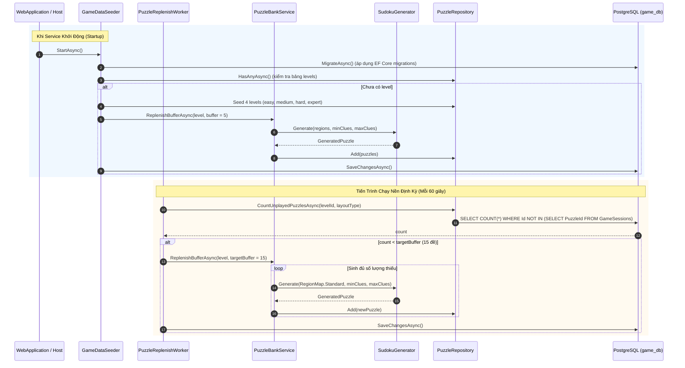
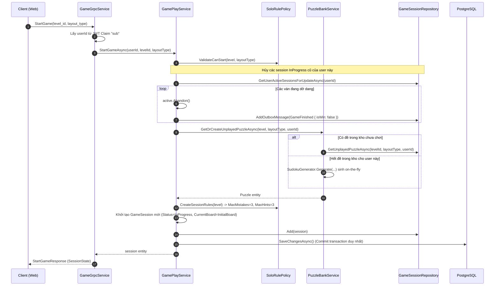
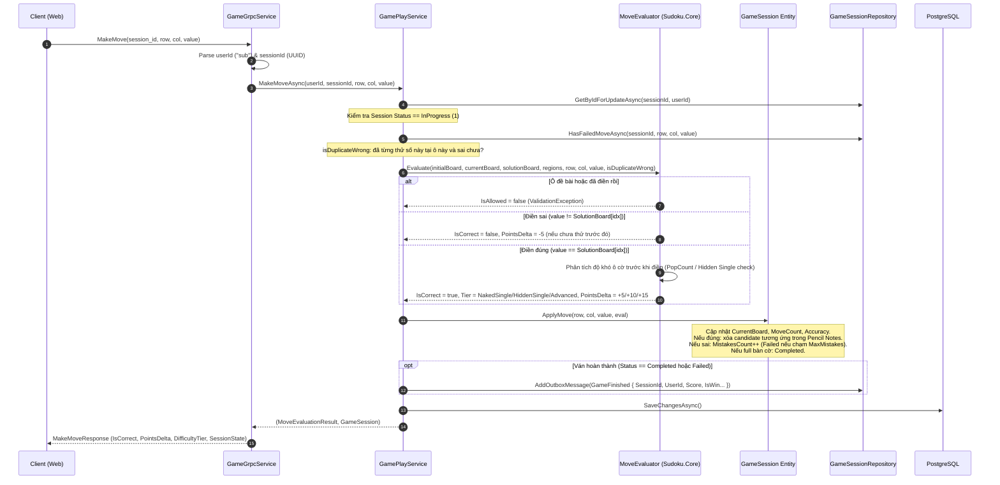

# Game Service — Tài liệu Flow Code & Kiến trúc Thực thi

Tài liệu này mô tả chi tiết luồng xử lý code (**Code Execution Flow**) của service Game (`Game.Api`) và bộ thư viện giải thuật Sudoku lõi (`Sudoku.Core`) trong dự án Sudoku Online Platform.

---

## 1. Bản đồ kiến trúc & Phân công trách nhiệm

```
┌────────────────────────────────────────────────────────┐
│  Client (Web Browser / Envoy Gateway :8080)            │
└───────────────────────────┬────────────────────────────┘
                            │ gRPC / Protobuf (proto/sudoku/game/v1/game.proto)
┌───────────────────────────▼────────────────────────────┐
│  Game.Api (:5101)                                      │
│  ├── Grpc/GameGrpcService.cs                           │ -> Entrypoint gRPC, xác thực Firebase JWT claim "sub"
│  ├── Domain/Services/GamePlayService.cs                │ -> Orchestrator điều phối toàn bộ vòng đời ván chơi
│  ├── Domain/Services/PuzzleBankService.cs              │ -> Cấp phát & sinh đề cho người chơi
│  ├── Domain/Services/SoloRulePolicy.cs                 │ -> Quản lý luật chơi Classic Solo
│  ├── Messaging/PuzzleReplenishWorker.cs                │ -> Chạy nền (60s) bù đệm đề chưa chơi vào kho
│  ├── Messaging/GameDataSeeder.cs                       │ -> Migrate DB & Seed level, đề khởi đầu lúc startup
│  └── Data/ (GameDbContext, Repositories, UnitOfWork)   │ -> PostgreSQL (game_db), EF Core, Outbox Pattern
└───────────────────────────┬────────────────────────────┘
                            │ Gọi in-memory
┌───────────────────────────▼────────────────────────────┐
│  building-block/Sudoku.Core (Pure Algorithmic Engine)  │
│  ├── SudokuBoard.cs        -> Biểu diễn bàn cờ 81 ô, bitmask ứng viên
│  ├── SudokuGenerator.cs    -> Thuật toán sinh đề duy nhất nghiệm
│  ├── SudokuSolver.cs       -> Bộ giải & đếm số nghiệm (Backtracking + Mask)
│  ├── MoveEvaluator.cs      -> Chấm điểm nước đi, xếp hạng Naked/Hidden Single
│  └── HintFinder.cs         -> Tìm gợi ý thông minh (Naked/Hidden Single)
└────────────────────────────────────────────────────────┘
```

---

## 2. Các luồng xử lý chi tiết (Detailed Code Flows)

### Flow 1: Khởi động & Quản lý kho đề (Data Seeding & Puzzle Replenish Worker)

Nhằm đảm bảo người chơi bắt đầu ván mới tức thì mà không phải chịu độ trễ sinh đề (thuật toán đào lỗ kiểm tra duy nhất nghiệm tốn 200–800ms), hệ thống áp dụng cơ chế **Puzzle Bank Buffer**:



- **File code liên quan**:
  - `services/Game/Game.Api/Messaging/GameDataSeeder.cs`
  - `services/Game/Game.Api/Messaging/PuzzleReplenishWorker.cs`
  - `services/Game/Game.Api/Domain/Services/PuzzleBankService.cs`
  - `building-block/Sudoku.Core/SudokuGenerator.cs`

---

### Flow 2: Bắt đầu ván chơi (`StartGame`)

- **gRPC RPC**: `StartGame(StartGameRequest) returns (StartGameResponse)`
- **Xác thực**: JWT Token từ Firebase, lấy `sub` làm `userId`.



- **File code liên quan**:
  - `services/Game/Game.Api/Grpc/GameGrpcService.cs` (Method `StartGame`)
  - `services/Game/Game.Api/Domain/Services/GamePlayService.cs` (Method `StartGameAsync`)
  - `services/Game/Game.Api/Domain/Services/SoloRulePolicy.cs`

---

### Flow 3: Thực hiện một nước đi (`MakeMove`)

- **gRPC RPC**: `MakeMove(MakeMoveRequest) returns (MakeMoveResponse)`



- **File code liên quan**:
  - `building-block/Sudoku.Core/MoveEvaluator.cs`
  - `services/Game/Game.Api/Domain/Entities/GameSession.cs` (Method `ApplyMove`, `CleanNotesForPlacedDigit`)
  - `services/Game/Game.Api/Domain/Services/GamePlayService.cs` (Method `MakeMoveAsync`)

---

### Flow 4: Sử dụng gợi ý thông minh (`UseHint`)

- **gRPC RPC**: `UseHint(UseHintRequest) returns (UseHintResponse)`
- **Quy tắc**: Người chơi bị giới hạn bởi `MaxHints` (mặc định 3).

```mermaid
flowchart TD
    Req([Client gọi UseHint]) --> Auth[Lấy userId từ JWT & nạp GameSession]
    Auth --> Valid{Session InProgress &<br/>HintsUsed < MaxHints?}
    Valid -- Không --> ThrowErr[Ném InvalidStateException]
    Valid -- Hợp lệ --> HasTarget{Client có truyền<br/>TargetRow, TargetCol?}

    HasTarget -- Có --> CheckCell[HintFinder: Kiểm tra Naked Single / Hidden Single tại ô đó.<br/>Nếu phức tạp: DirectReveal giá trị từ SolutionBoard]
    HasTarget -- Không --> ScanBoard[HintFinder: Quét toàn bàn cờ tìm nước đi dễ nhất:<br/>1. Naked Single (ô chỉ còn 1 ứng viên)<br/>2. Hidden Single Row/Col/Region]

    CheckCell --> Apply[session.ApplyHint: Điền số vào CurrentBoard,<br/>HintsUsed++, xóa candidate ở các Pencil Notes xung quanh]
    ScanBoard --> Apply

    Apply --> WinCheck{Bàn cờ đã đầy chưa?}
    WinCheck -- Đầy --> WinEvent[Chuyển Status = Completed<br/>Ghi Outbox Event GameFinished(isWin=true)]
    WinCheck -- Chưa đầy --> SaveDB[IUnitOfWork.SaveChangesAsync]
    WinEvent --> SaveDB
    SaveDB --> Resp([Trả về UseHintResponse:<br/>Row, Col, Value, Technique, HighlightCells, SessionState])
```

- **File code liên quan**:
  - `building-block/Sudoku.Core/HintFinder.cs`
  - `services/Game/Game.Api/Domain/Services/GamePlayService.cs` (Method `UseHintAsync`)

---

### Flow 5: Lưu ghi chú bút chì (`SaveNotes`)

- **gRPC RPC**: `SaveNotes(SaveNotesRequest) returns (SaveNotesResponse)`
- **Cấu trúc dữ liệu**:
  - Client gửi lên mảng `CellNote { cell_index, candidates_mask }`.
  - `cell_index` chạy từ `0` đến `80`.
  - `candidates_mask` là bitmask 9 bit đại diện cho các số nháp từ 1..9 (`bit 0` = số 1, `bit 8` = số 9).
  - Server serialize thành JSON string: `{"0": 18, "4": 64}` lưu vào cột `notes_json` của bảng `game_sessions`.
  - **Tự động dọn dẹp nháp**: Bất cứ khi nào một nước đi đúng (`MakeMove`) hoặc gợi ý (`UseHint`) điền một số vào ô $C$, hàm `CleanNotesForPlacedDigit` sẽ tự động xóa bit của số đó khỏi nháp của tất cả các ô nằm cùng hàng, cột và vùng 3x3 với ô $C$.

---

### Flow 6: Từ bỏ ván (`AbandonGame`) & Xem bảng xếp hạng (`GetHighScores`)

1. **Từ bỏ ván (`AbandonGame`)**:
   - Chuyển `Status = 4` (`Abandoned`).
   - Ghi Outbox event `GameFinished(isWin = false)` để hệ thống khác (User, Mission) cập nhật chỉ số ván đấu.
   - Commit DB và trả về trạng thái ván.
2. **Xem danh sách độ khó (`ListLevels`)**:
   - Query các record có `is_active = true` trong bảng `levels`, sắp xếp theo `sort_order`. Trả về số clues, max mistakes, max hints.
3. **Xem bảng xếp hạng (`GetHighScores`)**:
   - Query bảng `game_sessions` với điều kiện: `level_id == request.LevelId`, `layout_type == request.LayoutType`, `status == 2` (Completed).
   - Sắp xếp: `Score DESC, ElapsedMs ASC`.
   - Giới hạn: `Take(limit)`.

---

## 3. Kiến trúc Đảm bảo Tính Toàn vẹn (Integrity & Concurrency)

### Optimistic Concurrency Control (Chống race condition nước đi)
- Entity `GameSession` ánh xạ trường `Version` với system column `xmin` của PostgreSQL:
  ```csharp
  builder.Property(s => s.Version)
         .IsRowVersion();
  ```
- Khi hai request `MakeMove` hoặc `UseHint` gửi lên đồng thời, transaction nào commit sau sẽ gặp `DbUpdateConcurrencyException`, ngăn chặn việc ghi đè trạng thái sai lệch.

### Transactional Outbox Pattern (Đảm bảo gửi event liên service)
- Khi một ván game kết thúc (thắng, thua, từ bỏ), `GamePlayService` **không** bắn trực tiếp message vào Kafka trong luồng request HTTP/gRPC.
- Thay vào đó, một bản ghi `OutboxMessage` chứa protobuf byte payload của event `GameFinished` được thêm vào cùng DbContext:
  ```csharp
  _sessionRepo.AddOutboxMessage(new OutboxMessage
  {
      Id = Guid.NewGuid(),
      EventId = Guid.NewGuid().ToString(),
      Type = nameof(GameFinished),
      UserId = session.UserId,
      Topic = "sudoku.events",
      Payload = evt.ToByteArray(),
      CreatedAt = DateTime.UtcNow
  });
  ```
- Cả trạng thái ván chơi và event đều được commit trong cùng 1 database transaction duy nhất qua `IUnitOfWork.SaveChangesAsync()`. Đảm bảo tính nhất quán dữ liệu tuyệt đối (At-least-once delivery).

---

## 4. Bảng Schema Cơ sở Dữ liệu (`game_db`)

| Tên bảng | Chức năng | Các cột chính |
| :--- | :--- | :--- |
| `levels` | Cấu hình các độ khó của game | `level_id`, `name`, `sort_order`, `min_clues`, `max_clues`, `max_mistakes`, `max_hints`, `is_active` |
| `puzzles` | Kho đề Sudoku được sinh trước | `id`, `level_id`, `layout_type`, `initial_board`, `solution_board`, `region_map`, `clue_count`, `puzzle_hash` |
| `game_sessions` | Phiên chơi đơn của người dùng | `id`, `user_id`, `puzzle_id`, `level_id`, `status`, `current_board`, `notes_json`, `mistakes_count`, `hints_used`, `score`, `accuracy`, `elapsed_ms`, `xmin` |
| `game_moves` | Lịch sử từng nước đi trong ván | `id`, `session_id`, `move_index`, `row`, `col`, `value`, `is_correct`, `tier`, `points_delta`, `created_at` |
| `outbox_messages` | Lưu sự kiện chờ đẩy lên Kafka | `id`, `event_id`, `type`, `user_id`, `topic`, `payload`, `created_at`, `processed_at` |
