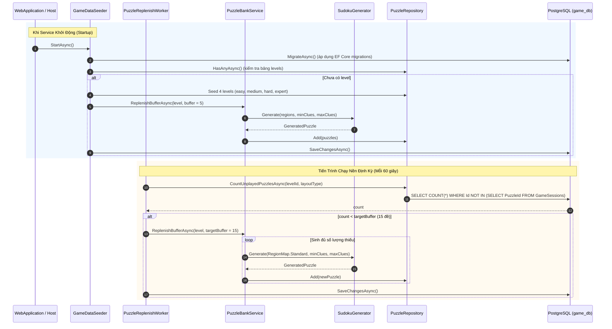
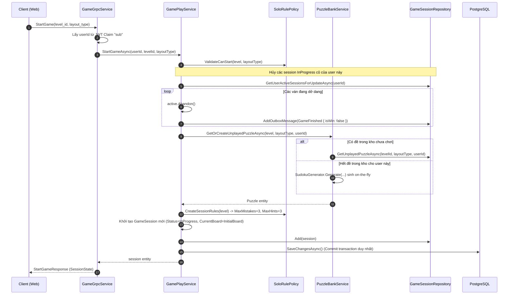

# Game Service — Tài liệu Flow Code & Kiến trúc Thực thi

Tài liệu này mô tả chi tiết luồng xử lý code (**Code Execution Flow**) của service Game (`Game.Api`) và bộ thư viện giải thuật Sudoku lõi (`Sudoku.Core`) trong dự án Sudoku Online Platform.

---

## 1. Bản đồ kiến trúc & Phân công trách nhiệm

```
┌────────────────────────────────────────────────────────┐
│  Client (Web Browser / Envoy Gateway :8080)            │
└───────────────────────────┬────────────────────────────┘
                            │ gRPC / Protobuf (proto/sudoku/game/v1/game.proto)
┌───────────────────────────▼────────────────────────────┐
│  Game.Api (:5101)                                      │
│  ├── Grpc/GameGrpcService.cs                           │ -> Entrypoint gRPC, xác thực Firebase JWT claim "sub"
│  ├── Domain/Services/GamePlayService.cs                │ -> Orchestrator điều phối toàn bộ vòng đời ván chơi
│  ├── Domain/Services/PuzzleBankService.cs              │ -> Cấp phát & sinh đề cho người chơi
│  ├── Domain/Services/SoloRulePolicy.cs                 │ -> Quản lý luật chơi Classic Solo
│  ├── Messaging/PuzzleReplenishWorker.cs                │ -> Chạy nền (60s) bù đệm đề chưa chơi vào kho
│  ├── Messaging/GameDataSeeder.cs                       │ -> Migrate DB & Seed level, đề khởi đầu lúc startup
│  └── Data/ (GameDbContext, Repositories, UnitOfWork)   │ -> PostgreSQL (game_db), EF Core, Outbox Pattern
└───────────────────────────┬────────────────────────────┘
                            │ Gọi in-memory
┌───────────────────────────▼────────────────────────────┐
│  building-block/Sudoku.Core (Pure Algorithmic Engine)  │
│  ├── SudokuBoard.cs        -> Biểu diễn bàn cờ 81 ô, bitmask ứng viên
│  ├── SudokuGenerator.cs    -> Thuật toán sinh đề duy nhất nghiệm
│  ├── SudokuSolver.cs       -> Bộ giải & đếm số nghiệm (Backtracking + Mask)
│  ├── MoveEvaluator.cs      -> Chấm điểm nước đi, xếp hạng Naked/Hidden Single
│  └── HintFinder.cs         -> Tìm gợi ý thông minh (Naked/Hidden Single)
└────────────────────────────────────────────────────────┘
```

---

## 2. Các luồng xử lý chi tiết (Detailed Code Flows)

### Flow 1: Khởi động & Quản lý kho đề (Data Seeding & Puzzle Replenish Worker)

Nhằm đảm bảo người chơi bắt đầu ván mới tức thì mà không phải chịu độ trễ sinh đề (thuật toán đào lỗ kiểm tra duy nhất nghiệm tốn 200–800ms), hệ thống áp dụng cơ chế **Puzzle Bank Buffer**:



#### Mô tả chi tiết bằng text (Flow 1)

1. **Giai đoạn khởi động dịch vụ (`GameDataSeeder`)**:
   - Khi container/service `Game.Api` khởi động, `GameDataSeeder` (kế thừa `IHostedService`) được kích hoạt trước khi mở cổng nhận request.
   - Seeder gọi `db.Database.MigrateAsync()` để tự động áp dụng các migration EF Core vào cơ sở dữ liệu `game_db`.
   - Kiểm tra xem bảng `levels` đã có dữ liệu chưa qua `levelRepo.HasAnyAsync()`:
     - **Nếu chưa có**: Tiến hành nạp 4 cấp độ chuẩn gồm: `easy` (38–42 clues), `medium` (32–36 clues), `hard` (28–31 clues), `expert` (24–27 clues). Tất cả đều mặc định giới hạn 3 mạng (`MaxMistakes = 3`) và 3 gợi ý (`MaxHints = 3`).
     - Ngay sau đó, seeder gọi `puzzleBank.ReplenishBufferAsync()` để tạo sẵn 5 đề cho mỗi cấp độ, lưu vào bảng `puzzles` giúp người chơi đầu tiên có thể bắt đầu chơi ngay lập tức mà không gặp bất kỳ độ trễ nào.

2. **Giai đoạn chạy nền định kỳ (`PuzzleReplenishWorker`)**:
   - `PuzzleReplenishWorker` kế thừa `BackgroundService`, khởi chạy sau 10 giây tính từ lúc app bật và lặp lại vòng lặp kiểm tra mỗi **60 giây**.
   - Trong mỗi chu kỳ:
     - Tạo một `IServiceScope` mới để lấy các dependency có vòng đời Scoped (`ILevelRepository`, `IPuzzleBankService`, `IUnitOfWork`).
     - Lấy danh sách toàn bộ các level đang hoạt động (`IsActive == true`).
     - Với mỗi level, đếm số lượng đề còn nguyên vẹn trong kho chưa từng được người chơi nào chơi (truy vấn đếm các bản ghi trong `puzzles` mà `id` không nằm trong cột `puzzle_id` của bảng `game_sessions`).
     - Nếu số lượng đề khả dụng nhỏ hơn mục tiêu đệm (`targetBuffer = 15`), tiến trình sẽ tính toán số đề còn thiếu và gọi `SudokuGenerator.Generate()` để sinh bù cho đủ.
     - Sau khi thêm các đề mới vào `IPuzzleRepository`, gọi `IUnitOfWork.SaveChangesAsync()` để commit toàn bộ vào cơ sở dữ liệu.

3. **Thuật toán sinh đề (`SudokuGenerator`)**:
   - **Bước 1**: Khởi tạo một mảng 81 ô trống và dùng thuật toán Backtracking ngẫu nhiên (`GenerateFullBoard`) để điền hoàn chỉnh 81 ô số hợp lệ (thỏa mãn quy tắc hàng, cột, vùng 3x3).
   - **Bước 2**: Xáo trộn danh sách 81 vị trí chỉ số (`0..80`) bằng `Random.Shared.Shuffle`.
   - **Bước 3**: Lần lượt thử xóa (đào lỗ) từng ô trong danh sách xáo trộn về ký tự `.`.
   - **Bước 4**: Sau mỗi lần đào một ô, gọi `SudokuSolver.CountSolutions(puzzle, limit: 2)` để giải thử:
     - Nếu số nghiệm tìm được đúng bằng `1`: Ô đó đào thành công, giảm số lượng clue hiện tại đi 1.
     - Nếu số nghiệm $\ge 2$ (mất tính duy nhất): Khôi phục lại chữ số ban đầu vào ô đó (không được đào).
   - **Bước 5**: Dừng lại ngay khi số clue còn lại chạm đến ngưỡng mục tiêu ngẫu nhiên nằm trong khoảng `[minClues, maxClues]` của level đó. Băm SHA-256 chuỗi đề để tạo `puzzle_hash` phục vụ chống trùng lặp.

- **File code liên quan**:
  - `services/Game/Game.Api/Messaging/GameDataSeeder.cs`
  - `services/Game/Game.Api/Messaging/PuzzleReplenishWorker.cs`
  - `services/Game/Game.Api/Domain/Services/PuzzleBankService.cs`
  - `building-block/Sudoku.Core/SudokuGenerator.cs`

---

### Flow 2: Bắt đầu ván chơi (`StartGame`)

- **gRPC RPC**: `StartGame(StartGameRequest) returns (StartGameResponse)`
- **Xác thực**: JWT Token từ Firebase, lấy `sub` làm `userId`.


#### Mô tả chi tiết bằng text (Flow 2)

1. **Tiếp nhận & Xác thực request**:
   - Client gửi `StartGameRequest` kèm `level_id` (ví dụ: `"easy"`, `"medium"`) và `layout_type` (chuẩn Standard 9x9 = 1).
   - `GameGrpcService.StartGame` trích xuất `sub` từ HttpContext ClaimsPrincipal (Firebase UID). Nếu claim rỗng hoặc thiếu, ném `RpcException(StatusCode.Unauthenticated)`.
2. **Kiểm tra hợp lệ & Dọn dẹp phiên chơi cũ**:
   - `GamePlayService.StartGameAsync` kiểm tra sự tồn tại của `Level`.
   - `_rulePolicy.ValidateCanStart(level, layout)` kiểm tra cấp độ có đang hoạt động không (`IsActive`), và layout có được hỗ trợ không (giai đoạn hiện tại hỗ trợ Standard).
   - Truy vấn tất cả session của người chơi này đang có trạng thái `InProgress (1)` (`GetUserActiveSessionsForUpdateAsync`):
     - Với mỗi ván dở dang, gọi `active.Abandon()` đổi trạng thái sang `Abandoned (4)`.
     - Tạo sự kiện `GameFinished` với `isWin = false` đưa vào Outbox để các service khác xử lý (tính ván thua, trừ chuỗi thắng, v.v.).
3. **Cấp phát đề chơi (`PuzzleBankService`)**:
   - Gọi `_puzzleBank.GetOrCreateUnplayedPuzzleAsync(level, layoutType, userId)`:
     - Trước hết tìm trong bảng `puzzles` một đề có độ khó tương ứng mà `userId` này chưa từng chơi (`GetUnplayedPuzzleAsync`).
     - Nếu kho đề tạm hết đề mới cho user này, hệ thống tự động gọi `SudokuGenerator.Generate()` để sinh ngay một đề mới on-the-fly và nạp vào DB.
4. **Khởi tạo GameSession**:
   - Tạo thực thể `GameSession` mới:
     - `Id = Guid.NewGuid()`
     - `Status = 1 (InProgress)`
     - `CurrentBoard = puzzle.InitialBoard` (chuỗi 81 ký tự)
     - `RulesJson`: serialize từ `_rulePolicy.CreateSessionRules(level)` (MaxMistakes = 3, MaxHints = 3)
     - Khởi tạo các bộ đếm `MistakesCount = 0`, `HintsUsed = 0`, `Score = 0`, `Accuracy = 0.0`.
5. **Lưu trữ nguyên tử & Phản hồi**:
   - Thêm `session` vào DbContext và gọi `_uow.SaveChangesAsync(ct)` để thực hiện tất cả thay đổi (hủy ván cũ, tạo ván mới, outbox) trong một transaction DB duy nhất.
   - Map `GameSession` sang `SessionState` của Protobuf và trả về `StartGameResponse` cho client.

- **File code liên quan**:
  - `services/Game/Game.Api/Grpc/GameGrpcService.cs` (Method `StartGame`)
  - `services/Game/Game.Api/Domain/Services/GamePlayService.cs` (Method `StartGameAsync`)
  - `services/Game/Game.Api/Domain/Services/SoloRulePolicy.cs`
---

### Flow 3: Thực hiện một nước đi (`MakeMove`)

- **gRPC RPC**: `MakeMove(MakeMoveRequest) returns (MakeMoveResponse)`


#### Mô tả chi tiết bằng text (Flow 3)

1. **Tiếp nhận & Khóa bản ghi (Locking)**:
   - Client gửi `MakeMoveRequest(session_id, row, col, value)`.
   - `GamePlayService.MakeMoveAsync` gọi `_sessionRepo.GetByIdForUpdateAsync(sessionId, userId)` để nạp session cùng relation `Puzzle`.
   - Kiểm tra `session.Status == 1 (InProgress)`. Nếu ván đã kết thúc hoặc bị hủy, ném `InvalidStateException`.
2. **Kiểm tra nước đi lặp đã từng sai trước đó**:
   - Gọi `HasFailedMoveAsync` kiểm tra trong bảng `game_moves` xem người chơi đã từng điền số `value` này vào ô `(row, col)` chưa.
   - Biến cờ `isDuplicateWrong` này giúp người chơi không bị phạt trừ điểm thêm lần thứ 2 và không bị mất thêm mạng nếu vô tình bấm lại số sai cũ.
3. **Đánh giá logic nước đi (`MoveEvaluator.Evaluate`)**:
   - **Ràng buộc đầu vào**: Tọa độ `0 <= row, col <= 8`, giá trị `1 <= value <= 9`.
   - **Ràng buộc ô cố định**: Nếu ô đó thuộc `InitialBoard` (ô đề cho ban đầu), từ chối không cho sửa.
   - **Ràng buộc ô đã giải**: Nếu ô đó trong `CurrentBoard` đã được điền đúng trước đó, từ chối không cho ghi đè.
   - **So sánh nghiệm**: Lấy ký tự tại `idx = row * 9 + col` của `puzzle.SolutionBoard`:
     - **Nếu sai (`valueChar != expectedChar`)**:
       - `IsCorrect = false`.
       - Nếu `isDuplicateWrong == false`: Phạt trừ điểm (`PointsDelta = -5`). Nếu đã từng sai trước đó: `PointsDelta = 0`.
     - **Nếu đúng (`valueChar == expectedChar`)**:
       - `IsCorrect = true`.
       - Phân tích độ khó kỹ thuật của ô cờ **ngay trước khi điền số**:
         - Đếm số ứng viên khả dĩ của ô đó (`PopCount(candidatesMask)`). Nếu chỉ có 1 ứng viên duy nhất $\rightarrow$ **Naked Single** (+5 điểm).
         - Kiểm tra xem trong hàng, cột hoặc vùng 3x3 chứa ô đó, chữ số `value` có phải chỉ có thể nằm duy nhất ở ô này không $\rightarrow$ **Hidden Single** (+10 điểm).
         - Nếu không thuộc 2 trường hợp cơ bản trên $\rightarrow$ **Advanced** ($+8 \times \text{số ứng viên}$ điểm).
4. **Cập nhật thực thể GameSession (`session.ApplyMove`)**:
   - Tăng tổng số nước đi: `MoveCount++`.
   - Ghi lại bản ghi `GameMove` vào danh sách `Moves`.
   - **Xử lý khi sai**:
     - Tăng `MistakesCount++`.
     - Nếu `MistakesCount >= MaxMistakes (3)`: Đổi `Status = 3 (Failed)`, cập nhật `FinishedAt = UtcNow`.
   - **Xử lý khi đúng**:
     - Tăng `CorrectMoveCount++`.
     - Ghi nhận điểm số: `Score += pointsDelta`.
     - Điền số vào `CurrentBoard` tại vị trí `idx`.
     - **Tự động làm sạch nháp**: Gọi `CleanNotesForPlacedDigit(idx, value)` để xóa candidate `value` khỏi tất cả các ô nháp nằm cùng hàng, cột và khối 3x3.
     - Kiểm tra nếu `CurrentBoard` không còn ký tự trống `.` $\rightarrow$ Đổi `Status = 2 (Completed)`, cập nhật `FinishedAt = UtcNow`.
   - Tính toán lại độ chính xác: `Accuracy = (double)CorrectMoveCount / MoveCount`.
5. **Ghi sự kiện Outbox (Transactional Outbox)**:
   - Nếu `Status` chuyển thành `Completed` (thắng) hoặc `Failed` (thua), tạo event protobuf `GameFinished` chứa: `SessionId`, `UserId`, `Difficulty`, `Score`, `ElapsedMs`, `IsWin`, `RewardCoins` (nếu thắng: `Score / 10`), `MistakesCount`, `HintsUsed`.
   - Lưu event vào bảng `outbox_messages` trong cùng context.
6. **Commit DB & Trả kết quả**:
   - Gọi `SaveChangesAsync` commit toàn bộ thay đổi.
   - Trả về `MakeMoveResponse` chứa `IsCorrect`, `IsDuplicateWrong`, `PointsDelta`, `DifficultyTier` và `SessionState` mới nhất.

- **File code liên quan**:
  - `building-block/Sudoku.Core/MoveEvaluator.cs`
  - `services/Game/Game.Api/Domain/Entities/GameSession.cs` (Method `ApplyMove`, `CleanNotesForPlacedDigit`)
  - `services/Game/Game.Api/Domain/Services/GamePlayService.cs` (Method `MakeMoveAsync`)
---

### Flow 4: Sử dụng gợi ý thông minh (`UseHint`)

- **gRPC RPC**: `UseHint(UseHintRequest) returns (UseHintResponse)`
- **Quy tắc**: Người chơi bị giới hạn bởi `MaxHints` (mặc định 3).

```mermaid
flowchart TD
    Req([Client gọi UseHint]) --> Auth[Lấy userId từ JWT & nạp GameSession]
    Auth --> Valid{Session InProgress &<br/>HintsUsed < MaxHints?}
    Valid -- Không --> ThrowErr[Ném InvalidStateException]
    Valid -- Hợp lệ --> HasTarget{Client có truyền<br/>TargetRow, TargetCol?}

    HasTarget -- Có --> CheckCell[HintFinder: Kiểm tra Naked Single / Hidden Single tại ô đó.<br/>Nếu phức tạp: DirectReveal giá trị từ SolutionBoard]
    HasTarget -- Không --> ScanBoard[HintFinder: Quét toàn bàn cờ tìm nước đi dễ nhất:<br/>1. Naked Single (ô chỉ còn 1 ứng viên)<br/>2. Hidden Single Row/Col/Region]

    CheckCell --> Apply[session.ApplyHint: Điền số vào CurrentBoard,<br/>HintsUsed++, xóa candidate ở các Pencil Notes xung quanh]
    ScanBoard --> Apply

    Apply --> WinCheck{Bàn cờ đã đầy chưa?}
    WinCheck -- Đầy --> WinEvent[Chuyển Status = Completed<br/>Ghi Outbox Event GameFinished(isWin=true)]
    WinCheck -- Chưa đầy --> SaveDB[IUnitOfWork.SaveChangesAsync]
    WinEvent --> SaveDB
    SaveDB --> Resp([Trả về UseHintResponse:<br/>Row, Col, Value, Technique, HighlightCells, SessionState])
```
#### Mô tả chi tiết bằng text (Flow 4)

1. **Tiếp nhận & Kiểm tra điều kiện gợi ý**:
   - Client gửi `UseHintRequest(session_id, [target_row], [target_col])`.
   - `GamePlayService.UseHintAsync` nạp session và kiểm tra:
     - `session.Status == 1 (InProgress)`.
     - `session.HintsUsed < rules.MaxHints` (mặc định tối đa 3 lần). Nếu đã hết lượt gợi ý, ném `InvalidStateException("No hints remaining")`.
2. **Thuật toán tìm kiếm gợi ý (`HintFinder.FindHint`)**:
   - Khởi tạo đối tượng `SudokuBoard` từ `CurrentBoard` để tính toán bitmask ứng viên cho toàn bộ 81 ô.
   - **Trường hợp 1: Người chơi chỉ định ô cần gợi ý (`targetRow`, `targetCol`)**:
     - Kiểm tra xem ô đó có thể giải được bằng kỹ thuật **Naked Single** (ô chỉ có 1 ứng viên khả dĩ) không.
     - Nếu không, kiểm tra xem ô đó có thể giải bằng **Hidden Single** (số chỉ xuất hiện ở ô đó trong hàng/cột/khối) không.
     - Nếu là nước đi nâng cao/phức tạp: Áp dụng kỹ thuật **DirectReveal** (lấy thẳng kết quả đúng từ `SolutionBoard`).
   - **Trường hợp 2: Người chơi không chỉ định ô (tìm gợi ý tốt nhất toàn bàn cờ)**:
     - Quét toàn bộ bàn cờ tìm ô có kỹ thuật cơ bản nhất:
       1. Tìm ô **Naked Single** đầu tiên gặp được.
       2. Nếu không có Naked Single, quét tìm **Hidden Single** theo thứ tự: hàng (Row) $\rightarrow$ cột (Col) $\rightarrow$ khối (Region).
   - Kết quả trả về gồm: tọa độ `(Row, Col)`, giá trị đúng `Value`, kỹ thuật giải `Technique`, và danh sách các ô liên quan `HighlightCells` (ví dụ toàn bộ hàng/cột/khối liên quan để UI tô màu hướng dẫn người chơi).
3. **Áp dụng gợi ý vào ván đấu (`session.ApplyHint`)**:
   - Tăng số lần dùng gợi ý: `HintsUsed++`.
   - Điền số đúng vào `CurrentBoard` tại vị trí ô được gợi ý.
   - Tự động xóa candidate của số vừa điền khỏi nháp bút chì của các ô cùng hàng/cột/vùng.
   - Kiểm tra nếu nước điền này làm đầy bàn cờ: Chuyển `Status = 2 (Completed)`, tính `FinishedAt` và ghi Outbox event `GameFinished(isWin = true)`.
4. **Commit DB & Trả kết quả**:
   - Gọi `SaveChangesAsync()` lưu trạng thái session và outbox event.
   - Trả về `UseHintResponse` kèm thông tin tọa độ, giá trị, kỹ thuật, mảng ô cần highlight và `SessionState` mới.

- **File code liên quan**:
  - `building-block/Sudoku.Core/HintFinder.cs`
  - `services/Game/Game.Api/Domain/Services/GamePlayService.cs` (Method `UseHintAsync`)

---

### Flow 5: Lưu ghi chú bút chì (`SaveNotes`)

- **gRPC RPC**: `SaveNotes(SaveNotesRequest) returns (SaveNotesResponse)`

#### Mô tả chi tiết bằng text (Flow 5)

1. **Mục đích & Nguyên lý hoạt động**:
   - Phục vụ tính năng ghi chú bút chì (Pencil Notes) cho phép người chơi đánh dấu các số có khả năng xuất hiện trong một ô trống trước khi chốt nước đi chính thức.
   - Ghi chú này chỉ mang tính chất hỗ trợ người chơi, không tính là nước đi chính thức, không làm mất mạng và không bị trừ điểm.
2. **Cơ chế mã hóa Bitmask 9-bit**:
   - Mỗi ô ghi chú được biểu diễn bằng một số nguyên 16-bit (`ushort`):
     - `bit 0` bật $\rightarrow$ ứng viên số 1
     - `bit 1` bật $\rightarrow$ ứng viên số 2
     - ...
     - `bit 8` bật $\rightarrow$ ứng viên số 9
     - Ví dụ: Một ô ghi chú ứng viên 2 và 7 sẽ có mask $= 2^1 + 2^6 = 2 + 64 = 66$.
3. **Xử lý lưu trữ**:
   - Client gửi `SaveNotesRequest` chứa danh sách `CellNote { cell_index, candidates_mask }`.
   - Server lọc các `cell_index` hợp lệ (`0..80`), chuyển thành từ điển `Dictionary<string, int>` và tuần tự hóa thành chuỗi JSON: `{"12": 66, "45": 2}`.
   - Lưu chuỗi JSON này vào cột `notes_json` của bảng `game_sessions` và commit DB qua `SaveChangesAsync`.
4. **Cơ chế tự động dọn dẹp nháp thông minh (`CleanNotesForPlacedDigit`)**:
   - Bất cứ khi nào một ô được điền số đúng (thông qua `MakeMove` hoặc `UseHint`), hàm `CleanNotesForPlacedDigit` sẽ giải mã `notes_json`, xác định tất cả các ô lân cận (cùng hàng, cùng cột, cùng khối 3x3) và thực hiện phép toán bit `mask &= ~(1 << (digit - 1))` để tự động xóa ứng viên đó, sau đó cập nhật lại JSON.

- **File code liên quan**:
  - `services/Game/Game.Api/Domain/Entities/GameSession.cs` (Method `UpdateNotes`, `CleanNotesForPlacedDigit`)
  - `services/Game/Game.Api/Domain/Services/GamePlayService.cs` (Method `SaveNotesAsync`)

---

### Flow 6: Từ bỏ ván (`AbandonGame`) & Xem bảng xếp hạng (`GetHighScores`)

#### Mô tả chi tiết bằng text (Flow 6)

1. **Từ bỏ ván chơi (`AbandonGame`)**:
   - **gRPC RPC**: `AbandonGame(AbandonGameRequest) returns (AbandonGameResponse)`
   - **Đầu vào**: `AbandonGameRequest(session_id)`.
   - **Xử lý**:
     - Nạp `GameSession` theo `sessionId` và `userId` (được xác thực từ token).
     - Nếu ván đang ở trạng thái `InProgress (1)`:
       - Gọi `session.Abandon()` $\rightarrow$ chuyển `Status = 4 (Abandoned)`, ghi nhận thời điểm kết thúc `FinishedAt = UtcNow`.
       - Tạo event Outbox `GameFinished` với `IsWin = false` để thông báo cho toàn hệ sinh thái microservice ghi nhận ván đấu đã dừng lại (không cộng điểm/thưởng).
       - Lưu vào DB và phản hồi `AbandonGameResponse(SessionState)`.
2. **Lấy danh sách cấp độ (`ListLevels`)**:
   - **gRPC RPC**: `ListLevels(ListLevelsRequest) returns (ListLevelsResponse)`
   - **Xử lý**:
     - `LeaderboardService` truy vấn bảng `levels` với điều kiện `IsActive == true`, sắp xếp theo `SortOrder ASC`.
     - Sử dụng `.AsNoTracking()` để tối ưu hóa hiệu năng đọc.
     - Trả về `ListLevelsResponse` gồm danh sách `LevelInfo` (`LevelId`, `Name`, `MinClues`, `MaxClues`, `MaxMistakes`, `MaxHints`).
3. **Lấy bảng xếp hạng điểm cao (`GetHighScores`)**:
   - **gRPC RPC**: `GetHighScores(GetHighScoresRequest) returns (GetHighScoresResponse)`
   - **Đầu vào**: `GetHighScoresRequest(level_id, layout_type, limit)`.
   - **Xử lý**:
     - Chuẩn hóa layout: Nếu client gửi `LayoutType.Unspecified (0)` thì quy về `Standard (1)`.
     - Truy vấn bảng `game_sessions` với các điều kiện:
       - `LevelId == level_id`
       - `LayoutType == effectiveLayout`
       - `Status == 2 (Completed)` (chỉ các ván chiến thắng mới được tính điểm)
     - Sắp xếp ưu tiên: `Score DESC` (điểm cao xếp trước), sau đó đến `ElapsedMs ASC` (thời gian hoàn thành ít hơn xếp trước).
     - Áp dụng `.Take(limit)` để phân trang/giới hạn số bản ghi lấy ra (thường là top 10 đến top 50).
     - Gán thứ hạng tự tăng `Rank = 1, 2, 3...` và trả về `GetHighScoresResponse`.

- **File code liên quan**:
  - `services/Game/Game.Api/Domain/Services/LeaderboardService.cs`
  - `services/Game/Game.Api/Data/Repositories/GameSessionRepository.cs` (Method `GetHighScoresAsync`)
---

## 3. Kiến trúc Đảm bảo Tính Toàn vẹn (Integrity & Concurrency)

### Optimistic Concurrency Control (Chống race condition nước đi)
- Entity `GameSession` ánh xạ trường `Version` với system column `xmin` của PostgreSQL:
  ```csharp
  builder.Property(s => s.Version)
         .IsRowVersion();
  ```
- Khi hai request `MakeMove` hoặc `UseHint` gửi lên đồng thời, transaction nào commit sau sẽ gặp `DbUpdateConcurrencyException`, ngăn chặn việc ghi đè trạng thái sai lệch.

### Transactional Outbox Pattern (Đảm bảo gửi event liên service)
- Khi một ván game kết thúc (thắng, thua, từ bỏ), `GamePlayService` **không** bắn trực tiếp message vào Kafka trong luồng request HTTP/gRPC.
- Thay vào đó, một bản ghi `OutboxMessage` chứa protobuf byte payload của event `GameFinished` được thêm vào cùng DbContext:
  ```csharp
  _sessionRepo.AddOutboxMessage(new OutboxMessage
  {
      Id = Guid.NewGuid(),
      EventId = Guid.NewGuid().ToString(),
      Type = nameof(GameFinished),
      UserId = session.UserId,
      Topic = "sudoku.events",
      Payload = evt.ToByteArray(),
      CreatedAt = DateTime.UtcNow
  });
  ```
- Cả trạng thái ván chơi và event đều được commit trong cùng 1 database transaction duy nhất qua `IUnitOfWork.SaveChangesAsync()`. Đảm bảo tính nhất quán dữ liệu tuyệt đối (At-least-once delivery).

---

## 4. Bảng Schema Cơ sở Dữ liệu (`game_db`)

| Tên bảng | Chức năng | Các cột chính |
| :--- | :--- | :--- |
| `levels` | Cấu hình các độ khó của game | `level_id`, `name`, `sort_order`, `min_clues`, `max_clues`, `max_mistakes`, `max_hints`, `is_active` |
| `puzzles` | Kho đề Sudoku được sinh trước | `id`, `level_id`, `layout_type`, `initial_board`, `solution_board`, `region_map`, `clue_count`, `puzzle_hash` |
| `game_sessions` | Phiên chơi đơn của người dùng | `id`, `user_id`, `puzzle_id`, `level_id`, `status`, `current_board`, `notes_json`, `mistakes_count`, `hints_used`, `score`, `accuracy`, `elapsed_ms`, `xmin` |
| `game_moves` | Lịch sử từng nước đi trong ván | `id`, `session_id`, `move_index`, `row`, `col`, `value`, `is_correct`, `tier`, `points_delta`, `created_at` |
| `outbox_messages` | Lưu sự kiện chờ đẩy lên Kafka | `id`, `event_id`, `type`, `user_id`, `topic`, `payload`, `created_at`, `processed_at` |
