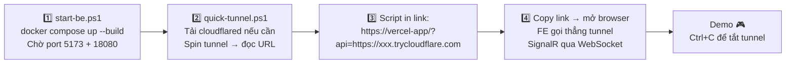
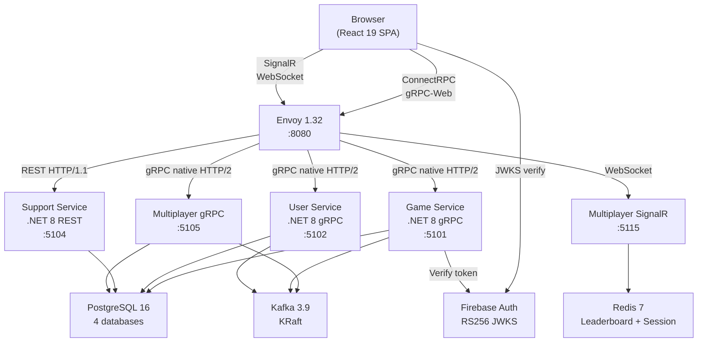

# Tech Stack — PRN_ASM Sudoku Platform

> Tài liệu này giải thích **lý do kỹ thuật** và **cách hoạt động thực tế** của từng công nghệ trong repo.
> Mọi đoạn code trích dẫn đều là code thật, không phải minh hoạ.
>
> 📍 Muốn biết từng đoạn cấu hình nằm ở **file nào, dòng nào** và luồng **Kafka publisher → consumer** chạy ra sao:
> xem [`TECH_STACK_ANNOTATED.md`](./TECH_STACK_ANNOTATED.md).

---

## Mục lục

1. [React 19 + TypeScript + Vite 8 + oxlint](#1-react-19--typescript--vite-8--oxlint)
2. [ConnectRPC v2 (connect-web)](#2-connectrpc-v2-connect-web)
3. [SignalR](#3-signalr)
4. [Envoy 1.32](#4-envoy-132)
5. [.NET 8 + Grpc.AspNetCore](#5-net-8--grpcaspnetcore)
6. [Protobuf + Buf](#6-protobuf--buf)
7. [EF Core 8 + Npgsql](#7-ef-core-8--npgsql)
8. [PostgreSQL 16](#8-postgresql-16)
9. [Kafka 3.9 (KRaft)](#9-kafka-39-kraft)
10. [Redis 7](#10-redis-7)
11. [Firebase Auth (JWT)](#11-firebase-auth-jwt)
12. [OpenTelemetry](#12-opentelemetry)
13. [Docker Compose](#13-docker-compose)
14. [Swagger (chỉ Support)](#14-swagger-chỉ-support)
15. [Deploy Scripts — start-be.ps1 & quick-tunnel.ps1](#15-deploy-scripts--start-beps1--quick-tunnelps1)

---

## 1. React 19 + TypeScript + Vite 8 + oxlint

### React 19

React 19 là phiên bản major đưa vào stable nhiều tính năng trước đó là experimental:

- **React Compiler (auto-memoization)**: Trình biên dịch phân tích dependency graph tĩnh và tự thêm memo, loại bỏ nhu cầu viết `useMemo`/`useCallback` thủ công. Với game Sudoku có nhiều re-render khi nhập số, đây là lợi ích thực chất.
- **Actions**: Form submit bất đồng bộ được tích hợp trực tiếp vào `<form action={...}>`, thay thế pattern `onSubmit + useState(pending)`.
- **`use()` hook**: Cho phép đọc Promise hoặc Context trong render function, bỏ qua các hook rule truyền thống.

Trong repo, `package.json` lock `react: ^19.2.8` và `react-dom: ^19.2.8`.

### TypeScript 6

```json
// clients/package.json (devDependencies)
"typescript": "~6.0.2"
```

TS 6 mang lại:
- **Isolated declarations**: Mỗi file `.d.ts` có thể sinh độc lập, song song hoá type checking, giảm thời gian build.
- **`erasableSyntaxOnly`**: Compiler chỉ xoá type annotation mà không cần transform runtime, phù hợp với Node 22+ native TypeScript strip.

Lý do quan trọng nhất chọn TypeScript ở đây: **Buf sinh type từ `.proto`**. Các message như `MoveResult`, `MatchStarted` được dùng nguyên si ở cả frontend lẫn backend, không cần viết DTO thêm, không sợ mismatch.

### Vite 8

```ts
// clients/vite.config.ts
import react from '@vitejs/plugin-react'
import { defineConfig } from 'vite'

export default defineConfig({
  plugins: [react()],
})
```

Config ngắn gọn vì Vite 8 mặc định đã handle:
- **ESM-first**: Không bundle trong dev, trình duyệt tải từng module qua native ESM — HMR gần như tức thì.
- **Rollup ở production**: Vite dùng Rollup để bundle production build, tree-shaking tốt, output nhỏ.
- **`@vitejs/plugin-react`**: Tích hợp Babel Fast Refresh để React component tự reload mà không mất state.

So với Webpack: Webpack cần bundle toàn bộ dependency graph trước khi có thể serve, Vite serve native ESM ngay → HMR latency từ vài giây xuống còn < 100ms.

### oxlint

```json
// package.json scripts
"lint": "oxlint"
```

oxlint viết bằng Rust (thông qua Oxc toolchain), nhanh hơn ESLint ~10–50× trên cùng ruleset vì:
1. **Parallelism**: Phân tích từng file song song trên thread pool Rayon.
2. **No plugin overhead**: Không có hệ plugin JavaScript nặng, rules được compile thẳng vào binary.
3. **Incremental**: Chỉ lint file đã thay đổi.

> [!NOTE]
> Luật repo (rule 12 `AGENTS.md`): **không sửa `src/gen/**`** vì đây là code sinh tự động từ proto — oxlint không lint các file trong `gen/`.

---

## 2. ConnectRPC v2 (connect-web)

### Vấn đề gRPC trên browser

Browser không hỗ trợ HTTP/2 raw (gRPC native) vì Fetch API và XMLHttpRequest không expose trailer headers cần thiết cho gRPC protocol. Có hai giải pháp:
- **gRPC-Web**: Protocol translation ở proxy (Envoy) — trailer được đặt vào body.
- **ConnectRPC**: Protocol tương thích hơn, hỗ trợ cả gRPC-Web lẫn Connect protocol riêng (JSON over HTTP/1.1 hoặc binary over HTTP/2).

Repo chọn **connect-web với gRPC-Web transport** để:
1. Dùng chung một `.proto` cho cả C# backend lẫn TypeScript frontend.
2. Envoy đã có filter `envoy.filters.http.grpc_web` xử lý translation.

### Cách hoạt động trong repo

```ts
// clients/src/api/transport.ts

const authInterceptor: Interceptor = (next) => async (request) => {
  const token = await getAccessToken()
  if (token) {
    request.header.set('Authorization', `Bearer ${token}`)
  }
  return next(request)
}

const baseUrl = getApiBase() || window.location.origin

export const transport = createGrpcWebTransport({
  baseUrl,
  interceptors: [authInterceptor],
})
```

**Interceptor chain**: Trước khi gửi bất kỳ RPC nào, `authInterceptor` lấy Firebase ID token (hoặc dev token) và chèn vào `Authorization` header. `getAccessToken()` tự động refresh token nếu cần — logic này nằm ở `src/auth/accessToken.ts`.

**Base URL động**: `getApiBase()` đọc từ nhiều nguồn theo thứ tự ưu tiên: `?api=` query param → localStorage → meta tag → `VITE_API_URL` env var. Khi deploy local, URL rỗng → dùng `window.location.origin` → proxy cùng host. Khi deploy Vercel + Cloudflare Tunnel, chỉ cần truyền `?api=https://tunnel.url`, không cần rebuild.

### Code gen flow

```
proto/sudoku/<domain>/v1/*.proto
        ↓ buf generate (protoc-gen-es)
clients/src/gen/sudoku/<domain>/v1/*_pb.ts
        ↓ import bởi
clients/src/api/*Client.ts
```

Ví dụ, `GameService` được gọi như:

```ts
import { GameServiceClient } from '../gen/sudoku/game/v1/game_connect'
import { transport } from './transport'

const client = new GameServiceClient(transport)
const response = await client.getLevel({ levelId: '...' })
```

Không cần viết DTO, không cần viết fetch wrapper, type-safe 100%.

---

## 3. SignalR

### Tại sao cần SignalR bên cạnh gRPC?

gRPC streaming (server-side stream) về lý thuyết có thể thay thế SignalR. Nhưng trong context của game 1v1:
- **Bidirectional realtime**: Nước đi phải đến cả 2 người trong < 100ms. gRPC server stream chỉ đi một chiều server→client; client stream phức tạp hơn để implement.
- **Group semantics**: SignalR có khái niệm **Group** (ở đây là `match:{matchId}`) — khi server `Clients.Group(matchId).MatchMoveResult(payload)`, tất cả player trong match đó nhận được ngay, không cần loop qua danh sách.
- **Reconnect tự động**: `@microsoft/signalr` v10 có built-in exponential backoff reconnect với `withAutomaticReconnect()`.
- **Transport fallback**: Thử WebSocket → Server-Sent Events → Long Polling theo thứ tự.

### Dual-port Kestrel cho Multiplayer

```yaml
# deploy/docker-compose.yml (multiplayer-service)
- Kestrel__Endpoints__Grpc__Url=http://*:8080
- Kestrel__Endpoints__Grpc__Protocols=Http2
- Kestrel__Endpoints__Web__Url=http://*:8081
- Kestrel__Endpoints__Web__Protocols=Http1
```

Port 8080 (HTTP/2): Nhận gRPC call (matchmaking, query rating...).  
Port 8081 (HTTP/1.1): Nhận SignalR WebSocket từ Envoy.

Lý do phải tách: HTTP/2 không hỗ trợ WebSocket upgrade theo spec RFC 7540. Kestrel không thể serve cả hai trên cùng port.

```yaml
# gateway/envoy.yaml — route SignalR sang port riêng
- match:
    prefix: '/hubs/match'
  route:
    cluster: multi_ws    # → multiplayer-service:8081
    timeout: 0s          # không timeout WebSocket
    upgrade_configs:
      - upgrade_type: websocket
```

> [!IMPORTANT]
> `timeout: 0s` là bắt buộc — nếu để timeout mặc định 15s, Envoy sẽ kill mọi WebSocket connection sau 15 giây, phá vỡ realtime game.

### Client-side: MatchHubClientManager

```ts
// matchHubClient.ts (trích)
class MatchHubClientManager {
  private connection: signalR.HubConnection | null = null
  private matchFoundListeners = new Set<Listener<MatchStartedPayload>>()
  private moveResultListeners = new Set<Listener<MoveResultPayload>>()
}
export const matchHub = new MatchHubClientManager()
```

**Singleton pattern**: `matchHub` là module-level singleton. React component chỉ gọi `matchHub.onMoveResult(cb)` và nhận cleanup function `() => Set.delete(cb)`.

**Offline simulation**: Code có hẳn một `simStateMap` cho phép chơi offline với bot (không cần server). Bot tự động gửi nước đi sau delay random, giả lập thực tế.

**Token cho SignalR**: Khác với HTTP request, WebSocket không gửi được Authorization header. SignalR dùng query string `?access_token=...`. `AuthExtensions.cs` có đoạn:

```csharp
OnMessageReceived = ctx => {
    if (ctx.HttpContext.Request.Path.StartsWithSegments("/hubs")) {
        ctx.Token = ctx.Request.Query["access_token"]; // Token qua query string
    }
    return Task.CompletedTask;
}
```

---

## 4. Envoy 1.32

### Vai trò: Edge proxy duy nhất

Envoy là "cửa ngõ" duy nhất từ internet vào hệ thống. Thay vì mỗi service tự xử lý CORS, authentication gateway, và protocol translation, Envoy làm tất cả tập trung.

### gRPC-Web transcoding

```
Browser                    Envoy                     .NET Service
  │  gRPC-Web (HTTP/1.1)    │    gRPC native (HTTP/2)   │
  │ ──────────────────────► │ ───────────────────────► │
  │  Content-Type:          │  Content-Type:            │
  │  application/grpc-web+  │  application/grpc+proto   │
  │  proto                  │                           │
  │  (trailer in body)      │  (trailer in HTTP/2)      │
  │ ◄────────────────────── │ ◄─────────────────────── │
```

Filter order trong `envoy.yaml` quan trọng: `cors` → `grpc_web` → `router`. CORS phải được xử lý trước khi grpc_web decode body.

### Routing theo prefix

```yaml
routes:
  - match: { prefix: '/sudoku.game.v1.' }   → cluster: game       (port 8080 HTTP/2)
  - match: { prefix: '/sudoku.user.v1.' }   → cluster: user       (port 8080 HTTP/2)
  - match: { prefix: '/api/v1/' }           → cluster: support    (port 8080 HTTP/1.1)
  - match: { prefix: '/swagger' }           → cluster: support
  - match: { prefix: '/sudoku.multi.v1.' }  → cluster: multi_grpc (port 8080 HTTP/2)
  - match: { prefix: '/hubs/match' }        → cluster: multi_ws   (port 8081 HTTP/1.1)
```

Tên service trong gRPC path có dạng `/<package>.<ServiceName>/<MethodName>`. Package `sudoku.game.v1` → tất cả method của GameService đều match prefix `/sudoku.game.v1.`.

### CORS tập trung

```yaml
allow_origin_string_match:
  - safe_regex: { regex: ".*" }  # Cho phép mọi origin (dev-friendly)
allow_headers: 'authorization,content-type,x-grpc-web,x-user-agent,grpc-timeout,
                x-requested-with,x-signalr-user-agent'
expose_headers: 'grpc-status,grpc-message,grpc-encoding,grpc-accept-encoding'
allow_credentials: true
max_age: '86400'  # Preflight cache 24h
```

> [!TIP]
> `expose_headers` phải liệt kê `grpc-status` và `grpc-message` để browser có thể đọc gRPC error code. Nếu thiếu dòng này, lỗi gRPC sẽ bị ẩn hoàn toàn ở phía client.

### Cluster với HTTP/2

```yaml
clusters:
  - name: game
    typed_extension_protocol_options:
      envoy.extensions.upstreams.http.v3.HttpProtocolOptions:
        explicit_http_config:
          http2_protocol_options: {}   # Bắt buộc dùng HTTP/2 đến upstream
```

Nếu không có `http2_protocol_options`, Envoy mặc định dùng HTTP/1.1 đến upstream → gRPC call sẽ fail vì gRPC cần HTTP/2.

---

## 5. .NET 8 + Grpc.AspNetCore

### Tại sao .NET 8 với gRPC?

- **Native HTTP/2**: Kestrel (web server tích hợp) hỗ trợ HTTP/2 out-of-the-box, không cần nginx hay IIS.
- **Source generators**: `Grpc.AspNetCore` dùng source generator để sinh code gRPC, tránh reflection runtime → warm-up nhanh hơn.
- **Async IO trên ThreadPool**: Model `async/await` với zero-allocation path cho IO-bound workload.

### Program.cs pattern (Multiplayer — service phức tạp nhất)

```csharp
var builder = WebApplication.CreateBuilder(args);

builder.AddSudokuObservability("multiplayer-service");  // OpenTelemetry
builder.Services.AddDbContext<MultiplayerDbContext>(...); // EF Core
builder.Services.AddSingleton<IConnectionMultiplexer>(...); // Redis
builder.Services.AddGrpcClient<GameService.GameServiceClient>(...); // gRPC inter-service
builder.Services.AddGrpcClient<UserService.UserServiceClient>(...);
builder.Services.AddSudokuKafkaPublisher(); // Kafka outbox
builder.Services.AddGrpc(options => {
    options.Interceptors.Add<DomainExceptionInterceptor>();
});
builder.Services.AddSignalR();
builder.Services.AddFirebaseJwt(builder.Configuration);
```

**DomainExceptionInterceptor**: Bắt exception từ domain layer, convert sang `RpcException` với `StatusCode` chuẩn. Ví dụ: `NotFoundException` → `StatusCode.NotFound`. Không để exception raw leak ra client.

### Hosted Services (background workers)

```csharp
builder.Services.AddHostedService<MatchLifecycleWorker>();     // Kiểm tra timeout, hết giờ
builder.Services.AddHostedService<OutboxProcessorWorker>();    // Publish event Kafka
builder.Services.AddHostedService<MultiplayerDataSeeder>();    // Seed data lần đầu
```

`BackgroundService` chạy song song với web server, không block request pipeline. `MatchLifecycleWorker` dùng `PeriodicTimer` để check match timeout mà không tốn CPU.

---

## 6. Protobuf + Buf

### Vấn đề contract-first giải quyết

Trước contract-first, flow thông thường:
1. FE dev viết REST API call.
2. BE dev viết controller.
3. Mismatch field name, type, optional/required → bug runtime.
4. Phải viết DTO ở cả 2 đầu, dễ drift.

Với Protobuf + Buf:
```
proto/sudoku/game/v1/game.proto
         ↓ buf generate
         ├─ C# code  → Game.Api/obj/...  (Grpc.Tools, khi dotnet build)
         └─ TS code  → clients/src/gen/  (protoc-gen-es, khi npm run gen)
```

Cả hai đầu dùng **cùng một type definition**. Compile error nếu không khớp.

### buf.yaml — lint và breaking change detection

```yaml
# proto/buf.yaml
version: v2
lint:
  use: [STANDARD]  # Enforce naming convention, comment requirement...
breaking:
  use: [FILE]      # So sánh với git commit cũ, báo lỗi nếu breaking change
```

`breaking: FILE` nghĩa là: nếu xoá field, đổi field number, đổi type → `buf breaking` sẽ fail CI. Protobuf serialization binary — đổi field number là breaking change không phát hiện được ở runtime.

### buf.gen.yaml — code generation

```yaml
# proto/buf.gen.yaml
version: v2
plugins:
  - local: protoc-gen-es   # Binary từ: npm install @bufbuild/protoc-gen-es
    out: src/gen
    opt: target=ts          # Sinh TypeScript (không phải JS)
```

Chạy bằng: `npm run gen` → `buf generate ../proto --template ../proto/buf.gen.yaml`

Output: `clients/src/gen/sudoku/game/v1/game_pb.ts`, `game_connect.ts`...

Cho C# phía backend: `*.csproj` dùng `<Protobuf Include="..." GrpcServices="Server|Client" />` — Grpc.Tools tự sinh code trong `obj/` khi `dotnet build`.

---

## 7. EF Core 8 + Npgsql

### Snake_case convention

```csharp
// Program.cs của mỗi service
options.UseNpgsql(connectionString)
       .UseSnakeCaseNamingConvention();
```

PostgreSQL convention dùng `snake_case` cho tên cột/bảng. C# convention dùng `PascalCase`. `UseSnakeCaseNamingConvention()` (từ package `EFCore.NamingConventions`) tự động map:
- Entity `MatchRecord` → table `match_records`
- Property `PlayerId` → column `player_id`
- Không cần `[Column("player_id")]` annotation khắp nơi.

### AsNoTracking + projection (rule 3)

```csharp
// ✅ Đúng
var result = await _db.Matches
    .AsNoTracking()
    .Where(m => m.UserId == userId)
    .Select(m => new { m.MatchId, m.CreatedAt, m.Result })
    .Take(50)
    .ToListAsync(ct);

// ❌ Sai — load toàn bộ entity, EF track change, không filter
var result = await _db.Matches.ToListAsync();
```

- `AsNoTracking()`: EF không tạo snapshot entity để detect change → tiết kiệm RAM và CPU, đặc biệt với query list.
- Projection (`.Select()`): Chỉ đọc cột cần thiết từ DB, không phải toàn bộ row.
- `Take(limit)`: Ngăn query không có upper bound, tránh OOM.

### UnitOfWork pattern (rule 4)

```csharp
// Repository KHÔNG gọi SaveChangesAsync()
// Chỉ UnitOfWork gọi một lần — đảm bảo nhiều thao tác trong cùng transaction
public interface IUnitOfWork {
    Task<int> SaveChangesAsync(CancellationToken ct = default);
}
```

Lợi ích: Tạo Match + ghi OutboxMessage được commit trong cùng một transaction, atomic.

---

## 8. PostgreSQL 16

### Tại sao PostgreSQL?

| Yêu cầu | PostgreSQL 16 |
|---|---|
| ACID cho giao dịch tiền tệ / ELO | ✅ Full MVCC, row-level locking |
| JSONB — board state | ✅ Binary JSON với index GIN |
| Snake_case native | ✅ Convention khớp EF NamingConventions |
| Mở rộng sau (PostGIS, pg_vector...) | ✅ Ecosystem phong phú |

**JSONB cho board state**: Bàn Sudoku 9×9 có thể lưu dưới dạng `{"cells": [1,0,3,...81 numbers...]}`. JSONB lưu dạng binary nên query nhanh hơn JSON text, và hỗ trợ index path cụ thể.

### Database-per-service (rule 7)

```sql
-- deploy/postgres-init/01-create-dbs.sql
CREATE DATABASE game_db;
CREATE DATABASE user_db;
CREATE DATABASE support_db;
CREATE DATABASE multiplayer_db;
```

Mỗi service có database riêng, schema riêng. Service A không được query trực tiếp DB của service B — phải đi qua gRPC hoặc Kafka event. Lý do:
- **Loose coupling**: Schema của service B có thể thay đổi mà không phá service A.
- **Independent scaling**: Game DB và Multiplayer DB có thể nằm trên server riêng.
- **Failure isolation**: Game DB down không kéo theo User DB.

### Healthcheck

```yaml
postgres:
  healthcheck:
    test: ['CMD-SHELL', 'pg_isready -U ${POSTGRES_USER:-postgres}']
    interval: 5s
    retries: 10
    start_period: 5s
```

Các service phụ thuộc `condition: service_healthy` — chỉ start sau khi Postgres thực sự sẵn sàng nhận connection, tránh race condition lúc boot.

---

## 9. Kafka 3.9 (KRaft)

### KRaft — không cần Zookeeper

```yaml
# docker-compose.yml
KAFKA_PROCESS_ROLES: broker,controller   # Cùng một node làm cả hai việc
KAFKA_LISTENERS: PLAINTEXT://:9092,CONTROLLER://:9093
KAFKA_CONTROLLER_QUORUM_VOTERS: 1@kafka:9093
```

Với single-node dev setup như repo này, KRaft giảm từ 2 container (Kafka + Zookeeper) xuống còn 1.

### Outbox Pattern (rule 5)

> [!IMPORTANT]
> **Không publish Kafka trực tiếp trong request handler.** Nếu ghi DB thành công nhưng Kafka down → event mất, state không nhất quán.

Giải pháp: **Transactional Outbox**

```
Request Handler:
  BEGIN TRANSACTION
    INSERT INTO match_records (...)
    INSERT INTO outbox_messages (topic, payload, processed=false)
  COMMIT

OutboxProcessorWorker (background, mỗi 2s):
  SELECT * FROM outbox_messages WHERE processed = false LIMIT 50
  FOR EACH message:
    Kafka.PublishAsync(topic, envelope)
    UPDATE outbox_messages SET processed = true
```

```csharp
// services/Multiplayer/Multiplayer.Api/Messaging/OutboxProcessorWorker.cs
protected override async Task ExecuteAsync(CancellationToken stoppingToken)
{
    using var timer = new PeriodicTimer(TimeSpan.FromSeconds(2));
    while (await timer.WaitForNextTickAsync(stoppingToken))
    {
        var pending = await matchRepo.GetUnprocessedOutboxMessagesAsync(limit: 50, stoppingToken);
        foreach (var msg in pending)
        {
            await _eventPublisher.PublishAsync(msg.Topic, envelope, stoppingToken);
            msg.ProcessedAt = DateTime.UtcNow;
        }
        await uow.SaveChangesAsync(stoppingToken);
    }
}
```

Nếu Kafka tạm thời down, outbox message ở lại DB và được retry sau 2s. Consumer phải implement InboxMessage (idempotent) để không xử lý 2 lần.

### Topic organization

```yaml
# kafka-init tạo 3 topic:
sudoku.events          # Domain events chung
user.admin-action.v1   # Admin ban/unban user
game.rules-changed.v1  # Admin thay đổi rule game
```

**Ordering theo key = UserId**: Kafka partition message theo key. Tất cả event của UserId A đều vào cùng partition → thứ tự đảm bảo tuyệt đối.

---

## 10. Redis 7

### Hai use case trong repo

#### 1. Match Runtime Store (session in-memory + Redis backup)

```csharp
// RedisMatchRuntimeStore.cs
private readonly ConcurrentDictionary<Guid, ActiveMatchSession> _sessions = new();
private static readonly TimeSpan RoomTtl = TimeSpan.FromHours(2);

public async Task<ActiveMatchSession?> GetAsync(Guid matchId, CancellationToken ct = default)
{
    // Thử RAM trước (fastest path — zero network round-trip)
    if (_sessions.TryGetValue(matchId, out var inMemory))
        return inMemory;

    // Fallback: Redis (nếu node restart, session không mất)
    var raw = await db.StringGetAsync(GetRoomKey(matchId));
    return JsonSerializer.Deserialize<ActiveMatchSession>(raw!);
}
```

Match session (`ActiveMatchSession`) lưu board state, turn, timer, lives của 2 player. Lưu RAM để **không** chạm Postgres mỗi nước đi (luật rule 6). Redis là backup khi Multiplayer service restart — session không mất.

TTL 2 giờ: Match không thể kéo dài quá 2 giờ, Redis tự dọn dẹp.

#### 2. Leaderboard (Sorted Set)

```csharp
// RedisLeaderboardCache.cs
// Composite score: rating là phần integer + tie-breaker wins ở fractional
double compositeScore = rating + Math.Min(matchesWon, 99999) * 0.00001;

// ZADD leaderboard:race {compositeScore} {userId}
await db.SortedSetAddAsync(key, userId, compositeScore);
```

Redis Sorted Set (`ZSET`) lưu `(score, member)`. Query top-N là O(log N), không cần sort toàn bộ:
- `ZREVRANGE leaderboard:race 0 9` → top 10, tức thì.
- `ZREVRANK leaderboard:race {userId}` → rank của người dùng cụ thể.

Nếu dùng PostgreSQL: `SELECT ... ORDER BY rating DESC LIMIT 10` cần index, và với lượng write cao (mỗi trận kết thúc update rating), write lock có thể gây contention.

---

## 11. Firebase Auth (JWT)

### Vì sao không tự viết auth?

Tự viết auth nghĩa là: lưu password hash, implement forgot password, OAuth flow với Google/GitHub/Facebook, email verification, MFA, brute-force protection, session management... Tất cả đây là security-critical code, bug ở đây = breach.

Firebase Auth cung cấp tất cả, chỉ cần integrate JWT verification.

### RS256 + JWKS

Firebase issue JWT ký bằng **RS256** (RSA + SHA256). Backend verify bằng public key từ Google JWKS endpoint:

```
https://securetoken.google.com/{projectId}/.well-known/openid-configuration
→ jwks_uri: https://www.googleapis.com/service_accounts/v1/jwk/securetoken@...
```

```csharp
// building-block/Sudoku.Auth/AuthExtensions.cs
var projectId = config["Firebase:ProjectId"];
var authority = $"https://securetoken.google.com/{projectId}";

services.AddAuthentication(JwtBearerDefaults.AuthenticationScheme)
    .AddJwtBearer(o => {
        o.Authority = authority;  // ASP.NET Core tự fetch JWKS từ /.well-known/
        o.TokenValidationParameters = new TokenValidationParameters {
            ValidIssuers = [googleIssuer],
            ValidAudiences = [projectId],  // Audience = Firebase Project ID
            ValidateLifetime = true,
        };
        o.MapInboundClaims = false;  // ← BẮT BUỘC (xem rule 11)
    });
```

### `MapInboundClaims = false` (rule 11)

> [!CAUTION]
> ASP.NET Core mặc định map `sub` → `ClaimTypes.NameIdentifier` (chuỗi URI dài). Firebase claim `sub` là Firebase UID. Nếu không set `MapInboundClaims = false`, `HttpContext.User.FindFirst("sub")` sẽ trả `null`.
>
> **Luôn dùng:** `User.FindFirst("sub")?.Value`  
> **Không dùng:** `User.FindFirst(ClaimTypes.NameIdentifier)?.Value`

### Dev token (bypass Firebase)

```csharp
// Nếu token dùng HS256 (HMAC) và devTokens được bật:
if (allowDevTokens && jwt.Alg == SecurityAlgorithms.HmacSha256) {
    return new[] { devSigningKey };  // Verify bằng local secret
}
// Ngược lại: dùng Google RSA keys từ JWKS
return configuration.SigningKeys;
```

Frontend có thể generate dev token bằng `VITE_DEV_AUTH_SECRET` mà không cần account Firebase thật. Chỉ enable khi `Auth__AllowDevTokens=true` trong env, production thì `false`.

---

## 12. OpenTelemetry

### Chuẩn mở, không lock vendor

OpenTelemetry (OTel) là CNCF standard cho observability. Thay vì dùng Datadog SDK, New Relic SDK... (bị lock vendor), OTel export qua **OTLP protocol** có thể gửi đến bất kỳ backend nào: Jaeger, Zipkin, Grafana Tempo, Datadog, GCP Trace...

```csharp
// building-block/Sudoku.Observability/ObservabilityExtensions.cs
builder.Services.AddOpenTelemetry()
    .ConfigureResource(r => r.AddService(serviceName))
    .WithTracing(tracing => {
        tracing
            .AddAspNetCoreInstrumentation()  // Tự trace HTTP request
            .AddGrpcClientInstrumentation(); // Tự trace gRPC outgoing call
        if (!string.IsNullOrWhiteSpace(otelEndpoint))
            tracing.AddOtlpExporter(opt => opt.Endpoint = new Uri(otelEndpoint));
    })
    .WithMetrics(metrics => {
        metrics.AddAspNetCoreInstrumentation(); // Request count, latency histogram
        if (!string.IsNullOrWhiteSpace(otelEndpoint))
            metrics.AddOtlpExporter(...);
    });
```

Nếu `Otel:Endpoint` không set → chỉ chạy in-memory, không export (zero overhead, không fail).

### Distributed tracing

Khi Game service gọi User service qua gRPC, `AddGrpcClientInstrumentation()` tự inject `traceparent` header vào request. User service đọc header đó và tiếp tục trace cùng `traceId`. Kết quả: waterfall view xuyên suốt từ FE → Envoy → Game → User trong một trace duy nhất.

---

## 13. Docker Compose

### 9 containers, 1 lệnh

```
docker compose -f deploy/docker-compose.yml up -d --build
```

| Container | Image | Vai trò |
|---|---|---|
| `gateway` | Build từ `gateway/` | Envoy reverse proxy |
| `web` | Build từ `clients/` | React SPA (Nginx serve static) |
| `game-service` | Build từ `services/Game/` | gRPC service |
| `user-service` | Build từ `services/User/` | gRPC service |
| `support-service` | Build từ `services/Support/` | REST service |
| `multiplayer-service` | Build từ `services/Multiplayer/` | gRPC + SignalR |
| `postgres` | `postgres:16` | Database |
| `redis` | `redis:7` | Cache + leaderboard |
| `kafka` | `apache/kafka:3.9.0` | Event bus |
| `kafka-init` | `apache/kafka:3.9.0` | One-shot: tạo topic rồi exit |

### Environment variable override

```yaml
game-service:
  environment:
    - ConnectionStrings__Default=Host=postgres;Database=game_db;...
    - Firebase__ProjectId=${FIREBASE_PROJECT_ID:-prn222-469cc}
```

ASP.NET Core đọc env var với `__` (double underscore) như nested config:
- `ConnectionStrings__Default` = `ConnectionStrings:Default`
- `Firebase__ProjectId` = `Firebase:ProjectId`

### Service dependency với healthcheck

```yaml
game-service:
  depends_on:
    postgres:
      condition: service_healthy  # Chờ postgres healthy, không phải chỉ "started"
    kafka:
      condition: service_started  # Kafka không có healthcheck
```

`service_started` vs `service_healthy`: Postgres mất vài giây sau khi container start để sẵn sàng nhận connection. `service_healthy` đảm bảo game-service không start trước khi Postgres thực sự ready.

---

## 14. Swagger (chỉ Support)

### Tại sao chỉ Support có Swagger?

Support service là service **REST duy nhất** (ba service kia đều là gRPC). gRPC có hệ thống tooling riêng (Postman gRPC, grpcurl, BloomRPC) và contract từ `.proto` đã rõ ràng. REST cần Swagger UI để:
1. Admin test CRUD tutorial/notice mà không cần viết curl.
2. Frontend dev confirm endpoint signature.

```csharp
// Support.Api/Program.cs
builder.Services.AddSwaggerGen(c => {
    c.SwaggerDoc("v1", new OpenApiInfo {
        Title = "Sudoku Platform - Support & Community REST API",
        Version = "v1",
    });
    // Swagger UI có ô nhập Bearer token để test authenticated endpoint
    c.AddSecurityDefinition("Bearer", new OpenApiSecurityScheme {
        Name = "Authorization",
        Type = SecuritySchemeType.Http,
        Scheme = "Bearer",
        BearerFormat = "JWT",
    });
});

// Luôn bật Swagger (kể cả Production — vì đây là admin tool)
app.UseSwagger();
app.UseSwaggerUI(c => {
    c.SwaggerEndpoint("/swagger/v1/swagger.json", "Support API v1");
    c.RoutePrefix = "swagger";  // → http://host/swagger
});
```

Envoy route `/swagger` → `cluster: support` nên có thể access qua gateway URL.

---

## 15. Deploy Scripts — start-be.ps1 & quick-tunnel.ps1

> [!NOTE]
> Thêm vào commit `cbdfcae` — "helper scripts to start stack and open quick tunnel with ready Vercel `?api=` link".
> Mục tiêu: **mỗi lần đổi tunnel chỉ cần copy 1 dòng link mà script in ra — không sửa code, không redeploy.**

### deploy/start-be.ps1 — Bật toàn bộ backend

```powershell
pwsh -File deploy/start-be.ps1          # Lần đầu hoặc sau khi sửa code (có --build)
pwsh -File deploy/start-be.ps1 -NoBuild # Khởi động nhanh với image đã build sẵn
```

**Những gì script làm:**

1. **Kiểm tra Docker Desktop** đang chạy (`docker version`) — nếu chưa thì báo và thoát thay vì hang vô tận.
2. Chạy `docker compose up -d [--build]` từ thư mục `deploy/`.
3. **Chờ chủ động** (polling TCP) đến khi port `18080` (Envoy) và `5173` (web) thực sự nhận connection — tối đa 7 phút (`-TimeoutSeconds 420`).
4. In bảng status: `docker compose ps` + URL local.
5. Nhắc lệnh tiếp theo: `pwsh -File deploy/quick-tunnel.ps1`.

```powershell
# Trích logic chờ port
function Test-Port([int]$Port) {
    try {
        $c = New-Object System.Net.Sockets.TcpClient
        $c.Connect('127.0.0.1', $Port)
        $c.Close(); return $true
    } catch { return $false }
}

$deadline = (Get-Date).AddSeconds($TimeoutSeconds)
while ((Get-Date) -lt $deadline) {
    if ((Test-Port 18080) -and (Test-Port 5173)) { break }
    Start-Sleep -Seconds 3
}
```

**Kết quả mong đợi:**

```
===== URL local =====
  Web app      : http://localhost:5173   [OK]
  Envoy gateway: http://localhost:18080  [OK]
  Postgres     : localhost:5432  (postgres / postgres)
  Kafka        : localhost:9092
  Redis        : localhost:6379

Mở tunnel công khai:  pwsh -File deploy/quick-tunnel.ps1
```

### deploy/quick-tunnel.ps1 — Mở Cloudflare Quick Tunnel & in link demo

```powershell
pwsh -File deploy/quick-tunnel.ps1                        # Tunnel vào web :5173 (mặc định)
pwsh -File deploy/quick-tunnel.ps1 -Port 18080            # Chỉ public Envoy Gateway (API-only)
pwsh -File deploy/quick-tunnel.ps1 -VercelUrl https://my-app.vercel.app
```

**Những gì script làm:**

1. **Tự tải `cloudflared.exe`** vào `%LOCALAPPDATA%\cloudflared\` nếu máy chưa có (không cần cài tay).
2. Kiểm tra port đang listen — cảnh báo nếu chưa bật app.
3. Spawn `cloudflared tunnel --url http://localhost:PORT` với stdout/stderr redirect vào temp file.
4. **Đọc URL tunnel từ log** bằng regex `https://[a-z0-9-]+\.trycloudflare\.com` — polling mỗi 700ms, deadline 60s.
5. In block kết quả để copy 1 dòng:

```
==================== LINK DEMO ====================
  Tunnel (API + SignalR) : https://<random-words>.trycloudflare.com
  Web local              : http://localhost:5173

  Copy đúng 1 dòng dưới đây để mở app Vercel:
  https://<vercel-app>/?api=https://<random-words>.trycloudflare.com

  Xoá override (về VITE_API_URL) : https://<vercel-app>/?api=reset
==================================================
```

6. Stream tiếp log cloudflared ra console (`Get-Content -Wait -Tail 20`).
7. `Ctrl+C` → `finally` block kill process cloudflared và dọn temp file.

**URL Vercel mặc định** lấy từ env `PRN_ASM_VERCEL_URL` → fallback `https://sudokumultimode.vercel.app`. Set env một lần để không phải truyền `-VercelUrl` mỗi lần.

### Cơ chế `?api=` — tại sao không cần rebuild

| Thứ tự | Nguồn | Cách dùng |
|---|---|---|
| 1 | `?api=<url>` trên URL | Mở link mà script in ra → lưu `localStorage` ngay |
| 2 | `localStorage["prnasm.apiBase"]` | Tự động cho các lần sau |
| 3 | `<meta name="api-base">` trong `index.html` | Config cứng trong HTML |
| 4 | `VITE_API_URL` env lúc build | Vercel env var (cần redeploy) |
| 5 | Rỗng = same-origin | Local: web + API cùng host qua Nginx |

`?api=reset` xoá localStorage và trả về mức ưu tiên 4/5.

> [!TIP]
> FE lưu `?api=` vào `localStorage` nên **chỉ cần mở link 1 lần**. Những lần sau mở `https://<vercel-app>.vercel.app` bình thường vẫn gọi đúng tunnel cũ, cho đến khi tunnel đổi (mỗi lần restart `quick-tunnel.ps1`).

### Flow hoàn chỉnh một buổi demo



### Tóm tắt lý do kỹ thuật chọn Cloudflare Quick Tunnel

| Tiêu chí | Quick Tunnel (trycloudflare.com) | ngrok free | localhost.run |
|---|---|---|---|
| Cần tài khoản | ❌ Không | ✅ Có | ❌ Không |
| WebSocket | ✅ Hỗ trợ | ✅ | ✅ |
| Tự tải binary | ✅ Script tự tải | ❌ Cài thủ công | N/A (SSH) |
| URL cố định | ❌ Đổi mỗi lần | ❌ (free) | ❌ |
| Latency | Thấp (Cloudflare PoP) | Trung bình | Trung bình |

URL đổi mỗi lần là tradeoff chấp nhận được vì `?api=` mechanism xử lý tự động — không cần sửa code hay config khi đổi tunnel.

---

## 16. Auth Hardening + CI/CD — commit `07b6a2b` ("fix: auth")

> [!NOTE]
> Commit này cải hóa toàn bộ luồng auth dev/prod và bổ sung GitHub Actions CI. Các thay đổi không phải feature mới mà là **sửa đúng thiết kế** để không leak dev token ra production.

### Vấn đề trước đó

Backend luôn chấp nhận cả Firebase token lẫn dev HS256 token mà **không cần config gì** — dev token không thể tắt, bất kỳ ai cũng có thể tự ký token admin nếu biết secret mặc định.

Frontend luôn gắn `Authorization` header dù chưa đăng nhập, dùng secret hardcode trong code.

### Những gì thay đổi

#### 1. `AuthExtensions.cs` — dev token phải bật tường minh

```csharp
// Trước: dev token luôn được chấp nhận
ValidIssuers = [googleIssuer, DevIssuer],

// Sau: chỉ chấp nhận khi Auth:AllowDevTokens = true
var allowDevTokens = bool.TryParse(config["Auth:AllowDevTokens"], out var allowDev) && allowDev;

ValidIssuers = allowDevTokens ? [googleIssuer, DevIssuer] : [googleIssuer],
ValidAudiences = allowDevTokens ? [projectId, DevAudience] : [projectId],

// Secret cũng đọc từ config thay vì hardcode:
var devSecret = config["Auth:DevSecret"];  // phải >= 32 ký tự
// Fallback về default key chỉ nếu chạy local dev (không dùng config)
```

Backend prod: chỉ cần không set `Auth__AllowDevTokens=true` → dev token reject hoàn toàn, không phụ thuộc vào secret có bị lộ hay không.

#### 2. `clients/src/auth/devAuth.ts` — dev-auth chỉ bật khi có env

```ts
// Trước: secret hardcode, luôn ký được token
const DEV_SECRET = 'sudoku-platform-insecure-dev-jwt-secret-key-2026-minimum-32-chars!'

// Sau: đọc từ VITE_DEV_AUTH_SECRET, chỉ fallback về default khi vite dev
const configuredSecret = import.meta.env.VITE_DEV_AUTH_SECRET?.trim()

export const DEV_AUTH_SECRET =
  configuredSecret && configuredSecret.length >= 32
    ? configuredSecret
    : import.meta.env.DEV          // ← chỉ true khi chạy vite dev
      ? DEV_SECRET_FALLBACK
      : ''                         // ← prod build không có env → tắt hoàn toàn

export const isDevAuthEnabled = DEV_AUTH_SECRET.length >= 32
```

Mọi hàm `getDevToken()`, `getAdminDevToken()`, `buildDevToken()` đều check `isDevAuthEnabled` đầu tiên, trả `null` ngay nếu tắt — không ký token, không gửi header.

#### 3. `clients/src/auth/accessToken.ts` — điểm tập trung duy nhất

File mới hoàn toàn, là **nguồn duy nhất** cung cấp token cho mọi HTTP/gRPC call:

```ts
export async function getAccessToken(fallbackSub = 'guest-solo-user'): Promise<string | null> {
  // 1. Dev-admin session (sessionStorage flag)
  if (isDevAdminSession()) return getAdminDevToken()

  // 2. Firebase đang đăng nhập
  const user = auth.currentUser
  if (user) {
    try { return await user.getIdToken() }
    catch { return getDevToken(fallbackSub) }  // refresh fail → thử dev token
  }

  // 3. Dev token guest (nếu dev-auth bật)
  return getDevToken(fallbackSub)
  // 4. null nếu tắt → không gắn Authorization header → endpoint protected trả Unauthenticated
}
```

Trước đây mỗi client tự lấy token theo cách riêng, dễ sót. Nay tất cả import từ đây.

#### 4. `clients/src/api/apiBase.ts` — resolve base URL chuẩn hoá

File mới hoàn toàn, chuẩn hoá logic `?api=` đã nói ở Section 15:

```ts
// 5 mức ưu tiên, cached sau lần resolve đầu tiên
export function getApiBase(): string { ... }

// Ghép path thông thường (HTTP)
export function getApiUrl(path: string): string { ... }

// URL tuyệt đối — bắt buộc cho WebSocket/SignalR
// (browser không nhận URL tương đối cho new WebSocket(...))
export function getAbsoluteApiUrl(path: string): string {
  const base = getApiBase()
  if (base) return `${base}${normalizedPath}`
  return `${window.location.origin}${normalizedPath}`
}
```

`getAbsoluteApiUrl` quan trọng: `matchHubClient.ts` dùng hàm này để xây URL SignalR — đảm bảo WebSocket luôn có scheme + host đầy đủ dù API base là rỗng (same-origin).

#### 5. `clients/vercel.json` — config Vercel một lần

```json
{
  "framework": "vite",
  "buildCommand": "npm run build",
  "outputDirectory": "dist",
  "rewrites": [{ "source": "/(.*)", "destination": "/index.html" }]
}
```

Rewrite `/*` → `index.html` giúp React Router (BrowserRouter) hoạt động khi user refresh trang ở `/play/match-id` hay bất kỳ route nào — không trả 404.

> [!WARNING]
> Không dùng Vercel rewrite để proxy `/api` → tunnel vì Vercel rewrite **không hỗ trợ WebSocket**. SignalR sẽ chết. Cứ để FE gọi thẳng tunnel URL (CORS đã mở ở Envoy).

#### 6. `deploy/.env.example` — tường minh hoá config auth

```dotenv
# Dev JWT (chỉ cho local/demo)
# ALLOW_DEV_TOKENS: true = backend chấp nhận token HS256 do FE tự ký
# DEV_AUTH_SECRET: phải TRÙNG với VITE_DEV_AUTH_SECRET khi build FE (>= 32 ký tự)
ALLOW_DEV_TOKENS=true
DEV_AUTH_SECRET=sudoku-platform-insecure-dev-jwt-secret-key-2026-minimum-32-chars!
```

Thêm vào `.env.example` để người clone repo biết phải set gì — không còn magic default ẩn.

#### 7. `.github/workflows/ci.yml` — GitHub Actions CI

Ba job chạy song song trên mỗi push/PR vào `main`:

```yaml
jobs:
  backend:   # dotnet restore → build Release → test
  frontend:  # npm ci → npm run gen (buf) → oxlint → tsc + vite build
  proto:     # npx buf lint
```

| Job | Lệnh kiểm tra |
|---|---|
| `backend` | `dotnet build PRN_ASM.sln -c Release` + `dotnet test` |
| `frontend` | `npm run gen` (proto stubs) → `npm run lint` (oxlint) → `npm run build` (tsc + vite) |
| `proto` | `buf lint` — kiểm tra naming convention và comment requirement |

`concurrency: cancel-in-progress: true` — nếu push commit mới khi CI đang chạy, job cũ bị cancel, tiết kiệm minutes.

> [!TIP]
> `frontend` job chạy `npm run gen` trước khi build để đảm bảo `src/gen/` luôn up-to-date — phát hiện ngay nếu proto thay đổi mà quên commit lại file gen.

### Tóm tắt: trạng thái auth theo môi trường

| Môi trường | `ALLOW_DEV_TOKENS` | `VITE_DEV_AUTH_SECRET` | Kết quả |
|---|---|---|---|
| `vite dev` (local) | — (không cần set) | — | Dev auth bật tự động, dùng secret fallback |
| Docker Compose | `true` | — (compose set từ `DEV_AUTH_SECRET`) | Dev auth bật, secret đọc từ `.env` |
| Vercel (không set env) | `false` (không có) | — | Dev auth tắt, bắt buộc đăng nhập Firebase |
| Vercel (set env) | `true` ở backend | `VITE_DEV_AUTH_SECRET` = secret trùng BE | Dev auth bật cho demo |
| Production thật | `false` | — | Chỉ Firebase ID token hợp lệ |

---

## Tổng quan kiến trúc — Data flow


