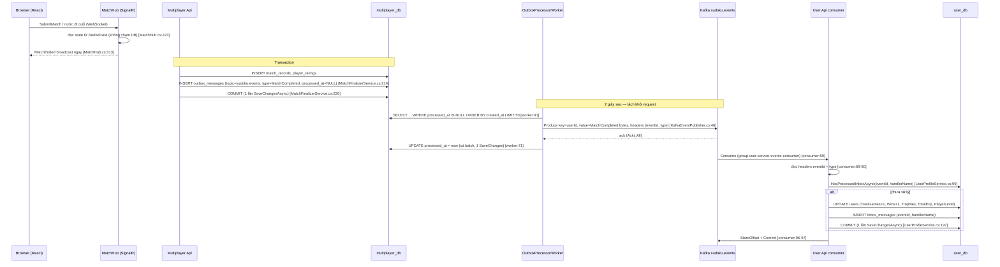

# TECH STACK — Bản đối chiếu với code thật

> Tài liệu này **không thay thế** `docs/TECH_STACK.md`. Nó trả lời câu hỏi:
> *"Đoạn cấu hình được nói trong TECH_STACK.md nằm ở file nào, dòng nào, và tại sao phải viết đúng như vậy?"*
>
> Mỗi mục dưới đây theo cùng một khuôn:
> **File ví dụ** (1 file tiêu biểu) → **đoạn cần đọc** (số dòng) → **giải thích** → **sai thì hỏng gì**.
>
> Mọi số dòng đúng tại commit hiện tại của repo. Khi code đổi, ưu tiên tìm theo tên symbol được nêu.

---

## 0. Bảng tra nhanh — mục TECH_STACK → file thật

| # | Tech (mục trong TECH_STACK.md) | File cấu hình / ví dụ tiêu biểu | Đoạn quyết định |
|---|---|---|---|
| 1 | React 19 + TS + Vite 8 + oxlint | `clients/package.json` | dòng 7–11 (scripts), 13–33 (versions) |
| 2 | ConnectRPC v2 | `clients/src/api/transport.ts` | 6–12 (interceptor), 18–23 (transport) |
| 3 | SignalR | `clients/src/realtime/matchHubClient.ts` | 334–343 (build connection) |
| 4 | Envoy 1.32 | `gateway/envoy.yaml` | 28–38 (CORS), 39–71 (routes), 72–81 (filter chain), 82–157 (clusters) |
| 5 | .NET 8 + Grpc.AspNetCore | `services/Multiplayer/Multiplayer.Api/Program.cs` | 17–96 (toàn bộ composition root) |
| 6 | Protobuf + Buf | `proto/buf.yaml`, `proto/buf.gen.yaml`, `Multiplayer.Api.csproj` | buf 1–9 / 1–5 ; csproj 10–13 |
| 7 | EF Core 8 + Npgsql | `services/Game/Game.Api/Data/Repositories/GameSessionRepository.cs` | 103–139 (AsNoTracking + projection + Take) |
| 8 | PostgreSQL 16 | `deploy/postgres-init/01-create-dbs.sql` | 1–4 |
| 9 | Kafka 3.9 (KRaft) | `deploy/docker-compose.yml` | 144–177 |
| 10 | Redis 7 | `services/Multiplayer/Multiplayer.Api/Domain/Runtime/RedisMatchRuntimeStore.cs` | 13–72 |
| 11 | Firebase Auth | `building-block/Sudoku.Auth/AuthExtensions.cs` | 25–70 |
| 12 | OpenTelemetry | `building-block/Sudoku.Observability/ObservabilityExtensions.cs` | 13–49 |
| 13 | Docker Compose | `deploy/docker-compose.yml` | 15–24 (web), 26–45 (game-service) |
| 14 | Swagger | `services/Support/Support.Api/Program.cs` | 26–59 |
| 15 | Deploy scripts | `deploy/start-be.ps1`, `deploy/quick-tunnel.ps1` | 38–56 / 4–112 |
| 16 | Auth hardening + CI | `.github/workflows/ci.yml`, `deploy/.env.example` | ci.yml 3 job; .env 15–16 |

---

## 1. React 19 + TypeScript 6 + Vite 8 + oxlint

**File ví dụ:** `clients/package.json`

```json
"scripts": {
  "gen": "buf generate ../proto --template ../proto/buf.gen.yaml",
  "dev": "vite --host 0.0.0.0",
  "build": "tsc -b && vite build",
  "lint": "oxlint",
}
```
(`clients/package.json` dòng 7–11)

**Ba chi tiết đáng chú ý trong file này:**

1. **`build` = `tsc -b && vite build`** (dòng 9) — Vite không type-check (nó chỉ strip type bằng esbuild). Nếu chỉ chạy `vite build` thì type sai vẫn ra bundle. Chuỗi `tsc -b` đứng trước chính là "cổng" type-safety, và nó dùng project references (`tsc -b` = build mode) để chỉ rebuild phần thay đổi.
2. **`gen` gọi `buf` local** (`@bufbuild/buf` là devDependency, dòng 24) — không cần cài buf toàn hệ thống, `npm ci` là đủ cho CI lẫn máy dev. Đây là lý do `ci.yml` job `frontend` chạy được `npm run gen` mà không setup gì thêm.
3. **`dev --host 0.0.0.0`** — bắt buộc để container/tunnel bên ngoài truy cập được; nếu để mặc định `localhost` thì `quick-tunnel.ps1` trỏ vào port 5173 sẽ nhận connection refused.

**File cấu hình Vite:** `clients/vite.config.ts` chỉ 7 dòng, đúng như TECH_STACK mô tả:

```ts
export default defineConfig({
  plugins: [react()],
})
```
(dòng 5–7) — không có `server.proxy`. Nghĩa là FE **không** proxy sang backend; nó gọi thẳng base URL do `apiBase.ts` quyết định. Đây là điểm nối quan trọng với mục 2 và mục 15.

**Sai thì hỏng gì:** bỏ `tsc -b` ⇒ API đổi field trong `.proto` mà FE vẫn build thành công ⇒ lỗi chỉ lộ lúc runtime; bỏ `--host` ⇒ tunnel/container không vào được.

---

## 2. ConnectRPC v2 (connect-web)

**File ví dụ:** `clients/src/api/transport.ts` (23 dòng, đọc hết)

```ts
const authInterceptor: Interceptor = (next) => async (request) => {
  const token = await getAccessToken()
  if (token) request.header.set('Authorization', `Bearer ${token}`)
  return next(request)
}

const baseUrl = getApiBase() || (typeof window === 'undefined' ? '' : window.location.origin)

export const transport = createGrpcWebTransport({ baseUrl, interceptors: [authInterceptor] })
```
(dòng 6–12 và 18–23)

**Cách client được tạo — điểm TECH_STACK.md đang viết lệch:** trang 136–144 của TECH_STACK nói import `GameServiceClient` từ `game_connect`. Code thật **không có file `*_connect.ts`**. Với `@bufbuild/protobuf` v2, service descriptor nằm ngay trong `*_pb.ts`:

```ts
import { GameService } from '../gen/sudoku/game/v1/game_pb'
import { transport } from './transport'

export const gameClient = createClient(GameService, transport)
```
(`clients/src/api/gameClient.ts` dòng 1–14)

**Luồng một RPC đi qua những đâu:**

```
gameClient.listLevels({}, { signal })         gameClient.ts:77
  → transport (interceptor gắn Authorization) transport.ts:6–12
  → POST /sudoku.game.v1.GameService/ListLevels   (HTTP/1.1 gRPC-Web)
  → Envoy  gateway/envoy.yaml:40–44  (prefix '/sudoku.game.v1.' → cluster game)
  → Game.Api (HTTP/2 native, application/grpc)
```

**Hai chi tiết dễ bỏ sót:**

- **`{ signal }` ở mọi call** — `listLevels({}, { signal })`, `makeMove(..., { signal })`. Đây là AbortSignal của `AbortController`, không phải cờ tuỳ chọn; bỏ đi thì request cũ vẫn chạy khi user đổi trang (xem `clients/AGENTS.md` luật 4).
- **`baseUrl` tính 1 lần lúc module load.** `transport.ts:18` chạy khi import. Vì `getApiBase()` cache kết quả (`apiBase.ts:72–75`), `?api=` được đọc trước đó ở lần load đầu trang. Nếu bạn `setApiBase()` sau khi transport đã tạo, transport **không** đổi — dùng `?api=` rồi reload là con đường đúng.

---

## 3. SignalR

**File ví dụ:** `clients/src/realtime/matchHubClient.ts` dòng 334–343

```ts
const conn = new signalR.HubConnectionBuilder()
  .withUrl(getAbsoluteApiUrl('/hubs/match'), {
    accessTokenFactory: async () => (await getAccessToken(caller.userId)) ?? '',
  })
  .withAutomaticReconnect([0, 1000, 2000, 5000])
  .configureLogging(signalR.LogLevel.Warning)
  .build()
```

**Vì sao là `getAbsoluteApiUrl` chứ không phải `getApiBase`:** `apiBase.ts:94–100` trả URL tuyệt đối; khi base rỗng (same-origin) nó ghép `window.location.origin`. Trình duyệt **không** nhận URL tương đối cho `new WebSocket(...)`, nên đây là ràng buộc kỹ thuật, không phải style.

**Vì sao `accessTokenFactory` thay vì header:** WebSocket handshake không cho set `Authorization`. Token đi qua query string, và đầu nhận xử lý ở `AuthExtensions.cs:60–70`:

```csharp
OnMessageReceived = ctx => {
    if (ctx.HttpContext.Request.Path.StartsWithSegments("/hubs")) {
        ctx.Token = ctx.Request.Query["access_token"];
    }
    return Task.CompletedTask;
}
```

**Phía server — điểm khác biệt cốt lõi so với gRPC là Group:** `services/Multiplayer/Multiplayer.Api/Hubs/MatchHub.cs`

| Dòng | Việc gì |
|---|---|
| 94 | `GetMatchGroupName(matchId) => $"match:{matchId}"` |
| 126, 130 | `Groups.AddToGroupAsync(connectionId, groupName)` cho 2 người |
| 134–135 | `Clients.Group(groupName).SendAsync("MatchFound"/"MatchStarted", payload)` |
| 229, 247, 276 | Nước đi: `MoveResult`, `TurnChanged`, `OpponentProgress` |
| 223 | `_runtimeStore.GetAsync(...)` — đọc state, **không** đọc `DbContext` |

Dòng 223 là chỗ thực thi luật 6: hot path chỉ chạm RAM/Redis. Nếu ai thêm `_db.SaveChangesAsync()` vào đây, mỗi nước đi thành 1 transaction Postgres và match 1v1 sẽ tụt xuống hàng trăm ms.

**Dual-port** (`deploy/docker-compose.yml:109–112`): 8080 HTTP/2 cho gRPC, 8081 HTTP/1.1 cho WebSocket. Envoy route `/hubs/match` sang cluster `multi_ws` (`envoy.yaml:65–71`) với `timeout: 0s`.

---

## 4. Envoy 1.32

**File ví dụ:** `gateway/envoy.yaml` (157 dòng). Đây là file cấu hình duy nhất của gateway — không có xDS control plane, mọi thứ static.

### 4.1 Filter chain — thứ tự là hợp đồng, không phải sở thích

```yaml
http_filters:
  - name: envoy.filters.http.cors        # 73
  - name: envoy.filters.http.grpc_web    # 76
  - name: envoy.filters.http.router      # 79
```
(dòng 72–81)

Đọc từ trên xuống: request vào → CORS xử lý preflight / gắn header → `grpc_web` dịch body `application/grpc-web+proto` sang `application/grpc+proto` (chuyển trailer từ body ra HTTP/2 trailer) → router chọn cluster. Đảo `grpc_web` lên trước `cors` thì preflight `OPTIONS` (không phải gRPC frame) sẽ bị decoder gRPC-Web nuốt và trả lỗi thay vì 200.

### 4.2 CORS — hai header quyết định thành/bại

```yaml
expose_headers: 'grpc-status,grpc-message,grpc-encoding,grpc-accept-encoding'   # 37
allow_headers: 'authorization,content-type,x-grpc-web,...,x-signalr-user-agent' # 35
allow_credentials: true                                                          # 36
```
(dòng 28–38)

- Thiếu `expose_headers` ⇒ browser **không đọc được** `grpc-status` ⇒ mọi lỗi gRPC (NotFound, Unauthenticated…) hiện ra như lỗi mạng chung chung. Đây là lỗi kinh điển của gRPC-Web.
- `allow_credentials: true` + `safe_regex: .*` hoạt động được vì Envoy echo lại origin cụ thể, không trả `*`. Nếu trả `*` thì browser chặn.
- `x-grpc-web` trong `allow_headers` là bắt buộc với connect-web; `x-signalr-user-agent` cho SignalR negotiate.

### 4.3 Routes — prefix chính là tên package Protobuf

```yaml
- match: { prefix: '/sudoku.game.v1.' }   → cluster: game,      timeout: 15s   # 40–44
- match: { prefix: '/sudoku.user.v1.' }   → cluster: user,      timeout: 15s   # 45–49
- match: { prefix: '/api/v1/' }           → cluster: support,   timeout: 15s   # 50–54
- match: { prefix: '/swagger' }           → cluster: support                    # 55–59
- match: { prefix: '/sudoku.multi.v1.' }  → cluster: multi_grpc, timeout: 15s   # 60–64
- match: { prefix: '/hubs/match' }        → cluster: multi_ws,  timeout: 0s     # 65–71
```
(dòng 39–71)

gRPC path trên wire là `/<package>.<Service>/<Method>` — tức `sudoku.game.v1` lấy từ `package` trong `game.proto`, không phải tên class C#. Vì vậy route theo prefix package tự động phủ **mọi** method hiện tại và tương lai của service đó. Thêm RPC mới vào proto ⇒ **không cần sửa Envoy**.

### 4.4 Cluster — HTTP/2 tới upstream

```yaml
- name: game
  type: STRICT_DNS
  typed_extension_protocol_options:
    envoy.extensions.upstreams.http.v3.HttpProtocolOptions:
      explicit_http_config:
        http2_protocol_options: {}
```
(dòng 83–99; lặp lại cho `user` 100–116 và `multi_grpc` 129–145)

**`multi_ws` cố tình KHÔNG có block này** (dòng 146–157) — vì nó nói HTTP/1.1 + WebSocket upgrade. Đây là lý do kỹ thuật của dual-port: cùng một container nhưng 2 giao thức, Envoy không thể dùng chung một HTTP protocol option.

`STRICT_DNS` + `address: game-service` = resolve tên Docker service qua DNS nội bộ compose, không hardcode IP.

---

## 5. .NET 8 + Grpc.AspNetCore

**File ví dụ:** `services/Multiplayer/Multiplayer.Api/Program.cs` — chọn file này vì nó chứa **tất cả** loại đăng ký của repo trong 96 dòng.

| Dòng | Đăng ký | Tech tương ứng |
|---|---|---|
| 19 | `AddSudokuObservability("multiplayer-service")` | OpenTelemetry (§12) |
| 21–26 | `AddDbContext<MultiplayerDbContext>` + `UseNpgsql` + `UseSnakeCaseNamingConvention` | EF Core (§7) |
| 28–35 | `AddSingleton<IConnectionMultiplexer>` + `AbortOnConnectFail=false`, `ConnectTimeout=2000` | Redis (§10) |
| 37–41 | `AddGrpcClient<GameService.GameServiceClient>` đọc `Services:Game` | gRPC liên service |
| 43–47 | `AddGrpcClient<UserService.UserServiceClient>` đọc `Services:User` | gRPC liên service |
| 49 | `AddSudokuKafkaPublisher()` | Kafka (§9) |
| 56–60 | singleton runtime store / leaderboard / match engine | hot path |
| 62–64 | 3 `AddHostedService` (seeder, lifecycle, outbox) | background |
| 66–69 | `AddGrpc(options => options.Interceptors.Add<DomainExceptionInterceptor>())` | error mapping (luật 9) |
| 71 | `AddSignalR()` | SignalR (§3) |
| 72 | `AddFirebaseJwt(builder.Configuration)` | Auth (§11) |
| 87 | `UseGrpcWeb(...)` | cho phép gọi trực tiếp không qua Envoy (dev) |
| 92 | `MapGrpcService<...>().EnableGrpcWeb()` | expose service |
| 94 | `MapHub<MatchHub>("/hubs/match")` | SignalR endpoint |

**gRPC liên service — mẫu gọi đúng chuẩn** (`services/Multiplayer/Multiplayer.Api/Domain/Services/MatchmakingService.cs` dòng 594–605):

```csharp
var resp = await _gameClient.AcquirePuzzleForMatchAsync(
    req,
    deadline: DateTime.UtcNow.AddSeconds(3),
    cancellationToken: ct);
...
catch (RpcException ex) { /* fallback local generator */ }
```

Ba thứ bắt buộc: `deadline` (nếu service kia treo, call FailFast sau 3s thay vì treo vô hạn), `cancellationToken: ct` (client bỏ đi thì huỷ luôn), `catch RpcException` (không để lỗi hạ tầng nổ ra như lỗi nghiệp vụ). Dòng 608–614 là fallback sinh puzzle cục bộ — minh hoạ nguyên tắc "dependency optional thì degrade, không chết".

**`DomainExceptionInterceptor`** là lý do các service throw `NotFoundException`, `InvalidArgumentException`… thay vì tự tạo `RpcException` ở tầng domain. Adapter `Grpc/` chỉ nên throw `RpcException` khi lỗi thuộc về transport/auth.

---

## 6. Protobuf + Buf

**File ví dụ 1:** `proto/buf.yaml` (9 dòng)

```yaml
version: v2
modules:
  - path: .
lint:
  use: [STANDARD]
breaking:
  use: [FILE]
```

**File ví dụ 2:** `proto/buf.gen.yaml` (5 dòng)

```yaml
version: v2
plugins:
  - local: protoc-gen-es
    out: src/gen
    opt: target=ts
```

`local:` = chạy binary `protoc-gen-es` trong `node_modules` (devDependency ở `clients/package.json:25`). `out: src/gen` là đường dẫn **tương đối so với cwd khi chạy** — vì script là `buf generate ../proto --template ../proto/buf.gen.yaml` chạy từ `clients/`, output rơi đúng `clients/src/gen`. Chạy lệnh này từ thư mục khác sẽ sinh ra `src/gen` sai chỗ.

`target=ts` = sinh `.ts` (không phải `.js` + `.d.ts`), để Vite/TS cùng đọc một nguồn.

**File ví dụ 3 — phía C#:** `services/Multiplayer/Multiplayer.Api/Multiplayer.Api.csproj` dòng 10–13

```xml
<Protobuf Include="../../../proto/sudoku/multi/v1/multi.proto"  ProtoRoot="../../../proto" GrpcServices="Server" />
<Protobuf Include="../../../proto/sudoku/user/v1/user.proto"    ProtoRoot="../../../proto" GrpcServices="Client" />
<Protobuf Include="../../../proto/sudoku/game/v1/game.proto"    ProtoRoot="../../../proto" GrpcServices="Client" />
<Protobuf Include="../../../proto/sudoku/events/v1/events.proto" ProtoRoot="../../../proto" GrpcServices="None" />
```

Bốn dòng này nói hết vai trò của service:
- `multi.proto` = `Server` → service này **phục vụ** MultiplayerService.
- `user.proto`, `game.proto` = `Client` → service này **gọi** 2 service kia (khớp `AddGrpcClient` ở Program.cs).
- `events.proto` = `None` → chỉ lấy **message** cho payload Kafka, không sinh stub. Đây là chi tiết hay bị bỏ: event contract và RPC contract dùng chung cơ chế codegen nhưng khác `GrpcServices`.

`ProtoRoot="../../../proto"` cần thiết vì các file import chéo nhau bằng path tuyệt đối từ root (`import "sudoku/game/v1/game.proto"`).

**Sai thì hỏng gì:** đổi `field number` trong proto ⇒ dữ liệu cũ trong DB (JSONB) hoặc message Kafka đang bay sẽ deserialize sai **mà không có exception** (protobuf wire format không mang tên field). Đó chính là lý do `breaking: use: [FILE]` tồn tại.

---

## 7. EF Core 8 + Npgsql

**File ví dụ:** `services/Game/Game.Api/Data/Repositories/GameSessionRepository.cs` dòng 103–139 — đây là mẫu đầy đủ nhất của luật 3 trong repo:

```csharp
var baseQuery = _context.GameSessions
    .AsNoTracking()                                    // 113
    .Where(s => s.UserId == userId && s.Status != 1);  // 114

int totalCount = await baseQuery.CountAsync(ct);                    // 116
int winsCount  = await baseQuery.CountAsync(s => s.Status == 2, ct);// 117

var items = await baseQuery
    .OrderByDescending(s => s.FinishedAt ?? s.StartedAt)  // 120
    .Skip(safeOffset)                                      // 121
    .Take(safeLimit)                                       // 122
    .Select(s => new Sudoku.Game.V1.GameHistoryItem { ... }) // 123–136
    .ToListAsync(ct);
```

Bốn thứ đáng học ở đây:

1. **`Math.Clamp(limit <= 0 ? 15 : limit, 1, 100)` (dòng 109)** — chặn upper bound ngay trong repository, không tin caller. `Take` một mình không đủ nếu `limit` do client gửi lên.
2. **Projection thẳng sang Protobuf message** (`GameHistoryItem`) — không entity, không DTO trung gian. Đây là cách thoả luật 2 ("không trả EF Entity ra gRPC") mà không cần lớp map.
3. **`AsNoTracking()` trên query nền** rồi tái dùng cho cả `Count` và `Select` — EF không tạo change-tracker snapshot cho ~15 row lịch sử + 2 count.
4. **`ct` (CancellationToken) đi tới `ToListAsync`** — client đóng tab thì query bị huỷ ở Postgres, không chỉ bỏ kết quả.

**`UseSnakeCaseNamingConvention`** khai báo ở `Multiplayer.Api/Program.cs:24–25` (và tương tự ở 3 service còn lại):

```csharp
options.UseNpgsql(connectionString)
       .UseSnakeCaseNamingConvention();
```

Nhờ nó `PlayerId` → `player_id`, `OutboxMessage` → `outbox_messages`, **không cần** attribute khắp nơi. Ngoại lệ có chủ đích: `InboxMessageConfiguration.cs:14–17` tự khai `HasColumnName` — thừa nhưng vô hại, dùng khi muốn khoá tên cột không cho convention đổi.

**Index cho outbox** (`Data/Configurations/OutboxMessageConfiguration.cs:19–20`):

```csharp
builder.HasIndex(x => x.CreatedAt).HasFilter("processed_at IS NULL");
```

Partial index: chỉ index các row **chưa xử lý**. Bảng outbox phình tới hàng triệu row đã publish nhưng index vẫn nhỏ và query `WHERE processed_at IS NULL ORDER BY created_at LIMIT 50` đi đúng index này.

---

## 8. PostgreSQL 16

**File ví dụ:** `deploy/postgres-init/01-create-dbs.sql` (4 dòng)

```sql
CREATE DATABASE game_db;
CREATE DATABASE user_db;
CREATE DATABASE support_db;
CREATE DATABASE multiplayer_db;
```

File này nằm tại `deploy/postgres-init/` và được mount vào `/docker-entrypoint-initdb.d` (`docker-compose.yml:130`). Cơ chế: image `postgres:16` chạy **mọi** file `.sql` trong thư mục đó **một lần duy nhất**, khi data directory còn rỗng.

> Hệ quả thực tế: sửa file này rồi `docker compose up` **không** có tác dụng nếu volume `pgdata` đã tồn tại. Muốn áp dụng phải `docker compose down -v` (xoá volume). Đây là lý do nhiều người tưởng SQL sai.

**Ai dùng DB nào** — kiểm chứng bằng connection string trong compose, không phải bằng tài liệu:

| Service | Database | Dòng compose |
|---|---|---|
| game-service | `game_db` | 32 |
| user-service | `user_db` | 53 |
| support-service | `support_db` | 73 |
| multiplayer-service | `multiplayer_db` | 101 |

Không service nào có connection string của service khác — đây là database-per-service thực thi bằng cấu hình, không chỉ bằng quy ước.

**Healthcheck** (`docker-compose.yml:132–137`) là điều kiện để `depends_on: condition: service_healthy` (dòng 41–43) có ý nghĩa. `pg_isready` trả 0 khi Postgres nhận connection, không chỉ khi process sống.

---

## 9. Kafka 3.9 (KRaft) — xem chuyên sâu ở **Phần C**

**File ví dụ:** `deploy/docker-compose.yml` dòng 144–177

```yaml
kafka:
  image: apache/kafka:3.9.0
  environment:
    KAFKA_NODE_ID: 1
    KAFKA_PROCESS_ROLES: broker,controller                          # 150
    KAFKA_LISTENERS: PLAINTEXT://:9092,CONTROLLER://:9093           # 151
    KAFKA_ADVERTISED_LISTENERS: PLAINTEXT://kafka:9092              # 152
    KAFKA_CONTROLLER_QUORUM_VOTERS: 1@kafka:9093                    # 155
    KAFKA_AUTO_CREATE_TOPICS_ENABLE: 'true'                         # 159

kafka-init:
  command: |
    kafka-topics.sh ... --create --if-not-exists --topic sudoku.events           --partitions 1   # 173
    kafka-topics.sh ... --create --if-not-exists --topic user.admin-action.v1    --partitions 1   # 174
    kafka-topics.sh ... --create --if-not-exists --topic game.rules-changed.v1   --partitions 1   # 175
```

Bốn chi tiết không hiển nhiên:

1. **`ADVERTISED_LISTENERS` phải là `kafka:9092`**, không phải `localhost:9092`. Broker trả metadata cho client; nếu advertise `localhost`, client trong container `game-service` sẽ cố kết nối tới chính nó và fail. `PLAINTEXT://:9092` (listen) và `PLAINTEXT://kafka:9092` (advertise) là hai thứ khác nhau và **cả hai đều cần**.
2. **`kafka-init` là one-shot container** — chạy, tạo topic, exit. Nó không restart như service. Vì vậy `depends_on: kafka` chỉ là "started", không "healthy" (Kafka image không có healthcheck).
3. **`AUTO_CREATE_TOPICS_ENABLE: true`** là lý do `user.updated.v1` (User publish, không có trong kafka-init) vẫn chạy được: topic được tạo tự động với **default partition = 1**. Bật cờ này ở production là rủi ro (topic rác, partition mặc định sai) nhưng tiện cho dev.
4. **`--partitions 1`** quyết định ordering toàn topic. Xem C.7 để hiểu đánh đổi.

---

## 10. Redis 7

**File ví dụ:** `services/Multiplayer/Multiplayer.Api/Domain/Runtime/RedisMatchRuntimeStore.cs` dòng 13–72 — pattern 2 tầng RAM→Redis:

```csharp
private static readonly TimeSpan RoomTtl = TimeSpan.FromHours(2);           // 15
private readonly ConcurrentDictionary<Guid, ActiveMatchSession> _sessions;  // 17

public async Task<ActiveMatchSession?> GetAsync(Guid matchId, CancellationToken ct = default)
{
    if (_sessions.TryGetValue(matchId, out var inMemory))    // 37  ← fast path, 0 network
        return inMemory;

    var raw = await db.StringGetAsync(GetRoomKey(matchId));  // 50  ← fallback
    var restored = JsonSerializer.Deserialize<ActiveMatchSession>(raw!);
    var canonical = _sessions.GetOrAdd(matchId, restored);   // 62  ← rehydrate RAM
}
```

Điểm cốt lõi: `GetOrAdd` ở dòng 62 — sau khi restore từ Redis, session được **đưa lại vào RAM**, nên chỉ nước đi đầu tiên sau restart chịu network round-trip; các nước sau lại 0ms. Nếu quên bước này, mỗi nước đi thành 1 Redis call (~0.5–1ms) — vẫn nhanh nhưng mất ý nghĩa "hot path không chạm network".

**Vì sao cần Redis nếu đã có RAM:** Multiplayer chạy singleton per-process. Restart/deploy ⇒ `ConcurrentDictionary` mất sạch ⇒ 2 người đang đánh mất trận. Redis là write-behind backup, TTL 2h (`RoomTtl`) nên session bỏ hoang tự dọn, không cần cron.

**Leaderboard** (`Domain/Runtime/RedisLeaderboardCache.cs`):

```csharp
double compositeScore = rating + Math.Min(matchesWon, 99999) * 0.00001;  // 59
batch.SortedSetAddAsync(GetZSetKey(effectiveFormat), userId, compositeScore); // 62
await db.SortedSetRangeByRankWithScoresAsync(...);                        // 87
```

Composite score = `rating` phần nguyên + tie-breaker ở phần thập phân. Vì ZSET chỉ có **một** score, muốn "xếp theo rating, hoà thì ai thắng nhiều hơn đứng trên" thì phải nhồi tie-breaker vào cùng number. `Math.Min(..., 99999)` chặn trường hợp wins lớn làm tràn sang phần nguyên (làm sai rating).

**Kết nối** (`Multiplayer.Api/Program.cs:28–35`): `AbortOnConnectFail = false` + `ConnectTimeout = 2000`. Redis chết không làm service chết lúc boot; `_redis` là `IConnectionMultiplexer?` (nullable ở constructor dòng 24) và mọi method đều `GetDatabase() == null → return null` ⇒ degrade về RAM-only.

---

## 11. Firebase Auth (JWT)

**File ví dụ:** `building-block/Sudoku.Auth/AuthExtensions.cs` dòng 16–77. Đây là file **quan trọng nhất** về auth — mọi service đều gọi `AddFirebaseJwt(builder.Configuration)`.

### 11.1 Authority + JWKS

```csharp
var authority = $"https://securetoken.google.com/{projectId}";   // 19
o.Authority = authority;                                          // 38
```

Chỉ cần set `Authority`, ASP.NET Core tự tải `/.well-known/openid-configuration` → `jwks_uri` → cache public key. Không có public key nào hardcode trong repo. `projectId` đọc từ `Firebase:ProjectId` (compose: `Firebase__ProjectId`).

### 11.2 Dev token — 3 lớp bảo vệ

```csharp
var allowDevTokens = bool.TryParse(config["Auth:AllowDevTokens"], out var allowDev) && allowDev;  // 25
var devSecret = config["Auth:DevSecret"];                                                        // 26
if (string.IsNullOrWhiteSpace(devSecret) || devSecret.Length < 32) devSecret = DevSecretKey;      // 27–30

ValidIssuers   = allowDevTokens ? [googleIssuer, DevIssuer] : [googleIssuer];      // 41
ValidAudiences = allowDevTokens ? [projectId, DevAudience] : [projectId];          // 42
```

```csharp
IssuerSigningKeyResolverUsingConfiguration = (token, securityToken, kid, parameters, configuration) =>
{
    if (allowDevTokens && securityToken is JsonWebToken jwt &&
        string.Equals(jwt.Alg, SecurityAlgorithms.HmacSha256, StringComparison.Ordinal))
        return new[] { devSigningKey };          // 49–54
    return configuration.SigningKeys;            // 56
}
```

Ba lớp: (1) cờ `AllowDevTokens` phải bật tường minh; (2) issuer/audience của dev token chỉ được whitelist khi cờ bật; (3) resolver chỉ trả HMAC key khi cờ bật **và** `alg == HS256`. Firebase luôn RS256 ⇒ token Firebase không bao giờ đi nhánh HMAC, và token HS256 tự ký không bao giờ đi nhánh RSA. Đây là lý do "quên set `ALLOW_DEV_TOKENS=true`" làm dev token fail ngay, không phải fail lúc gọi API.

### 11.3 `MapInboundClaims = false` — dòng quan trọng nhất của cả file

```csharp
o.MapInboundClaims = false;   // 59
```

Mặc định ASP.NET Core map `sub` → `http://schemas.xmlsoap.org/ws/2005/05/identity/claims/nameidentifier`. Firebase đặt UID vào `sub`. Nếu không tắt map, code `User.FindFirst("sub")` trả `null` — không exception, chỉ là userId rỗng, và bug lan ra rất xa (record ghi `user_id = ""`).

Trong repo, mọi chỗ đọc user đều dùng đúng tên claim:

```csharp
string? userId = Context.User?.FindFirst("sub")?.Value
             ?? Context.User?.FindFirst("user_id")?.Value;   // MatchHub.cs:434
```

### 11.4 Admin policy

```csharp
services.AddAuthorization(o => o.AddPolicy("Admin", p => p.RequireClaim("role", "admin")));  // 73
```

Claim `role` là custom claim do Firebase/Dev token phát. Policy này là thứ `[Authorize(Policy = "Admin")]` ở controller Support dựa vào.

---

## 12. OpenTelemetry

**File ví dụ:** `building-block/Sudoku.Observability/ObservabilityExtensions.cs` (49 dòng)

```csharp
var otelEndpoint = builder.Configuration["Otel:Endpoint"];   // 15
...
.WithTracing(tracing => {
    tracing.AddAspNetCoreInstrumentation()   // 22
           .AddGrpcClientInstrumentation();  // 23
    if (!string.IsNullOrWhiteSpace(otelEndpoint))
        tracing.AddOtlpExporter(opt => opt.Endpoint = new Uri(otelEndpoint));  // 27–30
})
```

**Điều tài liệu gốc nói đúng và nên nhấn mạnh:** exporter là **điều kiện**. Không set `Otel:Endpoint` ⇒ instrumentation vẫn chạy nhưng span/metric chỉ nằm trong bộ nhớ, không export, không lỗi, không cảnh báo. Nhờ vậy `docker compose up` không cần Jaeger vẫn sạch log.

**Điều tài liệu gốc chưa nói — giới hạn thực tế của trace trong repo này:**

| Có instrumentation | Không có |
|---|---|
| ASP.NET Core (incoming HTTP/gRPC) | Kafka producer/consumer |
| gRPC **client** (outgoing) | EF Core (SQL command) |
| | SignalR / WebSocket |
| | Redis (`StackExchange.Redis`) |
| | BackgroundService (`PostgresActivity` của outbox worker) |

Hệ quả cụ thể: trace FE → Envoy → Game → User (qua gRPC) liền mạch, nhưng **đứt tại Kafka**. Event `GameFinished` publish trong `OutboxProcessorWorker` không có span cha, và consumer tạo trace mới hoàn toàn. Muốn nối phải thêm `Confluent.Kafka` OpenTelemetry instrumentation hoặc tự inject `traceparent` vào Kafka headers (xem C.10).

`.ConfigureResource(r => r.AddService(serviceName))` (dòng 18) là cách mỗi service tự khai danh tính — `"game-service"`, `"user-service"`… nhờ đó filter theo service trong backend trace.

---

## 13. Docker Compose

**File ví dụ:** `deploy/docker-compose.yml` — 179 dòng, 10 service (TECH_STACK.md §13 nói "9 containers" nhưng bảng liệt kê 10; con số đúng là 10, tính cả `kafka-init` one-shot).

### 13.1 Env var → config .NET

```yaml
- ConnectionStrings__Default=Host=postgres;Database=game_db;Username=...    # 32
- Auth__AllowDevTokens=${ALLOW_DEV_TOKENS:-true}                            # 33
- Kafka__BootstrapServers=kafka:9092                                        # 35
- Services__User=http://user-service:8080                                   # 36
- Kestrel__Endpoints__Grpc__Protocols=Http2                                 # 39
```

`__` (double underscore) = `:` trong `IConfiguration`. Nhờ vậy `config["Kafka:BootstrapServers"]` trong `KafkaEventPublisher.cs:19` đọc được env var ở trên mà code không biết gì về Docker.

`${VAR:-default}` là default **của compose**, khác hoàn toàn default trong code (`?? "localhost:9092"`). Hai lớp default này giải thích vì sao chạy local (dotnet run) và chạy compose đều được mà không sửa file.

### 13.2 `web` build args — chỗ dễ sai nhất

```yaml
web:
  build:
    context: ../clients
    args:
      - VITE_API_URL=                        # 19  ← rỗng có chủ đích
      - VITE_DEV_AUTH_SECRET=${DEV_AUTH_SECRET:-...}  # 20
  ports: ['${WEB_PORT:-5173}:80']            # 22
```

`VITE_API_URL` **phải rỗng** trong Docker: web và API cùng host (Nginx proxy + Envoy), `apiBase.ts` trả `''` ⇒ same-origin. Nếu set `http://localhost:18080` ở đây, browser của người dùng ngoài máy bạn sẽ gọi vào localhost của **họ** và fail.

`VITE_*` được nhúng **lúc build** (Vite thay thế literal), không phải lúc runtime. Vì vậy đổi `DEV_AUTH_SECRET` bắt buộc `--build`, đây là lý do `start-be.ps1` mặc định build.

### 13.3 Dependencies

```yaml
depends_on:
  postgres: { condition: service_healthy }   # 42–43
  kafka:    { condition: service_started }   # 44–45
  redis:    { condition: service_started }   # 119–120
```

`service_healthy` chỉ dùng được khi target có `healthcheck` (chỉ Postgres có: 132–137). Kafka/Redis không có ⇒ buộc phải `service_started`, và đó là lý do các worker có `await Task.Delay(5s)` đầu `ExecuteAsync` (vd `GameEventsConsumerWorker.cs:35`) — tự chờ broker thay vì crash.

---

## 14. Swagger (chỉ Support)

**File ví dụ:** `services/Support/Support.Api/Program.cs` dòng 26–59 + phần `UseSwagger` phía dưới.

```csharp
builder.Services.AddSwaggerGen(c => {
    c.SwaggerDoc("v1", new OpenApiInfo { Title = "Sudoku Platform - Support & Community REST API", ... });  // 28–33
    c.AddSecurityDefinition("Bearer", new OpenApiSecurityScheme {  // 35–43
        Name = "Authorization", Type = SecuritySchemeType.Http, Scheme = "Bearer", In = ParameterLocation.Header,
    });
    c.AddSecurityRequirement(new OpenApiSecurityRequirement { ... });  // 45–58
});
```

Điểm phân biệt: `AddSecurityDefinition` chỉ **khai báo** scheme (hiện nút Authorize), còn `AddSecurityRequirement` mới là thứ khiến **mọi** endpoint được UI coi là cần token. Thiếu block thứ hai thì nút Authorize có nhưng token không được gắn vào request.

Đường dẫn `/swagger` hoạt động qua gateway vì `envoy.yaml:55–59` route prefix `/swagger` → cluster `support`. Không có route này thì Swagger chỉ truy cập được qua `localhost:5104`.

Support là REST duy nhất nên có thêm một chi tiết khác 3 service kia — nó **vừa** REST **vừa** gRPC client (`Program.cs:77–87`), dùng để gộp dữ liệu trong `Controllers/PortalController.cs` (deadline 3s ở dòng 45, 68, 94).

---

## 15. Deploy scripts

**File ví dụ 1:** `deploy/start-be.ps1` (71 dòng)

| Dòng | Việc |
|---|---|
| 18–19 | param `-NoBuild`, `$TimeoutSeconds = 420` |
| 32 | chỉ thêm `--build` khi không có `-NoBuild` |
| 38–45 | `Test-Port` = mở TCP socket thật, không dùng `Test-NetConnection` (chậm) |
| 47–49 | poll đến khi **cả** 18080 (Envoy) và 5173 (web) mở |

Polling TCP khác với "container đang chạy": container có thể `Up` trong khi app .NET còn đang migrate DB. Đây là lý do script chờ **port**, không chờ `docker compose ps`.

**File ví dụ 2:** `deploy/quick-tunnel.ps1` (112 dòng)

Luồng: tải `cloudflared.exe` nếu thiếu → spawn `cloudflared tunnel --url http://localhost:PORT` → redirect stdout ra temp → regex `https://[a-z0-9-]+\.trycloudflare\.com` mỗi 700ms (deadline 60s) → in link `?api=` → `finally` kill process.

**Cơ chế `?api=`** nằm ở `clients/src/api/apiBase.ts` — đây là nơi cần đọc để hiểu, không phải script:

```ts
if (params.has('api')) {
  if (raw.trim().toLowerCase() === 'reset') persist(null)        // 50–51
  else { persist(fromQuery); return fromQuery }                   // 54–57
}
const fromStorage = readStored(); if (fromStorage) return fromStorage   // 61–62
const fromMeta = normalize(metaContent); if (fromMeta) return fromMeta  // 64–66
return normalize(import.meta.env.VITE_API_URL) ?? ''                    // 68
```

Đúng 5 mức ưu tiên như bảng trong TECH_STACK.md §15, và `?api=reset` là đường thoát duy nhất (vì `localStorage` sẽ thắng `VITE_API_URL` ở mọi lần load sau).

---

## 16. Auth hardening + CI

**File ví dụ:** `deploy/.env.example` (16 dòng) — hợp đồng giữa FE và BE:

```dotenv
ALLOW_DEV_TOKENS=true
DEV_AUTH_SECRET=sudoku-platform-insecure-dev-jwt-secret-key-2026-minimum-32-chars!
```

Hai biến này **phải khớp** với `Auth__AllowDevTokens` / `Auth__DevSecret` của backend và `VITE_DEV_AUTH_SECRET` lúc build FE. Chuỗi secret phải `>= 32` ký tự vì `AuthExtensions.cs:27` coi secret ngắn là "không cấu hình" và fallback về `DevSecretKey` hardcode — ngược lại, `devAuth.ts` từ chối ký nếu `< 32`. Cùng một ngưỡng 32 ở hai nơi, cố ý.

**`clients/src/auth/devAuth.ts`** là lớp chặn phía FE (dòng 15–26):

```ts
const configuredSecret = (import.meta.env.VITE_DEV_AUTH_SECRET as string | undefined)?.trim()

export const DEV_AUTH_SECRET =
  configuredSecret && configuredSecret.length >= 32
    ? configuredSecret
    : import.meta.env.DEV
      ? DEV_SECRET_FALLBACK
      : ''

export const isDevAuthEnabled = DEV_AUTH_SECRET.length >= 32
```

`import.meta.env.DEV` chỉ `true` khi `vite dev`. Vercel build = `DEV === false` ⇒ không có env thì `DEV_AUTH_SECRET = ''` ⇒ `isDevAuthEnabled === false` ⇒ `getAccessToken()` trả token Firebase hoặc `null`, không bao giờ gửi token tự ký.

**`.github/workflows/ci.yml`** — 3 job độc lập, không job nào phụ thuộc job nào:

| Job | Lệnh | Bắt được lỗi gì |
|---|---|---|
| `backend` | `dotnet restore` → `dotnet build -c Release` → `dotnet test` | C# compile, proto C# codegen |
| `frontend` | `npm ci` → `npm run gen` → `npm run lint` → `npm run build` | proto TS codegen + oxlint + tsc |
| `proto` | `npx --yes @bufbuild/buf@1 lint` | naming convention, comment requirement |

`frontend` chạy `npm run gen` **trước** build là chủ ý: nếu ai sửa `.proto` mà quên commit `clients/src/gen/**`, job này regenerate và `tsc` sẽ báo lệch — biến "quên commit file sinh" từ lỗi im lặng thành lỗi CI.

---

# PHẦN B — Các tech nói chuyện với nhau thế nào

## B.1 Ma trận giao tiếp đầy đủ

| Từ | Đến | Giao thức | Bằng chứng trong code |
|---|---|---|---|
| Browser | Envoy | gRPC-Web (HTTP/1.1), body bọc trailer | `transport.ts:20–23` |
| Browser | Envoy | WebSocket (SignalR) | `matchHubClient.ts:335` |
| Browser | Envoy | REST JSON `/api/v1/*` | `supportClient.ts:55` |
| Browser | Firebase | HTTPS (SDK) | `clients/src/auth/firebase.ts` |
| Envoy | Game / User / Multiplayer(gRPC) | HTTP/2 native, `application/grpc` | `envoy.yaml:41–64` + cluster `http2_protocol_options` |
| Envoy | Multiplayer(SignalR) | HTTP/1.1 + WS upgrade, `timeout: 0s` | `envoy.yaml:65–71` |
| Envoy | Support | HTTP/1.1 REST | `envoy.yaml:50–54` |
| Multiplayer | Game | gRPC client, deadline 3s | `MatchmakingService.cs:594–605` |
| Multiplayer | User | gRPC client, deadline 2–3s | `MultiplayerQueryService.cs:188` |
| Support | Game, User | gRPC client, deadline 3s | `PortalController.cs:45,68,94` |
| Game/User/Support/Multiplayer | PostgreSQL | Npgsql + EF Core | connection string riêng từng service |
| Multiplayer | Redis | StackExchange.Redis | `RedisMatchRuntimeStore.cs`, `RedisLeaderboardCache.cs` |
| Service → Kafka | — | **không trực tiếp**; qua bảng outbox | `OutboxProcessorWorker.cs` |
| Kafka → Service | — | consumer loop trong `BackgroundService` | `GameEventsConsumerWorker.cs` |
| Mọi service | Firebase | HTTPS fetch JWKS | `AuthExtensions.cs:38` |

## B.2 Ba kiểu giao tiếp và lý do chọn

1. **Đồng bộ, cần kết quả ngay** → gRPC client. Ví dụ Multiplayer cần `AcquirePuzzleForMatch` để biết puzzle trước khi tạo match. Nếu Game chết ⇒ `RpcException` ⇒ fallback sinh cục bộ (`MatchmakingService.cs:602–614`).
2. **Bất đồng bộ, cập nhật dữ liệu dẫn xuất** → Kafka. Ví dụ User cộng `TotalGames`, `Trophies`, `PlayerLevel` sau khi game kết thúc. Không ai cần kết quả này ngay; nếu User chết vài giây thì event nằm trong topic chờ, không mất.
3. **Realtime 2 chiều, không lưu DB** → SignalR. Nước đi giữa 2 người chơi.

Câu hỏi chọn lựa nhanh: *"Nếu service đích đang chết, request có được phép fail không?"* — Có ⇒ gRPC. Không ⇒ Kafka. *"Người nhận có cần phản hồi trong < 100ms và gửi ngược lại không?"* — Có ⇒ SignalR.

---

# PHẦN C — Kafka: publisher và consumer, chi tiết từng bước

Đây là phần TECH_STACK.md §9 mô tả đúng về ý tưởng nhưng chưa chỉ ra **code chạy ở đâu, theo thứ tự nào**.

## C.1 Bản đồ topic — ai ghi, ai đọc

| Topic | Producer (file:dòng) | Loại event | Consumer (file:dòng) | GroupId |
|---|---|---|---|---|
| `sudoku.events` | `GamePlayService.cs:318–327` | `GameFinished` | `GameEventsConsumerWorker.cs` (User) | `user-service-events-consumer` |
| `sudoku.events` | `MatchFinalizerService.cs:214–223` | `MatchCompleted` | `SupportEventsConsumerWorker.cs` (Support) | `support-service-events-consumer` |
| `user.admin-action.v1` | `AdminUserService.cs:112–118, 188–194, 336–342, 392–398, 459–465` | `UserAdminAction` | `SupportEventsConsumerWorker.cs:96–100` | idem |
| `game.rules-changed.v1` | `AdminGameService.cs:92–98, 208–214` | `GameRulesChanged` | `SupportEventsConsumerWorker.cs:101–105` | idem |
| `user.updated.v1` | `AdminUserService.cs:92–98, 168–174, 251–257` | `UserUpdated` | **chưa có consumer nào** | — |

> `user.updated.v1` không nằm trong `kafka-init` (`docker-compose.yml:173–175`) nên topic được tạo tự động nhờ `KAFKA_AUTO_CREATE_TOPICS_ENABLE: 'true'` (dòng 159). Hiện event này chỉ được publish, chưa ai subscribe — hữu ích khi thêm notification service sau này, nhưng nếu bạn debug mà thấy topic có message "không ai xử lý", đó là lý do.

## C.2 Publisher — 3 giai đoạn, KHÔNG có giai đoạn nào gọi Kafka trong request

### Giai đoạn 1: domain service ghi outbox **cùng transaction**

`services/Multiplayer/Multiplayer.Api/Domain/Services/MatchFinalizerService.cs` dòng 200–226:

```csharp
var completedEvt = new MatchCompleted { ... };            // 199–212

matchRepo.AddOutboxMessage(new OutboxMessage               // 214
{
    Id        = Guid.NewGuid(),
    EventId   = Guid.NewGuid().ToString(),
    Type      = nameof(MatchCompleted),
    UserId    = effectiveWinner,
    Topic     = "sudoku.events",
    Payload   = completedEvt.ToByteArray(),                // 221  ← protobuf binary
    CreatedAt = now
});

// 4. Commit all changes in a single transaction!
await uow.SaveChangesAsync(ct);                            // 226
```

Điểm mấu chốt: `AddOutboxMessage` **không** gọi `SaveChangesAsync` (luật 4). Nó chỉ `_context.OutboxMessages.Add(...)`. Lệnh `SaveChangesAsync` duy nhất ở dòng 226 commit **cả** thay đổi nghiệp vụ (rating, match record) **và** outbox row. Đây là điều kiện để outbox đúng: không thể có trạng thái "đã cộng Elo nhưng chưa có event" hay ngược lại.

Cùng pattern ở Game (`GamePlayService.cs:301–328`, gọi từ luồng submit result) — chỉ khác `_sessionRepo` thay vì `matchRepo`.

### Giai đoạn 2: request trả về client ngay

Không có `await kafka.ProduceAsync(...)` trong request path. Độ trễ Kafka (5–50ms, tệ hơn khi broker bận) không bao giờ làm chậm response.

### Giai đoạn 3: background worker đẩy ra Kafka

`services/Multiplayer/Multiplayer.Api/Messaging/OutboxProcessorWorker.cs` (79 dòng, đọc hết):

```csharp
await Task.Delay(TimeSpan.FromSeconds(3), stoppingToken);             // 30  chờ app ổn định
using var timer = new PeriodicTimer(TimeSpan.FromSeconds(2));         // 31

while (!stoppingToken.IsCancellationRequested && await timer.WaitForNextTickAsync(stoppingToken))  // 33
{
    using var scope = _scopeFactory.CreateScope();                    // 37  DbContext mới mỗi vòng
    var pending = await matchRepo.GetUnprocessedOutboxMessagesAsync(limit: 50, stoppingToken);  // 41

    foreach (var msg in pending)                                      // 47
    {
        try {
            var envelope = new EventEnvelope { EventId = msg.EventId, Type = msg.Type, ... };
            await _eventPublisher.PublishAsync(msg.Topic, envelope, stoppingToken);  // 60
            msg.ProcessedAt = DateTime.UtcNow;                        // 61
            msg.Error = null;
        }
        catch (Exception ex) when (ex is not OperationCanceledException) {
            msg.Error = ex.Message;                                   // 66  ← lưu lỗi, KHÔNG mark processed
        }
    }
    await uow.SaveChangesAsync(stoppingToken);                        // 71  một lần cho cả batch
}
```

Bốn quyết định thiết kế trong 40 dòng này:

| Dòng | Quyết định | Vì sao |
|---|---|---|
| 30 | delay 3s lúc khởi động | chờ Postgres/Kafka sẵn sàng sau `docker compose up` |
| 31 | `PeriodicTimer(2s)` | `PeriodicTimer` không tích luỹ tick trễ như `Task.Delay` trong loop; CPU ~0 khi rảnh |
| 37 | `IServiceScopeFactory` | worker là singleton, `DbContext` là scoped — mỗi vòng phải tạo scope mới, nếu inject `DbContext` trực tiếp sẽ bị "context disposed" |
| 41 | batch 50 | khớp partial index `(created_at) WHERE processed_at IS NULL`; 50 đủ để bắt kịp burst mà không giữ transaction lâu |
| 66 | lỗi → ghi `Error`, **không** set `ProcessedAt` | event tự retry vô hạn mỗi 2s. Kafka down 1 phút = 30 lần thử, sau đó thành công và `Error` bị xoá ở dòng 62 |

> Vì `Error` được giữ lại khi fail và xoá khi thành công, bạn có thể query `SELECT * FROM outbox_messages WHERE error IS NOT NULL` để biết hiện có event nào đang kẹt và vì sao — đây là công cụ debug chính khi "consumer không nhận được event".

### Giai đoạn 4: producer thật

`building-block/Sudoku.Messaging/KafkaEventPublisher.cs` dòng 16–49:

```csharp
var producerConfig = new ProducerConfig
{
    BootstrapServers   = config["Kafka:BootstrapServers"] ?? "localhost:9092",  // 19
    Acks               = Acks.All,           // 24
    EnableIdempotence  = true,               // 25
    MessageSendMaxRetries = 3,               // 26
    MessageTimeoutMs   = 5000                // 27
};
_producer = new ProducerBuilder<string, byte[]>(producerConfig).Build();  // 30

var message = new Message<string, byte[]>
{
    Key   = @event.UserId,                   // 37  ← partition key
    Value = @event.Payload,                  // 38  ← protobuf bytes
    Headers = new Headers {
        { "eventId", Encoding.UTF8.GetBytes(@event.EventId) },  // 41
        { "type",    Encoding.UTF8.GetBytes(@event.Type)    },  // 42
    }
};
await _producer.ProduceAsync(topic, message, cancellationToken);   // 46
```

Từng cờ:

- **`Acks.All`** (`acks=-1`): chờ **tất cả** ISR replica ghi xong. Với `partitions=1, replication-factor=1` thì thực tế = "leader đã ghi xuống đĩa". Nếu dùng `Acks.None`, `ProduceAsync` trả về trước khi broker xác nhận ⇒ outbox mark `ProcessedAt` trong khi event có thể chưa vào log ⇒ mất event vĩnh viễn.
- **`EnableIdempotence = true`**: producer gắn sequence number, broker loại bỏ bản ghi trùng khi retry nội bộ. Chặn trường hợp network timeout → retry → 2 bản ghi giống nhau.
- **`MessageSendMaxRetries = 3` + `MessageTimeoutMs = 5000`**: giới hạn tổng thời gian thử ~5s. Nếu không chặn, `ProduceAsync` có thể treo tới `delivery.timeout.ms` mặc định (120s) và worker đứng im cả batch.
- **Singleton** (`MessagingExtensions.cs:9`): `_producer` là kết nối TCP tới broker. Tạo mỗi request = 1 kết nối mới = thảm hoạ. `IDisposable` (dòng 51–62) `Flush(2s)` rồi dispose khi host shutdown.

## C.3 Message trên wire trông như thế nào

```
topic:   sudoku.events
key:     "firebase-uid-A"                 (UTF-8 string)
value:   <protobuf bytes của GameFinished>
headers: eventId = "6f1c...-uuid"
         type    = "GameFinished"
```

**Điểm rất dễ hiểu sai:** `proto/sudoku/events/v1/events.proto` dòng 7–13 định nghĩa:

```protobuf
message EventEnvelope {
  string event_id = 1;
  string type = 2;
  string occurred_at = 3;
  string user_id = 4;
  bytes payload = 5;
}
```

Nhưng **message Protobuf này không được dùng ở đâu cả**. `KafkaEventPublisher` dùng class C# `Sudoku.Messaging.EventEnvelope` (`EventEnvelope.cs:5–12`), và nó **flatten** ra key + 2 header + value. Hệ quả thực tế:

1. `occurred_at` bị **mất** — consumer không biết event được tạo lúc nào. Muốn có phải thêm header.
2. `user_id` chỉ còn ở **key**, và consumer hiện không đọc key (chỉ đọc `Message.Value`). Nếu payload không chứa userId (ví dụ `GameRulesChanged`) thì consumer không biết event liên quan ai.
3. Value là **payload thuần**, không phải envelope. Vì vậy consumer parse trực tiếp `GameFinished.Parser.ParseFrom(value)` mà không cần unwrap.

Nếu bạn thêm 1 event mới và muốn consumer đọc được, contract thật là: *"value = protobuf bytes của message trong events.proto; type header = tên message"*. Cả hai đều phải khớp `nameof(...)` — xem checklist ở Phần E.

## C.4 Consumer — vòng lặp 9 bước

**File ví dụ:** `services/User/User.Api/Messaging/GameEventsConsumerWorker.cs` (118 dòng).

**Bước 0 — config** (dòng 38–45):

```csharp
var consumerConfig = new ConsumerConfig
{
    BootstrapServers = _config["Kafka:BootstrapServers"] ?? "localhost:9092",
    GroupId = "user-service-events-consumer",   // 41
    AutoOffsetReset = AutoOffsetReset.Earliest, // 42
    EnableAutoCommit = false,                   // 43
    EnableAutoOffsetStore = false               // 44
};
```

| Cờ | Ý nghĩa | Nếu đổi |
|---|---|---|
| `GroupId` | định danh consumer group; offset lưu theo group | đổi groupId ⇒ đọc lại từ `Earliest` toàn bộ topic → replay toàn bộ event (dedup bởi inbox sẽ chặn ghi trùng, nhưng vẫn tốn CPU) |
| `AutoOffsetReset.Earliest` | group mới chưa có offset ⇒ đọc từ đầu | `Latest` ⇒ event publish trước khi service start **bị bỏ qua** — nguy hiểm với outbox (event có thể đã nằm trong topic chờ) |
| `EnableAutoCommit = false` | không commit theo interval | đây là điều kiện để "xử lý xong mới commit" |
| `EnableAutoOffsetStore = false` | không auto-store offset trong RAM | buộc phải gọi `StoreOffset` tường minh |

**Bước 1 — subscribe + retry vòng ngoài** (dòng 47–53): nếu broker chưa lên, `new ConsumerBuilder().Build()` hoặc `Subscribe` ném exception, bắt ở dòng 111–115, log, chờ 5s, thử lại. Đây là lý do service không chết khi `docker compose up` theo thứ tự sai.

**Bước 2 — poll có timeout** (dòng 59): `consumer.Consume(TimeSpan.FromMilliseconds(500))`. Có timeout để vòng lặp còn kiểm tra `stoppingToken` — `Consume()` không tham số sẽ block vô hạn và app không shutdown sạch.

**Bước 3 — đọc metadata từ headers** (dòng 66–80):

```csharp
string eventId  = Guid.NewGuid().ToString();   // 66  ← fallback nguy hiểm
string eventType = string.Empty;
if (consumeResult.Message.Headers != null) {
    if (...TryGetLastBytes("eventId", out var idBytes))  eventId  = Encoding.UTF8.GetString(idBytes);
    if (...TryGetLastBytes("type",    out var typeBytes)) eventType = Encoding.UTF8.GetString(typeBytes);
}
```

`TryGetLastBytes` (không phải `TryGetBytes`) = lấy **giá trị cuối** nếu header bị set nhiều lần — đúng với semantics Kafka khi message được forward/re-publish.

⚠️ Dòng 66: nếu header `eventId` thiếu, consumer dùng một GUID **mới mỗi lần consume**. Cùng một message được deliver lại sẽ sinh eventId khác ⇒ inbox check ở dòng 99 pass ⇒ **xử lý trùng**. Đây là lỗ hổng tiềm ẩn; cách phòng là luôn publish qua `KafkaEventPublisher` (nó luôn set header) và không tự produce tay.

**Bước 4 — tạo DI scope** (dòng 82–83): `_scopeFactory.CreateScope()` + resolve `IUserProfileService`. Worker là singleton, service là scoped — cùng lý do như outbox worker.

**Bước 5 — dispatch theo `type`, parse protobuf** (dòng 85–94):

```csharp
if (eventType == nameof(GameFinished)) {
    var gameFinished = GameFinished.Parser.ParseFrom(consumeResult.Message.Value);
    await profileService.HandleGameFinishedEventAsync(eventId, HandlerName, gameFinished, ct);
}
else if (eventType == nameof(MatchCompleted)) { ... }
```

`nameof(GameFinished)` (dòng 85, 90) — string "GameFinished" đến từ C# name, không từ proto. Đổi tên message trong `.proto` sẽ **đổi luôn** giá trị header ở producer (vì producer cũng dùng `nameof`) nhưng **không đổi** được message đã nằm trong topic. Với `EnableAutoCommit=false` và retry vô hạn, event cũ sẽ fail parse → loop. Xem C.8.

**Bước 6 — xử lý nghiệp vụ + idempotency** (`UserProfileService.cs:88–145`):

```csharp
if (await repository.HasProcessedInboxAsync(eventId, handlerName, cancellationToken))  // 99
    return;

... cộng TotalGames / Trophies / TotalExp / PlayerLevel ...                            // 124–134

await repository.AddInboxMessageAsync(new InboxMessage {                              // 136
    EventId = eventId, HandlerName = handlerName, ReceivedAt = now, ProcessedAt = now
}, cancellationToken);

await unitOfWork.SaveChangesAsync(cancellationToken);                                  // 144
```

Inbox row và thay đổi profile nằm trong **cùng** transaction — đây là điểm đối xứng với outbox ở producer. Nếu chỉ một trong hai commit được thì hệ vẫn nhất quán.

**Bước 7 — commit offset** (dòng 96–97): `StoreOffset` (RAM) + `Commit` (gửi broker). Chỉ chạy khi handler không ném. Đây là "at-least-once": crash trước dòng 97 ⇒ message được deliver lại ⇒ inbox chặn xử lý trùng. Crash sau dòng 97 ⇒ event đã xử lý xong, không mất.

**Bước 8 — phân loại lỗi** (dòng 99–108):

```csharp
catch (ConsumeException ex) { log warning; await Task.Delay(2s); }       // 99–103  lỗi broker/deserialize frame
catch (Exception ex) when (ex is not OperationCanceledException) {       // 104–108
    log error; await Task.Delay(1s);
}
```

Cả hai nhánh **không** commit. Nghĩa là message lỗi sẽ được deliver lại sau 1–2s, mãi mãi, cho tới khi:
- xử lý thành công (broker hồi phục), hoặc
- cùng partition bị chặn vĩnh viễn bởi một message "độc" (poison message) — xem C.8.

## C.5 Inbox — idempotency được bảo đảm ở đâu

**Entity:** `building-block/Sudoku.Messaging/InboxMessage.cs:5–11` — 4 field: `EventId`, `HandlerName`, `ReceivedAt`, `ProcessedAt`.

**Khoá:** `services/User/User.Api/Data/Configurations/InboxMessageConfiguration.cs:12`

```csharp
builder.HasKey(x => new { x.EventId, x.HandlerName });
```

Khoá **ghép 2 cột**, không phải `EventId` đơn. Lý do: một event có thể được nhiều handler trong cùng service xử lý (ví dụ sau này thêm `AchievementWorker` cùng nghe `GameFinished`). Nếu khoá chỉ `EventId`, handler thứ hai sẽ bị chặn nhầm.

`HandlerName` = `nameof(GameEventsConsumerWorker)` (`GameEventsConsumerWorker.cs:18`) — tên class, không phải tên event. Vậy khoá cuối cùng là `(eventId, "GameEventsConsumerWorker")`.

**Hai cách kiểm tra trong repo:**

| Service | Cách | File |
|---|---|---|
| User | `repository.HasProcessedInboxAsync(eventId, handlerName, ct)` rồi mới xử lý | `UserProfileService.cs:99`, `:153` |
| Support | `db.InboxMessages.AsNoTracking().AnyAsync(...)` rồi xử lý + insert + save | `SupportEventsConsumerWorker.cs:90–116` |

User để logic idempotency trong **domain service** (đúng tầng), Support để trong **worker** (gần hạ tầng hơn, ít code hơn). Cả hai đều đúng vì cùng transaction.

## C.6 Ordering và partition — đọc `--partitions 1`

`docker-compose.yml:173–175` tạo cả 3 topic với `--partitions 1`.

- **1 partition = ordering toàn topic.** Mọi consumer trong cùng group nhận đúng thứ tự publish. Đây là lý do `GameEventsConsumerWorker` có thể yên tâm rằng `GameFinished` của session X đến trước `MatchCompleted` của match chứa X (nếu cùng publish từ 1 producer).
- **1 partition = chỉ 1 consumer thực sự hoạt động.** Nếu scale `user-service` lên 3 replica, 2 replica sẽ idle (cùng group, partition đã bị chiếm). Scale-out cần tăng `--partitions` trước.
- **Key = `UserId`** (`KafkaEventPublisher.cs:37`) là **chuẩn bị cho tương lai**: khi tăng lên N partition, mọi event của cùng user vẫn vào cùng partition ⇒ thứ tự per-user được giữ, đây là thứ tự duy nhất thực sự quan trọng (cộng dồn `TotalGames`, `TotalExp` của một user).

> Nếu bạn tăng partitions trên topic đã có data: Kafka **không** re-partition message cũ. Key cũ vẫn nằm partition cũ, nhưng vì key→partition mapping thay đổi theo số partition, cùng một user có thể có event cũ ở P0 và event mới ở P2 ⇒ thứ tự per-user bị phá trong giai đoạn chuyển tiếp. Với hệ đang chạy production phải dừng consumer, drain topic rồi mới tăng.

## C.7 Sơ đồ đầy đủ — từ nước đi cuối cùng tới profile được cập nhật



Lưu ý thứ tự quan trọng: **browser nhận `MatchEnded` trước khi event vào Kafka**. UI phản hồi ngay; profile cập nhật muộn hơn (thường < 100ms, tối đa 2s nếu worker vừa tick). Đây là eventual consistency có chủ đích — bảng xếp hạng có thể trễ vài giây so với màn hình kết quả.

## C.8 Bốn chế độ hỏng và hành vi thực tế

| Tình huống | Điều gì xảy ra | Có mất event? | Cách phát hiện |
|---|---|---|---|
| Kafka down lúc publish | `ProduceAsync` ném sau ~5s → worker ghi `error` → không set `processed_at` → retry mỗi 2s | Không | `SELECT * FROM outbox_messages WHERE error IS NOT NULL` |
| Consumer crash sau `SaveChanges` (inbox) trước `Commit` | Message được deliver lại → inbox check chặn → handler return sớm | Không | Không cần — đây là hành vi đúng |
| Producer crash **sau** khi Kafka ack, **trước** `UPDATE processed_at` | Event publish 2 lần (idempotence của producer chỉ chặn trùng trong cùng phiên produce) → consumer nhận 2 bản, inbox chặn bản 2 | Không (nhưng trùng ở tầng Kafka) | Log consumer có `HasProcessedInboxAsync` return true |
| **Poison message** — payload không parse được | `catch` ở `consumer:104` → không commit → consume lại cùng message → lặp vĩnh viễn, chặn cả partition phía sau | Không mất, nhưng **đứng** | Log lặp `Error processing event` với cùng `type`; lag tăng liên tục |

Về poison message: repo hiện **không có dead-letter queue**. Nếu gặp, cách xử lý thủ công:

```powershell
# Xem message đang kẹt (đọc từ offset chưa commit)
docker exec -it deploy-kafka-1 /opt/kafka/bin/kafka-console-consumer.sh `
  --bootstrap-server kafka:9092 --topic sudoku.events --from-beginning --max-messages 5
```

Sau đó `--skip` offset của message lỗi hoặc xoá inbox/outbox tương ứng. Muốn tự động hoá, thêm nhánh: sau N lần fail cho cùng `eventId` → publish sang `sudoku.events.dlq` và commit offset.

## C.9 Kafka down lúc service khởi động

Chuỗi phòng thủ theo thứ tự:

1. `depends_on: kafka: condition: service_started` (`docker-compose.yml:44–45`) — chỉ đảm bảo container đã start, **không** đảm bảo broker sẵn sàng nhận.
2. Producer không connect lúc build (Confluent producer là lazy) ⇒ `builder.AddSudokuKafkaPublisher()` (Program.cs) không bao giờ ném.
3. Worker chờ 3s (`OutboxProcessorWorker.cs:30`) rồi mới tick đầu tiên.
4. Consumer chờ 5s (`GameEventsConsumerWorker.cs:35`) rồi mới `Build()`; nếu vẫn fail, vòng ngoài retry mỗi 5s (`:114`).

Kết quả: service khởi động được trong mọi thứ tự compose. Cái giá là cửa sổ vài giây đầu, outbox worker log warning — vô hại.

## C.10 Trace bị đứt ở Kafka (và cách nối nếu cần)

`ObservabilityExtensions.cs` chỉ có `AddAspNetCoreInstrumentation` + `AddGrpcClientInstrumentation`. Vì vậy:

- Span `OutboxProcessorWorker.PublishAsync` **không** tồn tại như span con của request đã tạo ra event. Request gốc đã kết thúc từ lâu (2s trước).
- Consumer span là **root span mới** với `traceId` khác. Bạn thấy 2 trace tách rời: một cho "game session kết thúc", một cho "user profile được cập nhật".

Muốn nối, hai cách:

```csharp
// Cách A: thêm instrumentation (chỉ cần package + 1 dòng)
tracing.AddKafkaInstrumentation();   // OpenTelemetry.Instrumentation.ConfluentKafka
```

```csharp
// Cách B: truyền traceparent qua header, consumer tự ActivitySource.StartActivity với parent
message.Headers.Add("traceparent", Encoding.UTF8.GetBytes(Activity.Current?.Id ?? ""));
```

Cách B đúng theo W3C Trace Context nhưng phải làm cả 2 đầu. Hiện repo không chọn cách nào — biết giới hạn này quan trọng khi debug "sao trace không liền".

---

# PHẦN D — Những chỗ `TECH_STACK.md` đã lệch so với code

Các điểm dưới đây không sai về mặt khái niệm nhưng **sẽ làm bạn tìm sai file** nếu tin tuyệt đối. Đã kiểm chứng với code hiện tại.

| # | TECH_STACK.md nói | Code thật | Ảnh hưởng |
|---|---|---|---|
| 1 | §2 (dòng 139): `import { GameServiceClient } from '../gen/sudoku/game/v1/game_connect'` | Không tồn tại `*_connect.ts`. Dùng `createClient(GameService, transport)` từ `game_pb` — `gameClient.ts:1–14` | Copy snippet đó sẽ fail import |
| 2 | §9 (dòng 522–527): "kafka-init tạo 3 topic" | Đúng 3 topic, nhưng `user.updated.v1` cũng được publish và **không** có trong danh sách (auto-create) | Debug "topic lạ" sẽ mất thời gian |
| 3 | §13 (dòng 670): "9 containers" | Bảng ngay dưới liệt kê **10** (tính `kafka-init`) | Chỉ là số đếm |
| 4 | §10 nói Redis cho "Leaderboard + Session" | Đúng, nhưng thêm chi tiết: `RedisLeaderboardCache` dùng **composite score** (rating + wins/100000) vì ZSET chỉ có 1 score — `RedisLeaderboardCache.cs:59` | Hiểu sai sẽ thiết kế khoá xếp hạng sai |
| 5 | §4 CORS "tập trung ở Envoy" | Đúng, nhưng **mỗi service vẫn tự khai CORS**: `Game.Api/Program.cs:45–51` hardcode `localhost:5173`; `Multiplayer/Program.cs:74–81` allow-all | Nếu gọi trực tiếp port service sẽ thấy CORS khác Envoy |
| 6 | §11 dev token "chỉ enable khi `Auth__AllowDevTokens=true`" | Đúng, và có thêm lớp thứ 3: `IssuerSigningKeyResolver` chỉ trả HMAC key khi `alg == HS256` — `AuthExtensions.cs:49–54` | Dev token fail mà không rõ lý do ⇒ đọc dòng 49 |
| 7 | §15 (dòng 770): chờ port 18080 + 5173 | Đúng với compose (`GATEWAY_PORT:-18080`), **nhưng** `AGENTS.md` ghi Envoy local = 8080 | Hai con số khác nhau: 8080 = port trong container, 18080 = port host |
| 8 | §9 snippet outbox dùng `matchRepo.GetUnprocessedOutboxMessagesAsync` | Đúng, nhưng 3 service có 3 worker **gần giống nhau** (Game/User/Multiplayer) — sửa 1 phải sửa 3 | Dễ sửa thiếu |
| 9 | §3 nói gRPC server stream "có thể thay SignalR" | Trong repo không có RPC streaming nào — tất cả unary | Không ảnh hưởng, chỉ là lý thuyết |
| 10 | §9 nói "Consumer phải check InboxMessage" | Đúng. Support check **trong worker** (`SupportEventsConsumerWorker.cs:90`), User check **trong domain service** (`UserProfileService.cs:99`) | Tìm theo chỗ khác nhau sẽ tưởng thiếu |

---

# PHẦN E — Checklist khi thêm 1 event Kafka mới

Đây là bản rút gọn của luật 5 + rule contract-first, dùng đúng các file đã nêu ở trên.

**1. Contract — `proto/sudoku/events/v1/events.proto`**

```protobuf
message TournamentJoined {      // tên message = tên type header
  string tournament_id = 1;
  string user_id = 2;
}
```
Sau đó `cd clients; npm run gen` (proto chỉ dùng phía BE cũng phải gen để CI job `proto` pass).

**2. Producer — chọn 1 trong 2 nơi**

Domain service (khuyến nghị):

```csharp
_repo.AddOutboxMessage(new OutboxMessage {
    EventId   = Guid.NewGuid().ToString(),
    Type      = nameof(TournamentJoined),   // ← khớp chính xác tên message
    UserId    = userId,                     // ← quyết định partition + key
    Topic     = "sudoku.events",
    Payload   = evt.ToByteArray(),
    CreatedAt = DateTime.UtcNow
});
// KHÔNG SaveChanges ở đây — để domain service gọi 1 lần cuối method
```

KHÔNG gọi `IEventPublisher.PublishAsync` trực tiếp trong request handler (luật 5).

**3. Consumer — copy khung từ `GameEventsConsumerWorker.cs`**

- `GroupId` mới (mỗi service 1 group; nếu 2 worker trong cùng service nghe 2 topic khác nhau thì 2 group khác nhau).
- Thêm nhánh `else if (eventType == nameof(TournamentJoined))`.
- Gọi `HasProcessedInboxAsync` trước, `AddInboxMessageAsync` cùng transaction với thay đổi nghiệp vụ.
- Đăng ký `builder.Services.AddHostedService<...>()` trong `Program.cs`.

**4. Topic — `docker-compose.yml:173–175`**

Nếu topic mới (không phải `sudoku.events`), thêm dòng `--create --if-not-exists`. Không dựa vào auto-create cho production (partition mặc định có thể sai).

**5. Kiểm tra**

```powershell
dotnet build PRN_ASM.sln                       # BE + proto C#
cd clients; npm run gen; npm run lint; npm run build   # FE + proto TS
npx buf lint                                   # naming/comment
npx buf breaking --against '.git#branch=main'  # phát hiện breaking change
```

**6. Kiểm chứng runtime** (đừng tin "build pass")

```powershell
# publish có xảy ra?
docker exec -it deploy-kafka-1 /opt/kafka/bin/kafka-console-consumer.sh `
  --bootstrap-server kafka:9092 --topic sudoku.events --property print.headers=true
# có kẹt không?
docker exec -it deploy-postgres-1 psql -U postgres -d multiplayer_db `
  -c "SELECT type, error, count(*) FROM outbox_messages WHERE processed_at IS NULL GROUP BY 1,2;"
```
