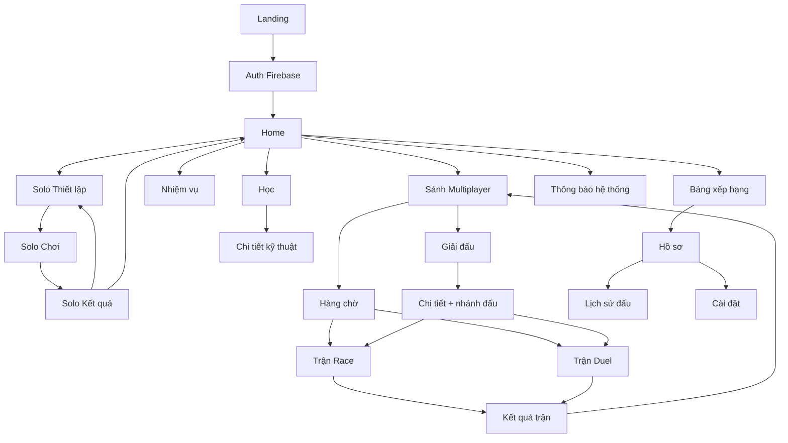

# DESIGN.md: Sudoku Online Platform (PRN_ASM), thiết kế giao diện web

Tài liệu thiết kế cho `web/` (React 19 + TypeScript + Vite). Gộp từ `ARCHITECTURE.md`, `HANDOFF.md`, `OPTIMIZATION.md`, `BUILDING_BLOCKS.md`, `CORE-LOGIC.md` và các quyết định trước đó.

**Nhãn**: **Đã chốt** = có trong tài liệu nguồn hoặc đã xác nhận. **Đề xuất** = hợp lý nhưng chưa xác nhận, chỉnh khi làm. **Cần proto** = màn hình cần RPC hoặc sự kiện chưa có trong `proto/`.

---

## 1. Phạm vi và ràng buộc kỹ thuật

| Mục | Nội dung | Nhãn |
|---|---|---|
| Frontend | React 19, TypeScript, Vite, Oxlint | Đã chốt |
| Gọi API | gRPC-Web qua Envoy `http://localhost:8080` bằng `@connectrpc/connect-web`, type sinh từ `proto/` (`npm run gen`) | Đã chốt |
| Realtime | SignalR `/hubs/match` qua Envoy (WebSocket upgrade), token qua query `access_token` | Đã chốt |
| Đăng nhập | **Firebase Auth** (Google, Email). Không có service tự phát token, không có refresh token riêng | Đã chốt |
| Service | Game, User, Multiplayer, Support (4 service) | Đã chốt |
| Không có | Coin, shop, đặt cược, Market Service | Đã chốt |
| Phần thưởng | XP, level người chơi, trophy (`PlayerProgress` ở User Service) | Đã chốt |

**Hai trục độc lập của một ván (CORE-LOGIC 1.1)**

| Trục | Giá trị | Ảnh hưởng UI |
|---|---|---|
| Layout | `standard` (3x3), `irregular` (shuffle, có `region_map`) | Cách vẽ viền và tô vùng của bàn |
| Format | `solo`, `race`, `duel` | Màn hình chơi, luật, thanh thông tin |

Mọi tổ hợp đều hợp lệ (ví dụ duel + shuffle). Component bàn cờ chỉ đọc `region_map`, **không rẽ nhánh theo layout**.

---

## 2. Nguyên tắc thiết kế

1. **Bàn cờ là trung tâm**: luôn là phần lớn nhất, vuông, rõ nhất.
2. **Phản hồi 0 ms trên bàn cờ**: gõ số và ghi chú cập nhật ngay ở client (optimistic), gửi server ở nền. Không khóa bàn cờ chờ ack. (OPTIMIZATION 3.2)
3. **Server là nơi quyết định**: đúng/sai, lượt, đồng hồ, thắng thua. Client chỉ hiển thị và chặn thao tác cho tiện. `solution_board` không bao giờ xuống client.
4. **Không nháy trắng**: dữ liệu đã có cache thì hiển thị ngay, làm mới ngầm (stale-while-revalidate).
5. **Mọi nút hành động có chống bấm đúp** (`isSubmitting`).
6. **Không chỉ dựa vào màu**: lỗi và trạng thái thêm biểu tượng hoặc gạch chân (người mù màu).
7. **Mobile first**, bàn số 1-9 dưới bàn cờ; desktop có phím tắt.

---

## 3. Hệ thống thiết kế (Design System, Đề xuất)

### 3.1 Màu (CSS variables, hỗ trợ sáng/tối theo `prefers-color-scheme`, người dùng đổi được ở Cài đặt)

| Token | Sáng | Tối | Dùng cho |
|---|---|---|---|
| `--bg` | `#F7F7FB` | `#0F1117` | Nền trang |
| `--surface` | `#FFFFFF` | `#181B25` | Thẻ, bảng |
| `--text` | `#1B1D2A` | `#ECEEF6` | Chữ chính |
| `--muted` | `#6B7084` | `#9096AD` | Chữ phụ |
| `--border` | `#E3E5EE` | `#2A2E3D` | Viền |
| `--primary` | `#4F46E5` | `#818CF8` | Nhấn chính, số người chơi điền, "mình" |
| `--opponent` | `#F97316` | `#FB923C` | "Đối thủ" trong race/duel |
| `--success` | `#16A34A` | `#4ADE80` | Đúng, thắng |
| `--danger` | `#DC2626` | `#F87171` | Sai, mất mạng |
| `--warning` | `#D97706` | `#FBBF24` | Sắp hết giờ, cảnh báo |

**Màu ô trên bàn cờ**

| Trạng thái ô | Biểu diễn |
|---|---|
| Ô đề (`initial_board != '0'`) | Chữ đậm, màu `--text`, không chọn để sửa được |
| Ô người chơi điền | Chữ màu `--primary` |
| Ô trống | Không chữ |
| Ô đang chọn | Nền `--primary` nhạt, viền đậm |
| Cùng hàng, cột, vùng với ô chọn | Nền nhạt |
| Cùng chữ số với ô chọn | Nền đậm hơn một bậc |
| Xung đột (hiển thị tạm) | Nền `--danger` nhạt + chữ đỏ + gạch chân |
| Ô duel đối thủ vừa điền | Nháy viền `--opponent` 600 ms |
| Chữ số sai đã bị lộ (duel) | Chữ nhỏ gạch ngang ở góc ô, chung cho hai người |

### 3.2 Chữ, khoảng cách, bo góc, chuyển động

| Mục | Giá trị |
|---|---|
| Font giao diện | Inter (hoặc system-ui) |
| Font số (bàn cờ, đồng hồ, điểm) | Font có `font-variant-numeric: tabular-nums` (ví dụ JetBrains Mono) |
| Cỡ chữ | 12, 14, 16, 20, 24, 32, 48 |
| Khoảng cách | Bội số của 4 px |
| Bo góc | 8 (nút, input), 12 (thẻ), 16 (modal) |
| Chuyển động | 120 ms (ô, nút), 200 ms (panel, modal), tôn trọng `prefers-reduced-motion` |
| Breakpoint | 360, 768, 1024, 1440 |
| Kích thước bàn | Mobile `min(92vw, 480px)`; desktop `min(70vh, 560px)`, luôn vuông |

### 3.3 Vẽ vùng cho layout irregular (Đề xuất)

- Viền dày giữa hai ô kề nhau **khác `region_map`**, viền mỏng nếu cùng vùng. Cách này dùng chung cho `standard` (khối 3x3 là trường hợp riêng).
- Có thể tô nền xen kẽ bằng tô màu đồ thị tham lam (greedy coloring, 4-5 màu nhạt) để 9 vùng dễ phân biệt. Tính một lần khi tải bàn, chỉ phụ thuộc `region_map`.
- Bật/tắt tô nền trong Cài đặt (nhiều người chỉ cần viền).

---

## 4. Danh sách màn hình

### 4.1 Tổng số: **27 màn** (23 người chơi + 4 admin)

| Nhóm | Số | Màn |
|---|---|---|
| Công khai, tài khoản | 2 | Landing, Đăng nhập/Đăng ký (Firebase) |
| Trang chủ | 1 | Home |
| Solo | 4 | Thiết lập, Chơi, Kết quả, Nhiệm vụ |
| Multiplayer | 6 | Sảnh, Hàng chờ, Trận Race, Trận Duel, Kết quả trận, Lịch sử đấu |
| Giải đấu | 3 | Danh sách, Chi tiết + nhánh đấu, Tạo giải |
| Xếp hạng, hồ sơ | 3 | Bảng xếp hạng, Hồ sơ, Cài đặt |
| Học, thông báo | 3 | Học (luật + kỹ thuật), Chi tiết kỹ thuật, Thông báo hệ thống |
| Hệ thống | 1 | 404/Lỗi |
| **Người chơi** | **23** | |
| Admin | 4 | Dashboard (kho puzzle), Nội dung và thông báo, Giải đấu, Người dùng |

**Vì sao ít hơn bản trước (32)**: đăng nhập, đăng ký, quên mật khẩu do Firebase lo nên gộp thành một màn; Support nay chỉ có luật, hướng dẫn, thông báo hệ thống (không còn feedback/ticket); multiplayer đã chốt hai format race và duel với giao diện khác nhau nên tách hai màn trận.

**Tùy chọn, không tính vào 27**: Feedback/ticket (`HANDOFF.md` còn nhắc "ticket hỗ trợ" ở Support nhưng `ARCHITECTURE.md` không có). Thêm sau nếu muốn.

### 4.2 Lộ trình theo giai đoạn

| GĐ | Màn | Số | Mục tiêu |
|---|---|---|---|
| 1 | Landing, Auth, Home, Solo Thiết lập/Chơi/Kết quả, Hồ sơ, 404 | 8 | Chơi solo trọn vẹn, đăng nhập Firebase |
| 2 | Sảnh, Hàng chờ, Trận Race, Kết quả trận, Bảng xếp hạng, Lịch sử đấu | 6 | Đấu 1v1 dạng race |
| 3 | Trận Duel | 1 | Đấu luân phiên |
| 4 | Học, Chi tiết kỹ thuật, Thông báo, Nhiệm vụ, Cài đặt | 5 | Nội dung và gắn kết |
| 5 | Giải đấu (3 màn) | 3 | Nhánh đấu |
| 6 | Admin (4 màn) | 4 | Quản trị |

Làm `SudokuBoard`, `NumberPad`, `GameTimer` ngay GĐ 1: dùng lại ở 4 màn.

### 4.3 Bản đồ điều hướng



### 4.4 Route

| Route | Màn | Bảo vệ |
|---|---|---|
| `/` | Landing | Công khai |
| `/auth` | Đăng nhập/Đăng ký | Công khai |
| `/home` | Home | Cần đăng nhập |
| `/solo/new`, `/solo/:sessionId`, `/solo/:sessionId/result` | Solo | Cần đăng nhập |
| `/quests` | Nhiệm vụ | Cần đăng nhập |
| `/play`, `/play/queue` | Sảnh, Hàng chờ | Cần đăng nhập |
| `/match/:matchId`, `/match/:matchId/result` | Trận (Race hoặc Duel theo `play_format`), Kết quả | Cần đăng nhập, chỉ người trong trận |
| `/history` | Lịch sử đấu | Cần đăng nhập |
| `/tournaments`, `/tournaments/:id`, `/tournaments/new` | Giải đấu | Cần đăng nhập |
| `/leaderboard` | Bảng xếp hạng | Cần đăng nhập |
| `/profile/:userId?` | Hồ sơ (bỏ trống là của mình) | Cần đăng nhập |
| `/settings` | Cài đặt | Cần đăng nhập |
| `/learn`, `/learn/:techniqueId`, `/notices` | Học, thông báo | Cần đăng nhập |
| `/admin/*` | Admin | Claim `role = admin` |
| `*` | 404 | Công khai |

Route trận dùng một URL, hiển thị component Race hay Duel theo `play_format` của trận.

---

## 5. Thành phần dùng chung

| Thành phần | Dùng ở | Ghi chú |
|---|---|---|
| `SudokuBoard` | Solo, Race, Duel, Học | Đọc `region_map`; xem mục 6 |
| `NumberPad` | Solo, Race, Duel | 1-9, xóa, bật ghi chú, gợi ý (chỉ solo) |
| `GameTimer` | Solo, Race, Duel | **Tách riêng**, tự giữ state, nhận `startedAt` (hoặc `serverDeadline`) |
| `TurnClock` | Duel | Vòng đếm ngược 15 s theo `turn_deadline` của server |
| `LivesIndicator` | Race, Duel | 3 tim, mất tim có hiệu ứng |
| `OpponentProgress` | Race | Thanh % ô đúng, **không lộ ô nào** |
| `ScoreBoard` | Duel | Điểm hai bên, lượt hiện tại |
| `LayoutPicker`, `LevelPicker`, `FormatPicker` | Thiết lập, Sảnh, Tạo giải | Layout: standard/irregular; Level: Easy, Medium, Hard, Expert |
| `PlayerCard` | Trận, Hàng chờ, Xếp hạng | Avatar, tên, elo, level |
| `EloDelta`, `XpBar` | Kết quả, Hồ sơ, Home | |
| `ResultSummary` | Kết quả solo/trận | Một khung, nội dung khác nhau |
| `LeaderboardTable` | Xếp hạng, Điểm cao | Phân trang, hàng "mình" ghim |
| `BracketView` | Chi tiết giải | Từ `round_number`, `bracket_slot`; tên vòng tính từ số vòng |
| `TutorialCard`, `NoticeItem` | Học, Thông báo | |
| `ReconnectOverlay` | Trận | Đếm 30 s vào lại |
| `Toast`, `Modal`, `EmptyState`, `Skeleton`, `ErrorState` | Toàn bộ | `ErrorState` có nút thử lại |

---

## 6. Bàn Sudoku: đặc tả component (quan trọng nhất)

### 6.1 Dữ liệu

| Dữ liệu | Kiểu | Ghi chú |
|---|---|---|
| `initial` | `string` 81 ký tự | `0` là trống; xác định ô đề |
| `cells` | `Uint8Array(81)` | Giá trị hiện tại, mảng phẳng, `index = row*9 + col` |
| `notes` | `Uint16Array(81)` | Bitmask 9 bit mỗi ô; bật/tắt số n: `mask ^ (1 << (n-1))` |
| `regionMap` | `string` 81 ký tự | Số hiệu vùng 0-8; mặc định là khối 3x3 |
| `selected` | `number \| null` | Chỉ số ô chọn |

### 6.2 Hiệu năng (OPTIMIZATION 3.3, bắt buộc)

- `<SudokuCell>` bọc `React.memo`, props chỉ là kiểu nguyên thủy: `value`, `notesMask`, `isGiven`, `isSelected`, `isPeer`, `isSameDigit`, `isConflict`, `borderMask`.
- `<GameTimer>` **không nằm trong** component cha của bàn cờ để mỗi giây không ép 81 ô render lại.
- `borderMask` và (nếu có) màu vùng tính một lần từ `regionMap` bằng `useMemo`.
- Không dùng mảng 2 chiều; không clone cả bàn khi đổi một ô.

### 6.3 Tương tác

| Hành động | Desktop | Mobile |
|---|---|---|
| Chọn ô | Click, phím mũi tên | Chạm |
| Điền số | 1-9 | `NumberPad` |
| Xóa | Backspace/Delete, 0 | Nút xóa |
| Bật/tắt ghi chú | `N` | Nút ghi chú |
| Hoàn tác | `Ctrl+Z` (solo) | Nút hoàn tác (solo) |
| Gợi ý | `H` (**chỉ solo**) | Nút gợi ý (chỉ solo) |

- Ô đề không sửa được: bấm chỉ để chọn và tô cùng chữ số.
- Số điền đã đủ 9 lần thì mờ nút số tương ứng trên `NumberPad`.
- Accessibility: mỗi ô có `aria-label` kiểu "Hàng 3, cột 5, giá trị 7, ô đề"; di chuyển được hoàn toàn bằng bàn phím; lỗi có gạch chân ngoài màu.

### 6.4 Xử lý điền sai theo format

| Format | Khi điền sai |
|---|---|
| Solo | Tăng `mistakes_count`, hiển thị sai ngay (tùy cài đặt). Giới hạn lỗi: chưa chốt (mục 11) |
| Race | Mất 1 mạng, **cộng 10 s** vào thời gian (toast "+10s"), một ô chỉ phạt một lần cho cùng chữ số sai |
| Duel | Mất 1 mạng, -5 điểm, **mất lượt**, ô vẫn trống, chữ số sai hiện cho cả hai |

---

## 7. Đặc tả từng màn hình

Cột "RPC / sự kiện" ghi API cần gọi. **Cần proto** là chưa có trong tài liệu nguồn.

### 7.1 Công khai và tài khoản

| # | Màn | Nội dung | RPC / sự kiện |
|---|---|---|---|
| 1 | **Landing** | Giới thiệu, nút "Chơi ngay", mô tả hai layout và hai chế độ đấu, ảnh minh họa bàn cờ | Không gọi API (Envoy đang bắt JWT cho mọi route) |
| 2 | **Auth** | Tab Đăng nhập/Đăng ký; nút Google; email + mật khẩu; "Quên mật khẩu" (hộp thoại); lỗi: sai mật khẩu, email đã tồn tại, tài khoản bị khóa | Firebase Auth client. Sau đăng nhập gọi `User.GetOrCreateProfile` rồi vào `/home` |

Luồng token: `onAuthStateChanged` → lấy ID token → interceptor connect-web gắn `Authorization: Bearer`; SignalR dùng `accessTokenFactory`. Gặp `Unauthenticated` thì làm mới token một lần, vẫn lỗi thì về `/auth` và nhớ trang cũ.

### 7.2 Home

| # | Màn | Nội dung | RPC |
|---|---|---|---|
| 3 | **Home** | Chào, avatar, `XpBar` và level, trophy; thẻ "Chơi tiếp" nếu có ván solo dở; hai lối vào lớn (Solo, Đấu); elo race/duel; tiến độ nhiệm vụ; một thông báo hệ thống nổi bật; lối vào Học | `User.GetOrCreateProfile` (cache), `Game.` ván dở (**Cần proto**), `Multiplayer.GetRankings` (vị trí mình), `Support.ListNotices` (cache) |

### 7.3 Solo

| # | Màn | Nội dung | RPC |
|---|---|---|---|
| 4 | **Solo Thiết lập** | `LayoutPicker`, `LevelPicker`, công tắc "Chỉ puzzle giải được bằng logic"; nếu có ván dở hỏi "Chơi tiếp hay bỏ" | `Game.StartGame` |
| 5 | **Solo Chơi** | Bàn, `NumberPad`, `GameTimer`, số lỗi, số gợi ý đã dùng, tạm dừng (che bàn), lưu và thoát | `Game.StartGame` (nhận `initial`, `region_map`, `layout`); nước đi, gợi ý, lưu ván (**Cần proto**: `ARCHITECTURE.md` mới có `SubmitResult`, `CORE-LOGIC.md` yêu cầu server kiểm từng nước) |
| 6 | **Solo Kết quả** | Thắng/thua, thời gian, điểm, độ chính xác, số lỗi, gợi ý, kỷ lục mới, XP nhận, nhiệm vụ hoàn thành | `Game.SubmitResult` (dùng thẳng response, không gọi lại) |
| 7 | **Nhiệm vụ** | Nhiệm vụ hằng ngày/tuần, tiến độ, phần thưởng **XP** | **Cần proto** (`QuestTemplate`, `UserQuestProgress`) |

Màn Kết quả hiển thị ngay giá trị server trả về; XP và thống kê toàn cục tới User Service sau qua Kafka (nhất quán cuối cùng, dưới 1 s), nên màn Hồ sơ có thể chậm một nhịp.

### 7.4 Multiplayer

| # | Màn | Nội dung | RPC / sự kiện |
|---|---|---|---|
| 8 | **Sảnh** | Chọn Format (Race/Duel), Layout, Level; hiển thị elo của format đó; nút "Tìm trận"; lối vào Phòng/Giải đấu | `Multiplayer.GetRankings`/hồ sơ rating |
| 9 | **Hàng chờ** | Đồng hồ chờ, thông tin mình, "đang tìm đối thủ gần rating", nút Hủy | Hub: `JoinQueue`, `LeaveQueue`; nhận `MatchFound`, `MatchStarted` |
| 10 | **Trận Race** | Bàn của mình, `LivesIndicator`, `GameTimer` theo server, `OpponentProgress`, nút đầu hàng. Hint tắt | Hub: `SubmitMove`, nhận `MoveResult`, `OpponentProgress`, `MatchEnded` |
| 11 | **Trận Duel** | **Một bàn chung**, `TurnClock`, `ScoreBoard`, mạng hai bên, hiển thị lượt, popup điểm (+5, +10, +8×ứng viên) khi điền đúng, ghi chú riêng tư. Hint tắt | Hub: `SubmitMove` kèm `turn_number`; nhận `TurnChanged`, `MoveResult`, `MatchEnded` |
| 12 | **Kết quả trận** | Thắng/thua/hòa, lý do (hoàn thành, hết mạng, hết giờ, mất kết nối), `EloDelta`, thống kê, nút "Đấu lại" | Nhận `MatchEnded`; nếu vào lại trang thì lấy chi tiết (**Cần proto**) |
| 13 | **Lịch sử đấu** | Danh sách trận (đối thủ, format, kết quả, elo đổi, thời lượng), phân trang, lọc | `Multiplayer.GetMatchHistory` (không tải JSONB nước đi) |

**Bộ sự kiện SignalR (Đề xuất)**

| Hướng | Tên | Payload nhỏ gọn |
|---|---|---|
| Client → Server | `JoinQueue` | `{format, layout, level}` |
| Client → Server | `LeaveQueue` | |
| Client → Server | `SubmitMove` | `{matchId, i, v, turn}`; `v = 0` là xóa |
| Client → Server | `Resign` | `{matchId}` |
| Client → Server | `SyncRoomState` | `{matchId}`; gọi sau `onreconnected` |
| Server → Client | `MatchFound` / `MatchStarted` | Thông tin đối thủ, `initial`, `region_map`, `rules`, giờ bắt đầu theo server (đếm ngược) |
| Server → Client | `MoveResult` | `{i, v, ok, lives, penaltySec?, points?}` |
| Server → Client | `OpponentProgress` | `{filled, mistakes}` (race) |
| Server → Client | `TurnChanged` | `{userId, turn, deadline}` (duel) |
| Server → Client | `OpponentDisconnected` / `Reconnected` | Đếm 30 s |
| Server → Client | `MatchEnded` | `{result, reason, eloDelta, ...}` |

Không bao giờ gửi cả 81 ô mỗi nước; chỉ gửi delta `{i, v}`. `solution_board` không có trong bất kỳ payload nào.

**Trạng thái đặc biệt của màn Trận**: đếm ngược bắt đầu do server phát; mất kết nối (`ReconnectOverlay`, đồng hồ vẫn chạy, 30 s, quá hạn xử thua); đối thủ mất kết nối; nước đi bị từ chối do sai lượt hoặc quá hạn (đồng bộ lại từ snapshot); trận bị hủy do server khởi động lại.

### 7.5 Giải đấu

| # | Màn | Nội dung | RPC |
|---|---|---|---|
| 14 | **Danh sách giải** | Giải đang đăng ký, đang diễn ra, đã xong; format, layout, level, số người, giờ bắt đầu | **Cần proto** |
| 15 | **Chi tiết giải** | Thông tin, danh sách người tham gia, `BracketView` (4, 8 hoặc 16 người), người thắng; nút Đăng ký/Rút; nút "Vào trận" khi tới lượt | **Cần proto** |
| 16 | **Tạo giải** | Tên, format, layout, level, `max_players` (4/8/16), hạn đăng ký, giờ bắt đầu, luật (mạng, giây mỗi lượt cho duel, phạt giây cho race, giới hạn thời gian trận). Kiểm tra: kho puzzle đủ cho tổ hợp đã chọn | **Cần proto**; ai được tạo (mọi người hay admin) chưa chốt (mục 11) |

Trạng thái giải: `draft` → `registration` → `in_progress` → `finished` (hoặc `cancelled`). Tên vòng tính từ số vòng: Chung kết, Bán kết, Tứ kết, Vòng 16.

### 7.6 Xếp hạng, hồ sơ, cài đặt

| # | Màn | Nội dung | RPC |
|---|---|---|---|
| 17 | **Bảng xếp hạng** | Tab: Elo Race, Elo Duel, Điểm cao Solo (tách theo layout và level). Top 100 + vị trí mình ghim | `Multiplayer.GetRankings` (Redis sorted set, dưới 1 ms), `Game.GetHighScores` |
| 18 | **Hồ sơ** | Avatar, tên, quốc gia, level/XP/trophy, elo hai format, số trận/thắng, biểu đồ gần đây, kỷ lục solo; hồ sơ người khác chỉ công khai | `User.GetProfile`, rating, `Game.GetHighScores`; lấy tên hàng loạt cho bảng xếp hạng (**Cần proto**: `GetProfiles` theo danh sách id) |
| 19 | **Cài đặt** | Sửa tên hiển thị, avatar (nén ảnh về 256x256 WebP phía client), quốc gia, giao diện sáng/tối, âm thanh, bật/tắt tô vùng, ngôn ngữ | `User.UpdateProfile` (dùng response cập nhật cache, không gọi lại) |

### 7.7 Học và thông báo hệ thống

| # | Màn | Nội dung | RPC |
|---|---|---|---|
| 20 | **Học** | Hai phần: Luật chơi (chuẩn và irregular, luật race/duel) và danh sách kỹ thuật giải (Naked Single, Hidden Single, ...) | `Support.GetRules`, `Support.ListTutorials` (cache Redis phía server, cache cả phía client) |
| 21 | **Chi tiết kỹ thuật** | Giải thích từng bước, bàn cờ minh họa tương tác (dùng lại `SudokuBoard` ở chế độ chỉ đọc) | `Support.ListTutorials` (hoặc RPC chi tiết, **Cần proto**) |
| 22 | **Thông báo hệ thống** | Danh sách thông báo cập nhật, sự kiện; chưa đọc nổi bật | `Support.ListNotices` |

Thông báo **cá nhân** (hoàn thành nhiệm vụ, tới lượt thi đấu giải) chưa có service phụ trách (mục 11), nên hiện chuông trên thanh trên chỉ trỏ tới thông báo hệ thống.

### 7.8 Hệ thống

| # | Màn | Nội dung |
|---|---|---|
| 23 | **404/Lỗi** | Thông báo, nút về Home; dùng chung cho lỗi bất ngờ (có mã lỗi để báo cáo) |

### 7.9 Admin (`role = admin`)

| # | Màn | Nội dung | RPC |
|---|---|---|---|
| 24 | **Dashboard** | Số puzzle còn trong kho theo (level, layout), trạng thái bổ sung, số người, số trận hôm nay | **Cần proto** |
| 25 | **Nội dung và thông báo** | CRUD luật, bài hướng dẫn, thông báo hệ thống | `Support.CreateNotice` (đã có, policy Admin) và các RPC còn lại (**Cần proto**) |
| 26 | **Giải đấu** | Duyệt, hủy, theo dõi giải | **Cần proto** |
| 27 | **Người dùng** | Tìm, xem, khóa/mở tài khoản | **Cần proto** |

---

## 8. Ánh xạ trạng thái và lỗi gRPC sang giao diện

| Mã gRPC | Hiển thị |
|---|---|
| `Unauthenticated` | Làm mới token một lần; vẫn lỗi thì về `/auth` |
| `PermissionDenied` | Trang 403 hoặc toast "Bạn không có quyền" |
| `NotFound` | `EmptyState` ("Không tìm thấy ván/trận/hồ sơ") |
| `InvalidArgument` | Hiện lỗi cạnh trường nhập |
| `DeadlineExceeded` / `Unavailable` | `ErrorState` có nút thử lại; nút tìm trận giữ trạng thái |
| `FailedPrecondition` (sai lượt, ván đã kết thúc) | Đồng bộ lại từ server, toast ngắn |

Mọi màn có dữ liệu đều có ba trạng thái: đang tải (`Skeleton`), rỗng (`EmptyState`), lỗi (`ErrorState`).

---

## 9. Dữ liệu phía client (OPTIMIZATION mục 3, bắt buộc)

| Việc | Cách làm |
|---|---|
| Cache đọc lặp (`GetOrCreateProfile`, `ListTutorials`, `ListNotices`, `GetRankings`) | `getCachedSync` + `fetchDeduped` (RAM + `sessionStorage`, TTL 5 phút, gộp request đang bay) |
| Khởi tạo state | `useState(() => getCachedSync(key))` để vẽ ngay khung đầu |
| Sau mutate | Dùng response cập nhật state và cache, **không** gọi lại danh sách |
| Hủy request cũ | `AbortController` trong mọi `useEffect` gọi RPC, truyền `signal` |
| SignalR | Một connection mỗi phiên đấu, `withAutomaticReconnect([0, 1000, 2000, 5000])`, gọi `SyncRoomState` khi `onreconnected`, gỡ listener bằng `connection.off` khi unmount |
| Mã nguồn tách | `React.lazy` cho Học, Lịch sử, Xếp hạng, Giải đấu, Admin; Bàn cờ và Lobby nằm trong bundle chính |
| Ảnh avatar | Nén phía client về dưới 40 KB, `URL.revokeObjectURL` khi xong |

Cấu trúc `web/src/` (Đề xuất, bám tài liệu nguồn):

```text
web/src/
├── api/            # connect-web client, interceptor token, queryCache.ts
├── auth/           # Firebase, AuthProvider, RequireAuth, RequireAdmin
├── realtime/       # SignalR connection, hook useMatch
├── gen/            # code sinh từ proto (không sửa tay)
├── components/     # SudokuBoard, NumberPad, GameTimer, ... (mục 5)
├── features/       # solo/, multiplayer/, tournament/, profile/, learn/, admin/
├── lib/            # board.ts (mã hóa 81 ký tự, region border), bitmask notes
├── routes/         # định nghĩa route, lazy import
├── styles/         # tokens.css, global.css
├── App.tsx
└── main.tsx
```

Logic board (mã hóa, quy đổi index, viền vùng, bitmask ghi chú) nằm trong `lib/board.ts`, viết một chỗ. Không nhân bản luật kiểm tra của server ở client ngoài phần hiển thị xung đột.

---

## 10. Bố cục (wireframe)

**Solo Chơi / Race (desktop)**

```text
┌────────────────────────────────────────────────────────────┐
│ ← Thoát          Hard · Shuffle               ⏸  Cài đặt   │
├────────────────────────────────────┬───────────────────────┤
│                                    │  ⏱ 04:12              │
│         [ SudokuBoard 9x9 ]        │  ♥ ♥ ♥                │
│                                    │  Lỗi 1 · Gợi ý 0     │
│                                    │  (Race: đối thủ 42% ▓▓░)│
│                                    ├───────────────────────┤
│                                    │  [1][2][3]            │
│                                    │  [4][5][6]            │
│                                    │  [7][8][9]            │
│                                    │  [Xóa][Ghi chú][Gợi ý*]│
└────────────────────────────────────┴───────────────────────┘
* Gợi ý chỉ ở solo. Race/Duel tắt.
```

**Mobile**: thanh thông tin trên cùng (giờ, mạng, lỗi), bàn giữa, `NumberPad` dưới, ẩn thanh điều hướng.

**Duel (desktop)**

```text
┌────────────────────────────────────────────────────────────┐
│ Bạn  ♥♥♥  120 điểm   ◯ 11s   Đối thủ  ♥♥  95 điểm          │
│ ▲ LƯỢT CỦA BẠN                                              │
├────────────────────────────────────┬───────────────────────┤
│       [ SudokuBoard chung ]        │  Nhật ký nước đi      │
│  (ô đối thủ vừa điền: viền cam)    │  +10 bạn · ô (3,5)    │
│                                    │  -5 đối thủ · sai     │
│                                    ├───────────────────────┤
│                                    │  NumberPad + Ghi chú  │
└────────────────────────────────────┴───────────────────────┘
```

**Điều hướng chung**: thanh trên (logo, Chơi, Xếp hạng, Học, chuông, avatar); mobile dùng thanh dưới 4-5 mục. Trong trận ẩn điều hướng, chỉ còn Thoát/Đầu hàng. Admin: thanh bên trái.

---

## 11. Việc còn mở và chỗ tài liệu đang lệch nhau

| # | Vấn đề | Ảnh hưởng tới giao diện |
|---|---|---|
| 1 | `ARCHITECTURE.md` chỉ có `SubmitResult` ở solo, `CORE-LOGIC.md` yêu cầu server kiểm từng nước đi và có hint | Cần thêm RPC nước đi, hint, lưu/tiếp tục ván cho màn Solo Chơi. Nếu chỉ nộp cuối ván thì không hiển thị lỗi theo thời gian thực được |
| 2 | `SubmitResultResponse` còn `RewardCoins` | Đã bỏ coin; đổi thành XP/trophy. UI không có coin |
| 3 | Notification cá nhân chưa có service | Chuông chỉ trỏ thông báo hệ thống; quyết định thuộc service nào trước khi làm thông báo cá nhân |
| 4 | Support là service hay trang tĩnh | Nếu tĩnh: màn Học, chi tiết kỹ thuật là route React, bỏ RPC; `ListNotices` cần chỗ khác |
| 5 | Giải đấu chưa có proto | 3 màn Giải đấu và nhánh đấu chờ proto |
| 6 | Ai tạo giải: mọi người hay admin | Quyết định màn "Tạo giải" thuộc người chơi hay admin |
| 7 | Solo có giới hạn lỗi và thời gian không | Quyết định có `max_mistakes`, `time_limit` ở Thiết lập và Chơi |
| 8 | Tên `Tournament` (CORE-LOGIC) và `Championship` (ERD cũ) | Dùng **Tournament** thống nhất trong UI và route |
| 9 | Envoy bắt JWT mọi route | Landing không gọi được API công khai; nếu muốn hiện top elo ở Landing cần route ẩn danh |
| 10 | Số người chơi đông, chạy nhiều bản Multiplayer | Cần sticky routing hoặc trạng thái trận ở Redis (không đổi UI, nhưng ảnh hưởng reconnect) |
| 11 | Ngôn ngữ giao diện: chỉ tiếng Việt hay thêm tiếng Anh | Quyết định có chuẩn bị i18n ngay từ đầu |
| 12 | Feedback/ticket có làm không | Thêm 3-4 màn nếu có; hiện ngoài phạm vi |
| 13 | Hằng số cân bằng (điểm 5/10/8n, phạt 5, phạt 10 s, 15 s mỗi lượt, 30 s vào lại) | Hiển thị lấy từ `rules` của trận, không hardcode ở client |

---

## 12. Checklist trước khi coi một màn là xong

- [ ] Có đủ ba trạng thái: tải, rỗng, lỗi.
- [ ] Dùng đúng token màu và font số cho số liệu; kiểm tra sáng và tối.
- [ ] Chạy tốt ở 360 px và 1440 px.
- [ ] Mọi nút gửi dữ liệu có chống bấm đúp.
- [ ] Mọi `useEffect` gọi RPC có `AbortController`; mọi listener SignalR có `off`.
- [ ] Màn có bàn cờ: `GameTimer` tách riêng, `SudokuCell` được memo, điền số phản hồi 0 ms.
- [ ] Điều khiển bằng bàn phím được; có `aria-label` cho ô và nút.
- [ ] Không có chỗ nào gửi hoặc hiển thị `solution_board`.
- [ ] Trạng thái "không phụ thuộc màu" (lỗi có biểu tượng hoặc gạch chân).
